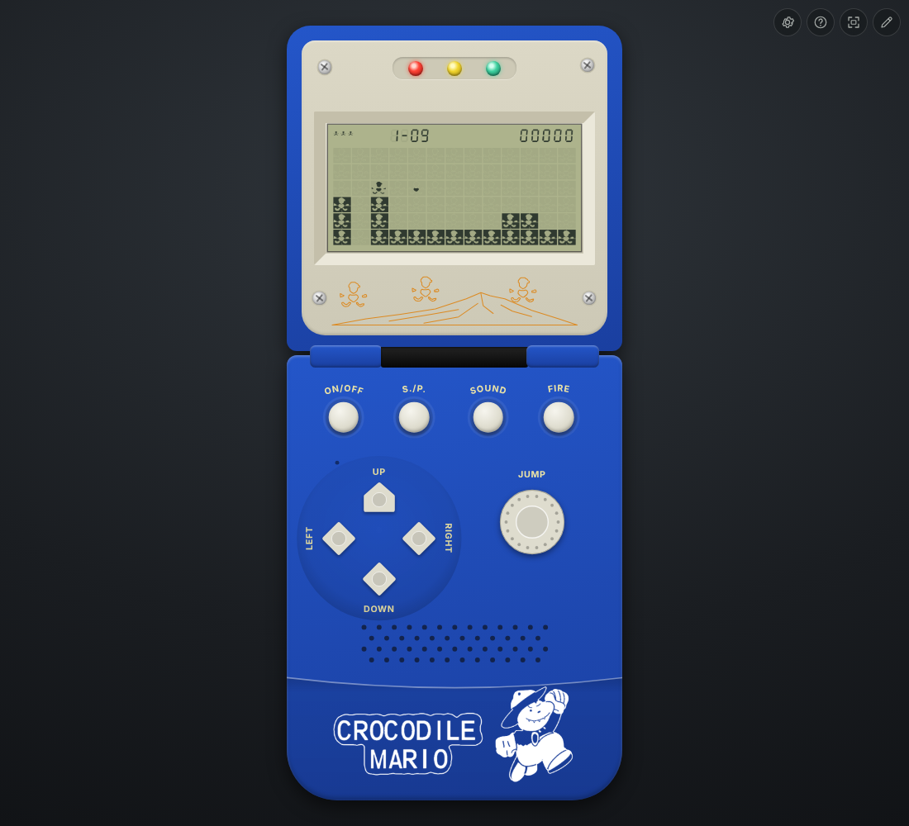

<p align="center">
  
</p>

# Crocodile Mario — браузерная реконструкция

> **Статус: техническая демоверсия движка. Оригинальный контент ещё не восстановлен.**
> Уровни, тайминги, графика и правила в репозитории — временные (`demo`). Спрайты LCD — реконструкция владельца по двум фото
> (статус `draft`), корпус вокруг экрана оформлен по фотографиям устройства. Подтверждённые владельцем
> параметры перечислены в [docs/reference-status.md](docs/reference-status.md).



## Что открывается

| Адрес | Что это |
| --- | --- |
| `…/` (по умолчанию) | **Игрушка**: раскладушка целиком — экран, три светодиода, девять кнопок (ON/OFF, S./P., SOUND, FIRE, крестовина, JUMP), динамик и логотип на нижней части. Внутри — тестовый уровень по видео владельца: интро (заливка → растворение → построение следом героя); **S./P. запускает уровень — герой сам выпрыгивает из туннеля** (три удара головой о крышку арки, отскок перекладины), дальше бежит вправо с прокруткой экрана, прыгает через блоки и стреляет «сердечками» по мишеням. В уголке — настройки, справка, кнопка «только экран» и редактор уровней; физика и анимации — наблюдения по видео, черновик — [docs/video-observations.md](docs/video-observations.md) |
| `…/#/editor` | **Редактор уровней** (#4): восстановление карт по фотографиям, калибровка четырёх углов, пометки наблюдений, тестовый запуск, проект и игровой JSON — [docs/editor.md](docs/editor.md). Открывается из уголка игрушки; в меню «Страницы» редактора — ссылки на технические страницы |
| `…/#/tech` | Техническая демоверсия движка (#1): два участка, стрельба, мишень, патруль, опасная область, отладка. Для разработки; ссылка — в редакторе |
| `…/#/sheet` | Контрольный лист ресурсов для согласования с владельцем: «референс → восстановленный элемент»; ссылка — в редакторе |

Страница игры — чистая: только игрушка и четыре кнопки в уголке, без технического текста и подсказок на экране. Уровень — **искусственная тестовая карта
по фрагменту видео, не оригинальный уровень**; тайминги — наблюдения по видео (ходьба/подъём/спуск ≈ 150 мс на клетку), не подтверждены. Вся графика — черновик по
реконструкции владельца; корпус, кнопки и рисунок — оформление, цвета и пропорции оценены по фото; светодиоды и звук — условные (оригинальная логика и звуки не измерены):
[docs/visual-spec.md](docs/visual-spec.md).

Реконструкция игры Apollo Crocodile Mario для браузера. Это не эмулятор процессора/ROM: проект воспроизводит
наблюдаемое поведение оригинального устройства по данным, которые предоставляет его владелец.

Стек: TypeScript (strict) + Vite + Canvas 2D, обычный HTML/CSS для оболочки, Vitest для ядра,
Playwright для одного браузерного smoke-набора. Без React, серверов и баз данных.

## Запуск

Нужен Node.js **22.13+** (или 24+); версия закреплена в `.nvmrc` и `engines`. Менеджер пакетов — npm.

```bash
nvm use            # или любой способ поставить Node 22
npm ci             # установка строго по package-lock.json
npm run dev        # сервер разработки: http://localhost:5173
```

| Команда | Что делает |
| --- | --- |
| `npm run dev` | сервер разработки Vite |
| `npm run build` | production-сборка в `dist/` (базовый путь `/`) |
| `npm run build:pages` | сборка для размещения в `/CrocodileMario/` |
| `npm run preview` | локальный просмотр сборки (`-- --base=/CrocodileMario/` для подкаталога) |
| `npm run typecheck` | проверка типов; ядро и формат данных дополнительно проверяются **без DOM-библиотек** |
| `npm run lint` | ESLint, в том числе запрет браузерных API/часов/`Math.random()` в ядре |
| `npm test` | Vitest: ядро, ввод, оболочка (без браузера) |
| `npm run test:smoke` | Playwright: игрушка (кнопки, ON/OFF, SOUND, «только экран», настройки, справка, касание), тестовый уровень (интро, выход из туннеля, бег с прокруткой, стрельба «сердечками»), ходьба/прыжок/пауза/геймпад подставной, проверка рендера и эталонных сцен, техническое демо, контрольный лист, редактор (рисование, тест, калибровка, экспорт/импорт). Снимки для документации — `SCREENSHOTS=1 npm run test:smoke -- screenshots` (пишутся в `docs/screenshots/`) |

Для smoke-теста нужен Chromium: `npx playwright install chromium`. Если он уже установлен, укажите
`CHROMIUM_PATH=/путь/к/chrome`. Тест сам собирает проект с базовым путём `/CrocodileMario/` и запускает `vite preview`.

### Размещение в подкаталоге

Статическая сборка работает с любым базовым путём: `npm run build -- --base=/МОЙ_ПУТЬ/`
(для `/CrocodileMario/` есть `npm run build:pages`). Файлы данных загружаются относительно `import.meta.env.BASE_URL`.
Для Cloudflare в корне лежит `wrangler.jsonc` (статические ресурсы из `./dist`): там сайт открывается с корня, поэтому
подходит обычная `npm run build` (базовый путь `/`), а не `build:pages`. Сборку запускает сам `wrangler deploy`
(`build.command`), поэтому поле «Build command» в настройках Workers Builds может быть пустым — каталог `dist/` в Git не хранится.
Пустой блок `previews` нужен для сборок веток и PR: Workers Builds выполняет для них `wrangler preview`, который без этого блока завершается ошибкой. Настройки GitHub Pages в репозитории не заданы.

## Управление

Кнопки на корпусе игрушки нажимаются **мышью и касанием** (стрелки и JUMP можно удерживать) и **подсвечиваются** при нажатии с клавиатуры или геймпада.
Подробный список — в «Справке» (значок «?» в уголке страницы).

Клавиатура (раскладка не важна: используется физическое положение клавиши, `KeyboardEvent.code`):

| Кнопка на корпусе | Клавиши |
| --- | --- |
| LEFT / RIGHT | ← → или A D |
| UP / DOWN | ↑ ↓ или W S (в тестовых правилах не используются) |
| JUMP | Пробел или Z |
| FIRE | X — вылетает «сердечко» (центральный сегмент фигурки), до двух одновременно |
| S./P. (старт и пауза) | Enter — старт и продолжение; Esc или P — пауза |
| ON/OFF | O |
| SOUND | M |

ON/OFF включает и выключает игрушку: выключенная показывает пустой экран с погасшими светодиодами, включение начинает заново (отдельной кнопки сброса нет).

Кнопка «только экран» (четвёртая в уголке) скрывает нижнюю половину игрушки и показывает крышку с экраном крупно; выбор запоминается. Без кнопок корпуса касание
экрана заменяет S./P. (старт и продолжение; во время игры ничего не делает).

Геймпад (`mapping: "standard"`): крестовина или левый стик — направления, нижняя лицевая кнопка — прыжок и
подтверждение, левая лицевая — огонь, Start — старт и пауза.

- Клавиатура работает, пока не открыт диалог и фокус не в кнопке или поле страницы: клик по пустому месту ничего не ломает, подсказок «кликните» нет. Прокрутка страницы не блокируется.
- Геймпад: нажмите любую кнопку, чтобы он стал активным. Нужны **HTTPS или localhost**; распознавание контроллера
  зависит от браузера и ОС. При недоступном Gamepad API игра остаётся работоспособной с клавиатурой.
- «Настройки» (шестерёнка в уголке) — цвет корпуса (синий, красный, жёлтый, белый), неактивные сегменты экрана, звук, переназначение клавиш и кнопок,
  порог стика, выбор устройства, сброс; хранится в `localStorage` (без него настройки действуют до перезагрузки).
- Окно потеряло фокус, вкладка скрыта, геймпад отключён или открыты настройки → **пауза**. Продолжение всегда явное
  (Esc/P/Start или кнопка), без скачка героя и без случайного прыжка/выстрела от удерживавшейся кнопки.

### Отладка

Для разработки: добавьте к адресу `?debug` — под игрушкой появятся технические панели (состояние ввода, флажок «Отладка»: номер такта, состояние героя,
активные действия, сетка и коллизии, шаг на один такт в паузе). Параметр `?seed=N` задаёт seed ядра. Техническая демоверсия (`#/tech`) показывает их всегда.

## Что реализовано

- **Тестовый уровень `tunnel-run`** (56 × 6 клеток при экране 13 × 6): сценарий входа (`animations.json → entry`) вводит заготовленные кадры вместо игрока —
  герой выходит из ямы под крышкой арки и встаёт на правую стойку; дальше управление у игрока, камера держит героя в середине экрана. Уровень проходим: четыре мишени по 10 очков, финиш.
- Игровое ядро (`step(inputFrame)`) без DOM/Canvas/Gamepad/звука/часов; фиксированный шаг; сериализуемое состояние;
  детерминированный порядок; события для внешних систем; replay.
- Демо-профиль правил (заменяемые данные): ходьба, табличный прыжок, падение, выстрел с проверкой каждой клетки пути,
  мишень, патруль, опасная область, смерть и перезапуск, финиш и переход на второй тестовый участок, жизни, счёт, таймер.
- Единый слой ввода: клавиатура и геймпад → логические действия; `pressed/held/released`; детерминированное объединение
  источников и конфликтов направлений.
- Версионированный формат данных (экран, правила, каталог ресурсов, уровни) с проверкой при загрузке.
- Canvas-рендерер: масштабирование с учётом `devicePixelRatio`, камера, слои ячеек (неактивные сегменты → препятствия → герой), HUD спрайтами из атласа, заглушки там, где графики нет.
- **Игрушка целиком** (HTML/CSS/SVG по фотографиям владельца): крышка с экраном и светодиодами, шарнир, нижняя половина с кнопками, динамиком и логотипом; четыре цвета
  корпуса; логотип на синем и красном — белая печать, на жёлтом и белом — красная.
- **Светодиоды** над экраном: в фазах «готов» и «игра» горят все три (наблюдение по видео), остальные фазы — условная схема демо: пауза — жёлтый мигает, герой погиб —
  красный мигает, игра окончена — красный, участок пройден — мигают все. Оригинальная логика не установлена.
- **Базовый 1-битный звук**: прямоугольная волна фиксированной громкости, один канал, короткие сигналы на старт, прыжок, приземление, выстрел, попадание,
  гибель, конец игры и прохождение участка (Web Audio; без API — тишина). Переключатель «Звук» запоминается; в редакторе тест использует ту же настройку.
  Сигналы условные, не оригинальные звуки устройства.
- Отладочная панель.
- **Редактор уровней** (`#/editor`): кисть, ластик, прямоугольник, заливка, выделение/копирование, undo/redo, старт и объекты движка; фото-подложка
  с калибровкой четырёх углов (выпрямление перспективы), несколько кадров со смещением в клетках, режимы «Фото / Карта / Наложение / Рядом»;
  пометки «неизвестно / предположение / подтверждено»; «Тестировать» на том же ядре и вводе; черновики в IndexedDB; архив проекта и игровой JSON общего формата;
  безопасный импорт с адресными ошибками. Инструкция «восстановить комнату по фотографии» — [docs/editor.md](docs/editor.md).

## Чего нет (и это намеренно)

Дамп ROM и эмуляция; подтверждённая графика и электрическое разбиение LCD; оригинальные уровни и враги; оригинальные звуки и
оригинальная логика светодиодов (в демо — условные: см. ниже); сохранение прогресса. Список того, что ещё предстоит измерить на устройстве, —
в [docs/reference-status.md](docs/reference-status.md).

## Структура

```text
src/
  core/      игровое ядро: состояние, симуляция, правила-поведения, replay (без DOM, часов и Math.random)
  content/   формат данных: типы схемы, проверка, сериализация (без DOM)
  input/     клавиатура, геймпад, привязки, настройки → логические действия
  render/    Canvas-рендерер, камера, масштабирование, заглушки, ресурсы
  editor/    редактор уровней: модель, инструменты, калибровка, проект/архив (без DOM) и ui/ (интерфейс)
  audio/     порт аудио (no-op)
  app/       оболочка: цикл, сессия, устройства, интерфейс, настройки
public/content/demo/   демо-пакет: pack.json, screen.json, rules.json, assets.json, levels/*.json
public/content/room/   основной пакет (маршрут по умолчанию): экран, правила, ресурсы, анимации, levels/tunnel-run.json (тестовый уровень) и levels/demo-room.json (песочница для редактора и тестов), reference/ (сцены с фотографий)
public/graphics/lcd/   LCD-графика владельца: атлас (lcd_atlas.png) и «сердечко»-снаряд (lcd_heart.png); описание — public/content/room/assets.json
public/brand/          логотип на корпусе: цветной и белая печать
tests/       Vitest (core, content, input, render, app, editor) и Playwright (smoke); fixtures/ — replay и эталонные экраны владельца (reference/)
docs/        architecture.md, content-format.md, editor.md, visual-spec.md, video-observations.md, reference-status.md, manual-gamepad-check.md, editor-demo/, screenshots/
```

## Документация

- [Архитектура](docs/architecture.md) — границы слоёв, цикл, ввод, replay, куда добавлять новое.
- [Формат данных](docs/content-format.md) — примеры экрана, правил, ресурсов и уровня.
- [Редактор уровней](docs/editor.md) — как восстановить комнату по фотографии, клавиши, файлы, пределы; демо — [docs/editor-demo](docs/editor-demo/README.md).
- [Визуальная спецификация LCD](docs/visual-spec.md) — профиль экрана, элементы, допущения, блокеры по референсам.
- [Статус референсов](docs/reference-status.md) — подтверждено / demo-допущение / предстоит измерить.
- [Ручная проверка геймпада](docs/manual-gamepad-check.md) — чек-лист для владельца.
- [Наблюдения по видео](docs/video-observations.md) — физика героя, анимации уровня, светодиоды и звук по видео владельца; как они вошли в тестовый уровень.

## Куда добавлять оригинальное

- **Графика** — в каталог ресурсов (`assets.json`): `image` принимает PNG и SVG (полоса кадров; в SVG `currentColor` рисуется цветом LCD-профиля), у ресурса есть `provenance` со статусом и источниками. Ядро и ввод не меняются. Порядок замены — в [visual-spec.md](docs/visual-spec.md).
- **Карты** — JSON-файлы уровней в пакете контента и ссылка на них в `pack.json`; проще всего нарисовать карту в [редакторе](docs/editor.md) и выгрузить «Экспорт для игры (.json)».
- **Измеренные правила** — значения в `rules.json` (и `status: "confirmed"` с записью в `reference-status.md`).
  Особые механики — отдельные обработчики в `src/core/behaviors.ts`, а не «язык правил» в JSON.
