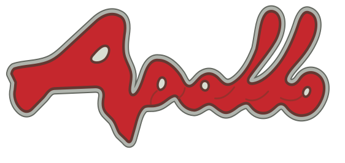
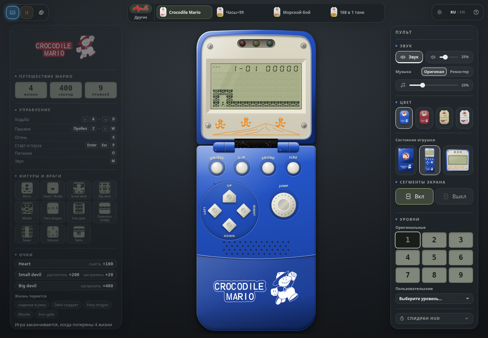
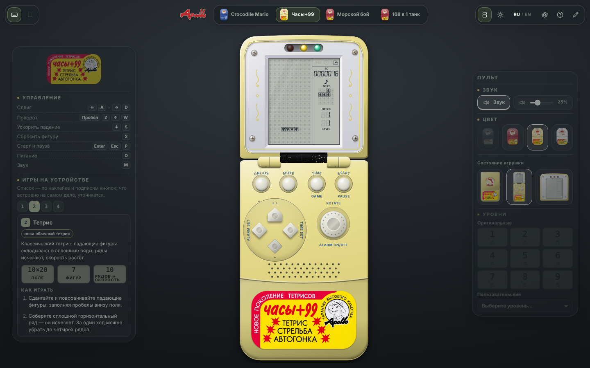
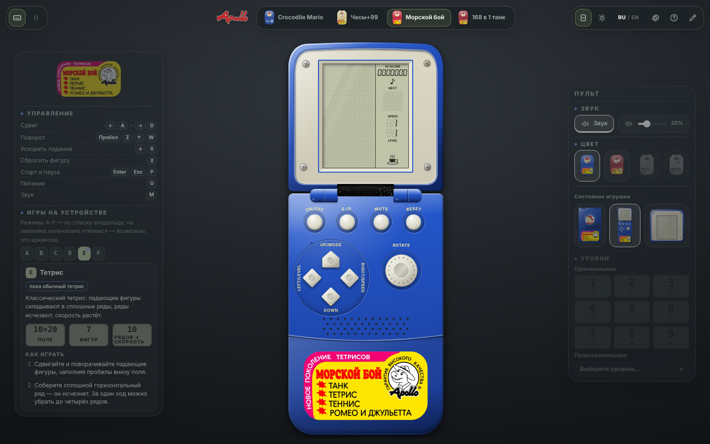
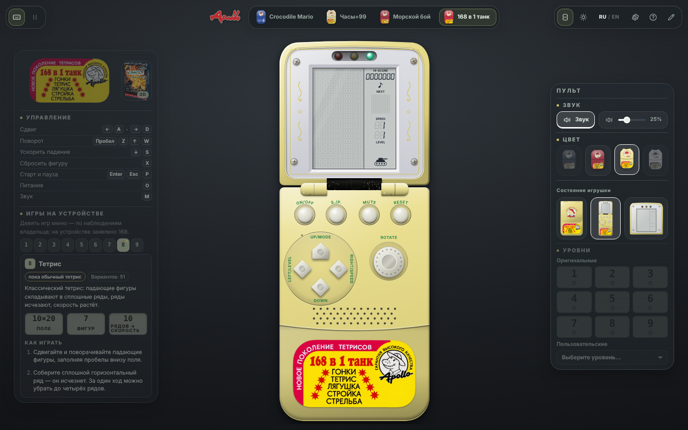

<p align="center">
  
</p>

<h1 align="center">Четыре игрушки. Один браузер.</h1>

<p align="center">
  <b>Crocodile Mario · Часы+99 · Морской бой · 168 в 1 танк</b><br>
  Складные корпуса, сегментные экраны и знакомые кнопки — в цифровой коллекции Apollo.
</p>

<p align="center">
  <a href="#игрушки">Коллекция</a> ·
  <a href="#быстрый-старт">Быстрый старт</a> ·
  <a href="#управление">Управление</a> ·
  <a href="docs/architecture.md">Архитектура</a> ·
  <a href="docs/reference-status.md">Статус реконструкции</a>
</p>



> **Проект в разработке.** Это браузерная реконструкция по фотографиям и видео владельцев, а не эмулятор процессора или ROM. Корпуса и оформление трёх игрушек уже доступны. У Mario — девять геймплейных уровней-приближений; у «Часов+99» и «Морского боя» пока работает тетрис вместо оригинальных наборов игр. Подтверждённые сведения отделены от допущений в [статусе референсов](docs/reference-status.md).

## Игрушки

| | Crocodile Mario | Часы+99 | Морской бой | 168 в 1 танк |
| --- | --- | --- | --- | --- |
| Открыть | `/` | `/?toy=clock99` | `/?toy=seabattle` | `/?toy=tank168` |
| Сейчас можно играть | Платформер: 9 уровней, прыжки, выстрелы, таймер и секретные комнаты | Тетрис: 7 фигур, поле 10 × 20, рекорд | Тетрис: 7 фигур, поле 10 × 20, рекорд | Тетрис: 7 фигур, поле 10 × 20, рекорд |
| LCD | Широкий экран с сегментами героя | Портретный экран с ячейками-звёздочками | Портретный экран с точками в прямоугольниках | Портретный экран с точками в прямоугольниках, танк на панели |
| Корпуса | Синий, красный, жёлтый, белый | Жёлтый, красный, белый | Красный, синий | Красный, жёлтый |
| Особенности | Музыка «Оригинал / Ремастер», светодиоды, редактор, спидран | Светодиоды, собственная наклейка и орнамент рамки | Собственная наклейка и рамка, без светодиодов | Светодиоды и завитки как у «Часов+99», кнопки как у «Морского боя» |

Смена игрушки — через миниатюры в верхнем меню, **без перезагрузки страницы**: цвет корпуса (если он есть у новой игрушки), вид (закрытая / полная / только экран) и питание сохраняются, перерисовываются только экран, кнопки и наклейка. Набор игр каждой консоли закреплён за ней (по наклейке, упаковке и наблюдениям владельца) и описан **вкладками в левой панели**: «168 в 1 танк» — игры 1–9, «Морской бой» — режимы A–F, «Часы+99» — игры 1–4 (описания — справка, а не правила: сами игры ещё не восстановлены). У «168 в 1 танк» (коробка по развёртке) и у Crocodile Mario (блистерная карточка с игрушкой по фото) рядом с наклейкой или логотипом — **3D-модель упаковки**: щелчок открывает диалог, где её можно покрутить и рассмотреть — [docs/toys.md](docs/toys.md). Каждая загрузка начинается с **закрытой и выключенной** игрушки: откройте крышку щелчком, Enter или пробелом, затем нажмите **ON/OFF** или **O**.

| Часы+99 | Морской бой |
| --- | --- |
|  |  |

| 168 в 1 танк |
| --- |
|  |

### Вокруг игрушки

- **Сверху** — выбор одной из четырёх моделей; **справа сверху** — сегменты LCD, фон, RU/EN, настройки, справка и редактор Mario. **Слева сверху** — устройство ввода и пауза. Меню плавно появляется и реагирует на наведение; системная настройка уменьшения движения учитывается.
- **Слева** — наклейка выбранной игрушки, управление с текущими привязками и правила. У Mario — справка по упаковке; у остальных моделей — правила тетриса и очки.
- **Справа** — звук, панель «Цвет» (четыре цвета всегда, недоступные игрушке неактивны) и пиктограммы вида: закрытая игрушка, полная, только экран. У Mario также доступны музыка, выбор уровня и спидран. Обе панели приглушены и проявляются при наведении или фокусе с клавиатуры; на сенсорном экране доступны без наведения.
- **На телефоне** — крупная игрушка сверху, панели ниже. Корпус поддерживает мышь, касание, клавиатуру и геймпад.

## Быстрый старт

Нужен **Node.js 22.13+ или 24+**, npm. В `.nvmrc` закреплена ветка Node 22.

```bash
nvm use              # если установлен nvm; Node 24 тоже поддерживается
npm ci               # установка по package-lock.json
npm run dev          # Vite, порт 5173
```

Бэкенд, база данных и секреты для локальной игры не нужны. Настройки, привязки и рекорды сохраняются в браузере; проекты редактора — в IndexedDB.

| Команда | Результат |
| --- | --- |
| `npm run dev` | Сервер разработки |
| `npm run build` | Production-сборка в `dist/`, базовый путь `/` |
| `npm run build:pages` | Сборка для `/CrocodileMario/` |
| `npm run preview` | Локальный просмотр готовой сборки |
| `npm run typecheck` | Strict TypeScript; игровые ядра дополнительно без DOM |
| `npm run lint` | ESLint и границы чистого игрового ядра |
| `npm test` | Vitest: Mario, тетрис, контент, ввод, рендер, редактор и оболочка |
| `npm run test:smoke` | Playwright: три игрушки, меню, управление, звук, рендер и редактор |

Для браузерных тестов нужен Chromium:

```bash
npx playwright install chromium
npm run test:smoke
# Или используйте установленный браузер:
CHROMIUM_PATH=/usr/bin/chromium npm run test:smoke
```

Playwright сам собирает приложение с базовым путём `/CrocodileMario/` и запускает preview на порту 4173. Создание иллюстраций документации включается отдельно: `SCREENSHOTS=1 npm run test:smoke -- screenshots` — эта команда обновляет файлы в `docs/screenshots/`.

## Управление

| Действие | Mario | Тетрис («Часы+99», «Морской бой», «168 в 1 танк») |
| --- | --- | --- |
| Движение | ← / → или A / D | ← / → или A / D — сдвиг фигуры |
| ↑ / W / пробел / Z | Прыжок | Поворот по часовой стрелке |
| ↓ / S | В режиме MARIO не используется | Мягкое падение |
| X | Выстрел сердечком | Мгновенный сброс |
| Enter | Старт / продолжение | Старт / продолжение |
| Esc / P | Пауза | Пауза |
| O | Питание | Питание |
| M | Звук | Звук |

Клавиши используют физическое положение (`KeyboardEvent.code`), поэтому раскладка языка не мешает. Их можно переназначить в настройках; справка слева обновится. Кнопки корпуса нажимаются мышью и касанием, направления можно удерживать. При потере фокуса или отключении активного геймпада игра ставится на паузу. [Проверка настоящего геймпада →](docs/manual-gamepad-check.md)

**Тетрис:** заполняйте горизонтальные ряды без пробелов. За 1 / 2 / 3 / 4 ряда — 100 / 300 / 700 / 1500 очков; каждые 10 рядов растёт скорость. Подсказка NEXT показывает следующую фигуру. Партия заканчивается, когда новой фигуре не хватает места. Рекорд у каждой игрушки свой. На «Морском бое» **RESET** начинает партию заново. Часы и будильник «Часов+99» ещё не реализованы: **TIME/GAME** пока без действия.

## Редактор и технические страницы

| Маршрут | Назначение |
| --- | --- |
| `/#/editor` | Редактор уровней Mario: рисование, фотоподложки, калибровка, тестовый запуск, импорт и экспорт |
| `/#/tech` | Техническая демоверсия движка Mario с отладкой |
| `/#/sheet` | Контрольный лист восстановленных LCD-ресурсов |

В редактор можно перейти из системного меню Mario; технические страницы находятся в меню редактора. Для ссылок и тестов доступны `?power=on` и `?view=closed|full|screen`; для Mario — `?level=1` … `9`. Подробности: [редактор](docs/editor.md), [демопроект](docs/editor-demo/README.md), [три модели](docs/toys.md).

## Устройство проекта

**TypeScript strict · Vite · Canvas 2D · HTML/CSS · Vitest · Playwright.** Без React и серверного рантайма. Игровые ядра не зависят от DOM, системных часов или `Math.random()`; одинаковые seed и ввод воспроизводят одну и ту же партию.

```text
src/
  core/       ядро Mario: симуляция, поведение, replay
  tetris/     поле, фигуры, падение, ряды, очки
  content/    типы, валидация и сериализация контента
  input/      клавиатура, геймпад, экранные кнопки, настройки
  render/     Canvas-рендереры Mario и портретных LCD
  app/        три модели, меню, панели, игровой цикл, звук
  audio/      пищалка, события, оригинальная мелодия и ремастер
  editor/     модель редактора, калибровка, архивы и UI
public/
  brand/      Apollo, логотип Mario и наклейки двух других игрушек
  graphics/   LCD-атласы и сегменты
  content/    пакеты Mario, уровни и сцены-референсы
  audio/      запись музыки «Ремастер»
tests/        модульные и браузерные проверки
tools/        генераторы уровней, обработка фото, видео и звука
docs/         архитектура, форматы, наблюдения и референсы
```

Меню анимируется средствами CSS, без дополнительного JS-рантайма. Выключенные экраны не перерисовываются каждый кадр; рендер тетриса обновляет Canvas только при изменении видимого состояния. Resize, переключение сегментов и эффект «шлейфа» принудительно обновляют изображение. [Замеры и повторная проверка →](docs/performance.md)

### Размещение

Сборка статическая. Для произвольного подкаталога:

```bash
npm run build -- --base=/МОЙ_ПУТЬ/
```

Данные и ресурсы учитывают `import.meta.env.BASE_URL`. Для Cloudflare в корне есть `wrangler.jsonc`: ресурсы берутся из `dist/`, обычную сборку запускает `wrangler deploy`. Настройки GitHub Pages в репозитории не заданы.

## Реконструкция по источникам

Фотографии и записи владельцев помогают восстановить корпус, наклейки, LCD-графику, физику, мелодию и светодиоды Mario. Приближённые элементы остаются помеченными; оригинальные игры двух новых моделей, часы и будильник ещё предстоит восстановить. Исходные видео и фотографии для аналитических скриптов в репозиторий не входят.

| Документ | Что внутри |
| --- | --- |
| [Статус референсов](docs/reference-status.md) | Подтверждено, предположено, ещё не измерено |
| [Три игрушки](docs/toys.md) | Корпуса, LCD, кнопки и ограничения каждой модели |
| [Визуальная спецификация](docs/visual-spec.md) | Происхождение графики и сегментов |
| [Наблюдения по видео](docs/video-observations.md) | Измерения физики, таймингов, звука и светодиодов |
| [Архитектура](docs/architecture.md) | Границы слоёв и расширение проекта |
| [Формат контента](docs/content-format.md) | JSON-пакеты, уровни, правила, ресурсы |

Графику заменяют через `assets.json` с указанием происхождения; карты удобнее создавать в редакторе и экспортировать для игры. [Как восстановить комнату по фотографии →](docs/editor.md)
