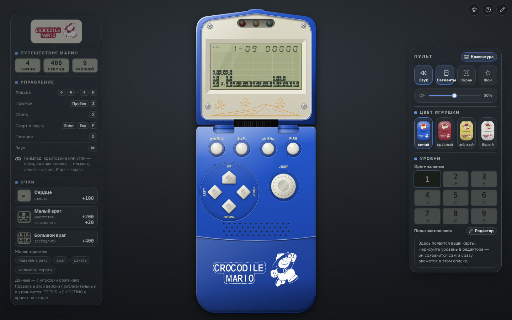

<p align="center">
  
</p>

# Crocodile Mario — браузерная реконструкция

> **Статус: техническая демоверсия движка. Оригинальный контент ещё не восстановлен.**
> Уровни, тайминги, графика и правила в репозитории — временные (`demo`). Спрайты LCD — реконструкция владельца по двум фото
> (статус `draft`), корпус вокруг экрана оформлен по фотографиям устройства. Подтверждённые владельцем
> параметры перечислены в [docs/reference-status.md](docs/reference-status.md).



## Что открывается

| Адрес | Что это |
| --- | --- |
| `…/` (по умолчанию) | **Игрушка**: раскладушка, которая **при каждой загрузке закрыта** — на крышке логотип Apollo (красная или белая надпись — под цвет корпуса), снизу выглядывает «подбородок» с логотипом Crocodile Mario; **щелчок по крышке (или Enter / пробел)** плавно раскрывает её (поворот вокруг шарнира с перспективой) до полного вида: экран, три светодиода, девять кнопок (ON/OFF, S./P., SOUND, FIRE, крестовина, JUMP), динамик. Открытая игрушка при загрузке **выключена** (включить — ON/OFF или клавиша O). Внутри — девять уровней MARIO (геймплейное приближение по видео владельца, начинается с № 1): интро (заливка → растворение → построение следом героя); **S./P. запускает уровень — герой сам выпрыгивает из туннеля** (три удара головой о крышку арки, отскок перекладины), дальше бежит вправо с прокруткой экрана, прыгает через блоки и стреляет «сердечками» по мишеням. Слева от игрушки — приглушённая справка по упаковке оригинала и клавишам, справа — «пульт» (мини-блок «Звук» с музыкой «Оригинал/Ремастер», блок «Вид» — цвет текущей игры, «свёрнута / полная / только экран», сегменты, выбор уровней и выезжающий спидран-HUD); в уголке — значок клавиатуры/геймпада, смена светлого/тёмного фона, переключатель языка **RU / EN**, настройки управления, справка и редактор уровней; физика и анимации — наблюдения по видео, черновик — [docs/video-observations.md](docs/video-observations.md) |
| `…/#/editor` | **Редактор уровней** (#4): восстановление карт по фотографиям, калибровка четырёх углов, пометки наблюдений, тестовый запуск, проект и игровой JSON — [docs/editor.md](docs/editor.md). Открывается из уголка игрушки; в меню «Страницы» редактора — ссылки на технические страницы |
| `…/#/tech` | Техническая демоверсия движка (#1): два участка, стрельба, мишень, патруль, опасная область, отладка. Для разработки; ссылка — в редакторе |
| `…/#/sheet` | Контрольный лист ресурсов для согласования с владельцем: «референс → восстановленный элемент»; ссылка — в редакторе |

Страница игры — чистая: игрушка, две панели у краёв окна и системное меню в уголке (устройство ввода, фон, язык, настройки, справка, редактор), без технического текста и подсказок на экране. Уровень — **искусственная тестовая карта
по фрагменту видео, не оригинальный уровень**; тайминги — наблюдения по видео (ходьба/подъём/спуск ≈ 150 мс на клетку), не подтверждены. Вся графика — черновик по
реконструкции владельца; корпус, кнопки и рисунок — оформление, цвета и пропорции оценены по фото; звук, мелодия и бег светодиодов восстановлены по записи со звуком, остальное в звуке и светодиодах — условное:
[docs/visual-spec.md](docs/visual-spec.md).

Реконструкция игры Apollo Crocodile Mario для браузера. Это не эмулятор процессора/ROM: проект воспроизводит
наблюдаемое поведение оригинального устройства по данным, которые предоставляет его владелец.

Стек: TypeScript (strict) + Vite + Canvas 2D, обычный HTML/CSS для оболочки, Vitest для ядра,
Playwright для одного браузерного smoke-набора. Без React, серверов и баз данных.

## Запуск

Нужен Node.js **22.13+** (или 24+); версия закреплена в `.nvmrc` и `engines`. Менеджер пакетов — npm.

```bash
nvm use            # или любой способ поставить Node 22
npm ci             # установка строго по package-lock.json
npm run dev        # сервер разработки: http://localhost:5173
```

| Команда | Что делает |
| --- | --- |
| `npm run dev` | сервер разработки Vite |
| `npm run build` | production-сборка в `dist/` (базовый путь `/`) |
| `npm run build:pages` | сборка для размещения в `/CrocodileMario/` |
| `npm run preview` | локальный просмотр сборки (`-- --base=/CrocodileMario/` для подкаталога) |
| `npm run typecheck` | проверка типов; ядро и формат данных дополнительно проверяются **без DOM-библиотек** |
| `npm run lint` | ESLint, в том числе запрет браузерных API/часов/`Math.random()` в ядре |
| `npm test` | Vitest: ядро, ввод, оболочка (без браузера) |
| `npm run test:smoke` | Playwright: игрушка (закрытая крышка и её раскрытие, кнопки, ON/OFF, SOUND, «только экран» и его плавный переход, настройки, справка, касание), язык RU/EN, левая справка по упаковке, шарнир и шутка со шлейфом, панели вокруг неё (пульт: звук и музыка, вид и цвет, уровни и выпадающий список, спидран; угловое меню: фон и значок устройства; справка слева), звук и светодиоды (фанфара и мелодия, эффекты по событиям, ползунок громкости, бег светодиодов под фальшивый AudioContext), тестовый уровень (интро, выход из туннеля, бег с прокруткой, стрельба «сердечками»), ходьба/прыжок/пауза/геймпад подставной, проверка рендера и эталонных сцен, техническое демо, контрольный лист, редактор (рисование, тест, калибровка, экспорт/импорт). Снимки для документации — `SCREENSHOTS=1 npm run test:smoke -- screenshots` (пишутся в `docs/screenshots/`) |

Для smoke-теста нужен Chromium: `npx playwright install chromium`. Если он уже установлен, укажите
`CHROMIUM_PATH=/путь/к/chrome`. Тест сам собирает проект с базовым путём `/CrocodileMario/` и запускает `vite preview`.

### Размещение в подкаталоге

Статическая сборка работает с любым базовым путём: `npm run build -- --base=/МОЙ_ПУТЬ/`
(для `/CrocodileMario/` есть `npm run build:pages`). Файлы данных загружаются относительно `import.meta.env.BASE_URL`.
Для Cloudflare в корне лежит `wrangler.jsonc` (статические ресурсы из `./dist`): там сайт открывается с корня, поэтому
подходит обычная `npm run build` (базовый путь `/`), а не `build:pages`. Сборку запускает сам `wrangler deploy`
(`build.command`), поэтому поле «Build command» в настройках Workers Builds может быть пустым — каталог `dist/` в Git не хранится.
Пустой блок `previews` нужен для сборок веток и PR: Workers Builds выполняет для них `wrangler preview`, который без этого блока завершается ошибкой. Настройки GitHub Pages в репозитории не заданы.

## Управление

Кнопки на корпусе игрушки нажимаются **мышью и касанием** (стрелки и JUMP можно удерживать) и **подсвечиваются** при нажатии с клавиатуры или геймпада.
Подробный список — в «Справке» (значок «?» в уголке страницы).

Клавиатура (раскладка не важна: используется физическое положение клавиши, `KeyboardEvent.code`):

| Кнопка на корпусе | Клавиши |
| --- | --- |
| LEFT / RIGHT | ← → или A D |
| UP / DOWN | ↑ или W — прыжок (по упаковке UP, как и JUMP, прыгает вверх); ↓ или S — в режиме MARIO не используется |
| JUMP | Пробел или Z |
| FIRE | X — вылетает «сердечко» (центральный сегмент фигурки), до двух одновременно |
| S./P. (старт и пауза) | Enter — старт и продолжение; Esc или P — пауза |
| ON/OFF | O |
| SOUND | M |

ON/OFF включает и выключает игрушку: **при открытии страницы игрушка выключена** — пустой экран, погасшие светодиоды, кнопка ON/OFF мягко мерцает; включение (кнопка или клавиша O) начинает заново (отдельной кнопки сброса нет). Выбор уровня на пульте тоже включает игрушку, в режиме «только экран» — касание экрана; `?power=on` включает сразу и раскрывает игрушку (для ссылок и тестов), `?view=full|screen|closed` задаёт вид явно.

**Жизни — по упаковке оригинала:** после старта 4 жизни (на экране три значка запасных). **Секрет:** если нажать LEFT и DOWN вместе до того, как Марио выпрыгнет из стартового колодца в начале уровня (он есть у каждого из девяти) — до S./P. или пока он бьётся головой о крышку, — будет 200 жизней (значки жизни мигают, звучит условный сигнал).

**Вид игрушки** — блок «Вид» на пульте: «Свёрнута» (крышка закрыта), «Полная» (открыта целиком) и «Только экран» (нижней половины нет, крышка с экраном крупно). Вид **не сохраняется**: при каждой загрузке игрушка закрыта. Закрытая крышка ставит идущую игру на паузу, клавиши игре не принадлежат (Enter или пробел открывают игрушку). В виде «только экран» без кнопок корпуса касание экрана
включает выключенную игрушку и заменяет S./P. (старт и продолжение; во время игры ничего не делает).

Геймпад (`mapping: "standard"`): крестовина или левый стик — направления, нижняя лицевая кнопка — прыжок и
подтверждение, левая лицевая — огонь, Start — старт и пауза.

- Клавиатура работает, пока не открыт диалог и фокус не в кнопке или поле страницы: клик по пустому месту ничего не ломает, подсказок «кликните» нет. Прокрутка страницы не блокируется.
- Геймпад: нажмите любую кнопку, чтобы он стал активным. Нужны **HTTPS или localhost**; распознавание контроллера
  зависит от браузера и ОС. При недоступном Gamepad API игра остаётся работоспособной с клавиатурой.
- **Пульт справа от игрушки** — мини-блок **«Звук»** (кнопка вкл/выкл, громкость и переключатель музыки **«Оригинал» / «Ремастер»**: ремастера пока нет — звучит та же мелодия, выбор сохраняется для будущей аранжировки); блок **«Вид»**: **цвет игрушки** — четыре миниатюры закрытой «раскладушки» (выбор действует на текущую игру и после перезагрузки сбрасывается на цвет по умолчанию), состояние **«Свёрнута / Полная / Только экран»** и **Сегменты** (неактивные сегменты экрана);
  **уровни** — «Оригинальные» 1–9 (девять **геймплейных приближений** по видео геймплея, не оригиналы 1 в 1; оригиналы владелец передаст позже) и **«Пользовательские» выпадающим списком**: готовый сгенерированный уровень «Генерация 1» (`custom-1`, `tools/levels/generate.mjs`, проходимость проверяется тестом) и карты из редактора (черновики из IndexedDB; не запускаемые показаны с причиной и недоступны). Последним блоком — **«Спидран HUD»**: он скрыт под переключателем и по щелчку выезжает — время каждого уровня (по тактам мира: пауза и закрытая крышка не в счёт), идущий уровень подсвечен, внизу общее время и число пройденных уровней; рестарт, выбор другого уровня и новая игра обнуляют счётчик.
  Значок клавиатуры (всегда) и геймпада (при подключении; подсвечено устройство, которым играют сейчас) и кнопка светлого/тёмного фона стоят в **угловом меню** рядом с языком (технические страницы всегда тёмные). Кнопки и выбор запоминаются в `localStorage` (кроме цвета текущей игры, вида игрушки и выбранного уровня).
- **Справка слева** — об игре по упаковке оригинала: три игры на устройстве, 4 жизни и 400 секунд, клавиши по текущим привязкам (UP и JUMP — прыжок), **«Фигуры и враги»** — все 12 фигур
  из раздела «Figure introduction» (Марио, сердце, малый и большой чёрт, ракета, огненный дракон, пуля, железные ворота, выдвижной мост, колодец, вулкан, тетрис), **очки**
  (сердце 100; малый чёрт — растоптать 200, застрелить 20; большой — застрелить 400) и чем **теряется жизнь** (река, чёрт, огненный дракон, ракета, железные ворота). Названия фигур — **по-английски на любом языке интерфейса**, как на упаковке. Панель шире и компактнее по высоте: **вся помещается в окне без прокрутки** (при низком окне часть пояснений скрывается).
  Сведения «Оригинальное устройство» (выбор игры до старта, правила TETRIS и SHOOTING, особые функции, секрет «200 жизней») — в **диалоге «Справка»** (значок «?» в уголке). Фигуры составлены из тех же LCD-ячеек, что рисует игра; панель приглушена, чтобы не читаться как часть игрушки.
- **Язык интерфейса RU / EN** — кнопка в уголке; переводятся левая справка, пульт, диалоги «Настройки» и «Справка», подписи кнопок и подсказки; выбор запоминается. Редактор уровней и технические
  страницы остаются русскими. Тексты — в `src/app/messages.ts` (английский обязан иметь те же ключи, это проверяет компилятор и тест).
- **Громкость по умолчанию — 25 %** (ползунок на пульте; сохранённый выбор не сбрасывается).
- **Раскрытие крышки и вид «только экран» с анимацией**: крышка поворачивается вокруг шарнира (оборот с логотипом уходит, показывается экран), место под ней раскрывается, игрушка плавно меняет размер; «только экран» — нижняя половина сворачивается, шарнир тает, вырез на крышке закрывается, игрушка увеличивается; обратно — так же. При «уменьшении движения» в системе
  и при загрузке страницы переходы мгновенные.
- **GAME OVER как в оригинале**: когда жизни кончились, поле пустеет и справа налево плывёт надпись «GAME OVER» блоками 3 × 5 клеток (≈ 6 колонок в секунду, по раскадровке 288–326 с), повторяясь, пока не начнут новую игру.
- **Шутка со шлейфом**: зажмите шлейф между половинами игрушки (мышью или пальцем) — экран сначала рассыпается кусками, светодиоды мигают, потом гаснет совсем; отпустите — всё возвращается.
  Игра при этом идёт своим ходом, гаснет только изображение. Это забава оболочки, не поведение оригинала.
- «Настройки» (шестерёнка в уголке) — только управление: переназначение клавиш и кнопок, порог стика, выбор устройства, сброс — и **цвет игрушки по умолчанию**
  (с него начинается каждая игра); хранится в `localStorage` (без него настройки действуют до перезагрузки).
- Окно потеряло фокус, вкладка скрыта, геймпад отключён или открыты настройки → **пауза**. Продолжение всегда явное
  (Esc/P/Start или кнопка), без скачка героя и без случайного прыжка/выстрела от удерживавшейся кнопки.

### Отладка

Для разработки: добавьте к адресу `?debug` — под игрушкой появятся технические панели (состояние ввода, флажок «Отладка»: номер такта, состояние героя,
активные действия, сетка и коллизии, шаг на один такт в паузе). Параметр `?seed=N` задаёт seed ядра, `?level=N` (1–9) или `?level=id` (например `tunnel-run`) открывает уровень сразу. Техническая демоверсия (`#/tech`) показывает их всегда.

## Что реализовано

- **Девять уровней MARIO** (`mario-1…9`, 170–253 × 6 клеток, подписи `1-01 … 1-09`) — геймплейное приближение по видео геймплея: общий старт «яма», провалы с цепочками платформ, колонны, лестницы, створки,
  малые и большие враги, сердца (+100). **Враги и таймер — по видео геймплея:** шаг врага раз в 12 тактов (0,6 с); малого чёрта можно **растоптать** (+200, по упаковке), большой (2 × 2) преследует героя сверху и пикирует; на HUD после первого S./P. подпись заменяет **TIME** — 400 единиц по ≈ 0,77 с, пауза при гибели, при нуле игра окончена. Первые ≈ 119 столбцов уровня 1 измерены по видео (± 2), остальное — допущения. Каждый уровень проходим (решатель на настоящем движке, `tests/core/mario-levels.test.ts`), в том числе с врагами и без стрельбы.
  Обзор карт — `docs/screenshots/levels-overview.png`; перегенерация — `node tools/levels/generate.mjs`; открыть сразу — `?level=N`. Подробности и открытые вопросы — [docs/video-observations.md](docs/video-observations.md#9-видео-геймплея-устройство-уровней-девять-геймплейных-уровней).
- **Тестовый уровень `tunnel-run`** (56 × 6 клеток при экране 13 × 6; открывается `?level=tunnel-run`): сценарий входа (`animations.json → entry`) вводит заготовленные кадры вместо игрока —
  герой выходит из ямы под крышкой арки и встаёт на правую стойку; дальше управление у игрока, камера держит героя в середине экрана. Уровень проходим: четыре мишени по 10 очков, финиш.
- Игровое ядро (`step(inputFrame)`) без DOM/Canvas/Gamepad/звука/часов; фиксированный шаг; сериализуемое состояние;
  детерминированный порядок; события для внешних систем; replay.
- Демо-профиль правил (заменяемые данные): ходьба, табличный прыжок, падение, выстрел с проверкой каждой клетки пути,
  мишень, патруль, опасная область, смерть и перезапуск, финиш и переход на второй тестовый участок, жизни, счёт, таймер.
- Единый слой ввода: клавиатура и геймпад → логические действия; `pressed/held/released`; детерминированное объединение
  источников и конфликтов направлений.
- Версионированный формат данных (экран, правила, каталог ресурсов, уровни) с проверкой при загрузке.
- Canvas-рендерер: масштабирование с учётом `devicePixelRatio`, камера, слои ячеек (неактивные сегменты → препятствия → герой), HUD спрайтами из атласа, заглушки там, где графики нет.
- **Игрушка целиком** (HTML/CSS/SVG по фотографиям владельца): крышка с экраном и светодиодами — верхняя кромка — плавная дуга без выступа (по фото закрытой игрушки), лицевая панель утоплена в рамку;
  шарнир — простая петля: по две цилиндрические втулки с каждой стороны, на каждой одна вертикальная линия шва, между ними чёрный изношенный шлейф (трещины, белые потёртости по краям);
  винты потёрты и повёрнуты по-разному; рисунок «три Марио на горе» — яркий и чёткий, одной линией, как на оригинале; нижняя половина ≈ 1,5 ширины с кнопками, динамиком и «подбородком» с логотипом; всё с объёмом (глянец, фаски, тени,
  купола кнопок, линзы светодиодов); четыре цвета корпуса; логотип на синем и красном — белая печать, на жёлтом и белом — красная. Строка HUD на экране — крупнее, как на оригинале.
- **Светодиоды** над экраном **бегут в такт мелодии**, как на записи со звуком: горит один, красный → жёлтый → зелёный на каждой ноте; в тишине (построение комнаты, гибель) погашены.
  Пауза, конец игры и прохождение — условная схема демо.
- **Звук по записи устройства** (Web Audio, 1-битные прямоугольные волны): фанфара запуска и **зацикленная мелодия** (20 тактов), тон готовности после гибели, эффекты —
  шаги построения комнаты, прыжок, удар головой, крошение блока, приземление, выстрел, гибель с джинглом, щелчок выключения. Мелодия и эффекты — два слоя (эффекты
  звучат поверх, не обрывая её); всё запускается событиями движка и фазами игры. Кнопка «Звук» глушит, **ползунок громкости** — на пульте справа; оба запоминаются,
  в редакторе тест использует те же настройки. Какие звуки измерены, а какие допущены или условны — [docs/video-observations.md §8](docs/video-observations.md#8-звук-и-светодиоды-запись-со-звуком).
- Отладочная панель.
- **Редактор уровней** (`#/editor`): кисть, ластик, прямоугольник, заливка, выделение/копирование, undo/redo, старт и объекты движка; фото-подложка
  с калибровкой четырёх углов (выпрямление перспективы), несколько кадров со смещением в клетках, режимы «Фото / Карта / Наложение / Рядом»;
  пометки «неизвестно / предположение / подтверждено»; «Тестировать» на том же ядре и вводе; черновики в IndexedDB; архив проекта и игровой JSON общего формата;
  безопасный импорт с адресными ошибками. Инструкция «восстановить комнату по фотографии» — [docs/editor.md](docs/editor.md).

## Чего нет (и это намеренно)

Дамп ROM и эмуляция; подтверждённая графика и электрическое разбиение LCD; оригинальные уровни и враги; оригинальные звуки и
оригинальная логика светодиодов (в демо — условные: см. ниже); сохранение прогресса. Список того, что ещё предстоит измерить на устройстве, —
в [docs/reference-status.md](docs/reference-status.md).

## Структура

```text
src/
  core/      игровое ядро: состояние, симуляция, правила-поведения, replay (без DOM, часов и Math.random)
  content/   формат данных: типы схемы, проверка, сериализация (без DOM)
  input/     клавиатура, геймпад, привязки, настройки → логические действия
  render/    Canvas-рендерер, камера, масштабирование, заглушки, ресурсы
  editor/    редактор уровней: модель, инструменты, калибровка, проект/архив (без DOM) и ui/ (интерфейс)
  audio/     порт аудио (no-op)
  app/       оболочка: цикл, сессия, устройства, интерфейс, настройки
public/content/demo/   демо-пакет: pack.json, screen.json, rules.json, assets.json, levels/*.json
public/content/room/   основной пакет (маршрут по умолчанию): экран, правила, ресурсы, анимации, levels/mario-1…9.json (девять уровней — геймплейное приближение; генератор `tools/levels/`), levels/tunnel-run.json (тестовый уровень по видео), levels/custom-1.json (сгенерированный «пользовательский» уровень «Генерация 1») и reference/ (сцены с фотографий)
public/graphics/lcd/   LCD-графика владельца: атлас (lcd_atlas.png) и «сердечко»-снаряд (lcd_heart.png); описание — public/content/room/assets.json
public/brand/          логотипы: Crocodile Mario (цветной и белая печать) и Apollo на оборотной стороне крышки (apollo-logo.svg — красная надпись, apollo-logo-white-caption.svg — белая; векторная реконструкция по фото владельца)
tools/video-analysis/  скрипты разбора видео владельца (OpenCV, ffmpeg, scipy): стабилизация, сетка клеток, герой, светодиоды, звук (спектрограмма, ноты), бег светодиодов; видео в репозиторий не входит
tests/       Vitest (core, content, input, render, app, editor) и Playwright (smoke); fixtures/ — replay, песочница `sandbox-room.json` (только для тестов, в пакет страницы не входит) и эталонные экраны владельца (reference/)
docs/        architecture.md, content-format.md, editor.md, visual-spec.md, video-observations.md, reference-status.md, manual-gamepad-check.md, editor-demo/, screenshots/
```

## Документация

- [Архитектура](docs/architecture.md) — границы слоёв, цикл, ввод, replay, куда добавлять новое.
- [Формат данных](docs/content-format.md) — примеры экрана, правил, ресурсов и уровня.
- [Редактор уровней](docs/editor.md) — как восстановить комнату по фотографии, клавиши, файлы, пределы; демо — [docs/editor-demo](docs/editor-demo/README.md).
- [Визуальная спецификация LCD](docs/visual-spec.md) — профиль экрана, элементы, допущения, блокеры по референсам.
- [Статус референсов](docs/reference-status.md) — подтверждено / demo-допущение / предстоит измерить.
- [Ручная проверка геймпада](docs/manual-gamepad-check.md) — чек-лист для владельца.
- [Наблюдения по видео](docs/video-observations.md) — физика героя, анимации уровня, светодиоды и звук по видео владельца; как они вошли в тестовый уровень; видео геймплея и девять геймплейных уровней (§ 9).

## Куда добавлять оригинальное

- **Графика** — в каталог ресурсов (`assets.json`): `image` принимает PNG и SVG (полоса кадров; в SVG `currentColor` рисуется цветом LCD-профиля), у ресурса есть `provenance` со статусом и источниками. Ядро и ввод не меняются. Порядок замены — в [visual-spec.md](docs/visual-spec.md).
- **Карты** — JSON-файлы уровней в пакете контента и ссылка на них в `pack.json`; проще всего нарисовать карту в [редакторе](docs/editor.md) и выгрузить «Экспорт для игры (.json)».
- **Измеренные правила** — значения в `rules.json` (и `status: "confirmed"` с записью в `reference-status.md`).
  Особые механики — отдельные обработчики в `src/core/behaviors.ts`, а не «язык правил» в JSON.
