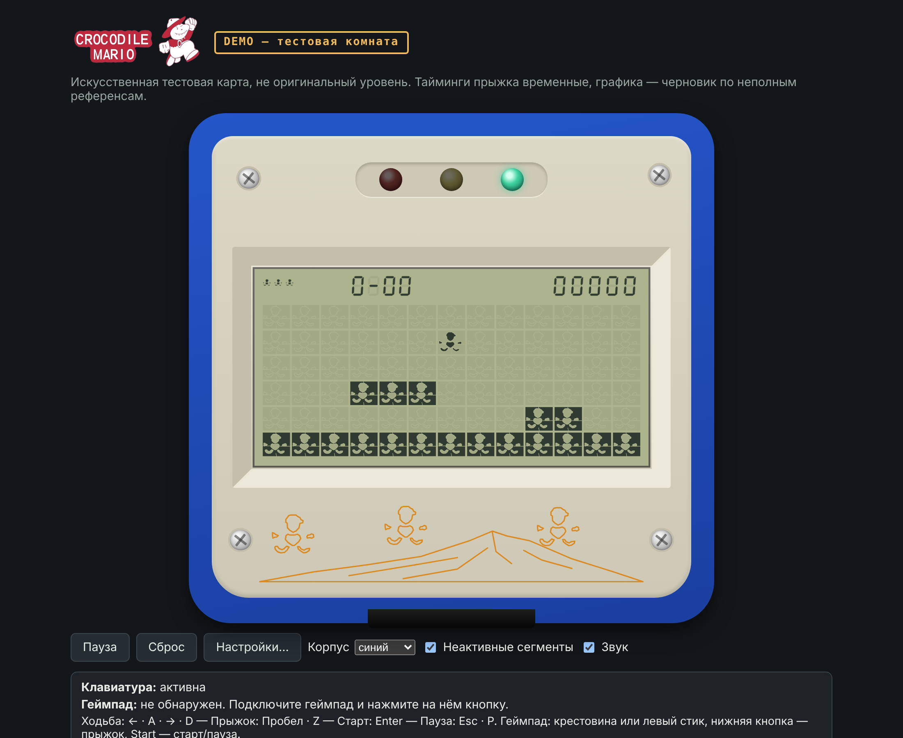

<p align="center">
  
</p>

# Crocodile Mario — браузерная реконструкция

> **Статус: техническая демоверсия движка. Оригинальный контент ещё не восстановлен.**
> Уровни, тайминги, графика и правила в репозитории — временные (`demo`). Спрайты LCD — реконструкция владельца по двум фото
> (статус `draft`), корпус вокруг экрана оформлен по фотографиям устройства. Подтверждённые владельцем
> параметры перечислены в [docs/reference-status.md](docs/reference-status.md).



## Что открывается

| Адрес | Что это |
| --- | --- |
| `…/` (по умолчанию) | **Однокомнатное демо** (#2): одна неподвижная комната `demo-room`, один герой ходит и прыгает; экран в корпусе-раскладушке (синий, красный или белый — переключатель «Корпус»), LCD-графика из пакета владельца, переключатель «Неактивные сегменты» |
| `…/#/tech` | Техническая демоверсия движка (#1): два участка, стрельба, мишень, патруль, опасная область, отладка. Для разработки |
| `…/#/sheet` | Контрольный лист ресурсов для согласования с владельцем: «референс → восстановленный элемент» |

Комната — **искусственная тестовая карта, не оригинальный уровень**; тайминги прыжка временные. Вся графика — черновик по
реконструкции владельца; корпус, светодиоды и рисунок под экраном — только оформление, их цвета и пропорции оценены по фото:
[docs/visual-spec.md](docs/visual-spec.md).

Реконструкция игры Apollo Crocodile Mario для браузера. Это не эмулятор процессора/ROM: проект воспроизводит
наблюдаемое поведение оригинального устройства по данным, которые предоставляет его владелец.

Стек: TypeScript (strict) + Vite + Canvas 2D, обычный HTML/CSS для оболочки, Vitest для ядра,
Playwright для одного браузерного smoke-набора. Без React, серверов и баз данных.

## Запуск

Нужен Node.js **22.13+** (или 24+); версия закреплена в `.nvmrc` и `engines`. Менеджер пакетов — npm.

```bash
nvm use            # или любой способ поставить Node 22
npm ci             # установка строго по package-lock.json
npm run dev        # сервер разработки: http://localhost:5173
```

| Команда | Что делает |
| --- | --- |
| `npm run dev` | сервер разработки Vite |
| `npm run build` | production-сборка в `dist/` (базовый путь `/`) |
| `npm run build:pages` | сборка для размещения в `/CrocodileMario/` |
| `npm run preview` | локальный просмотр сборки (`-- --base=/CrocodileMario/` для подкаталога) |
| `npm run typecheck` | проверка типов; ядро и формат данных дополнительно проверяются **без DOM-библиотек** |
| `npm run lint` | ESLint, в том числе запрет браузерных API/часов/`Math.random()` в ядре |
| `npm test` | Vitest: ядро, ввод, оболочка (без браузера) |
| `npm run test:smoke` | Playwright: комната (ходьба, прыжок, границы, пауза, сброс, переназначение, геймпад подставной, проверка рендера), техническое демо, контрольный лист |

Для smoke-теста нужен Chromium: `npx playwright install chromium`. Если он уже установлен, укажите
`CHROMIUM_PATH=/путь/к/chrome`. Тест сам собирает проект с базовым путём `/CrocodileMario/` и запускает `vite preview`.

### Размещение в подкаталоге

Статическая сборка работает с любым базовым путём: `npm run build -- --base=/МОЙ_ПУТЬ/`
(для `/CrocodileMario/` есть `npm run build:pages`). Файлы данных загружаются относительно `import.meta.env.BASE_URL`.
Для Cloudflare в корне лежит `wrangler.jsonc` (статические ресурсы из `./dist`): там сайт открывается с корня, поэтому
подходит обычная `npm run build` (базовый путь `/`), а не `build:pages`. Настройки GitHub Pages в репозитории не заданы.

## Управление

Клавиатура (раскладка не важна: используется физическое положение клавиши, `KeyboardEvent.code`):

| Действие | Клавиши |
| --- | --- |
| Влево / вправо | ← → или A D |
| Вверх / вниз | ↑ ↓ или W S (в демо-правилах не используются) |
| Прыжок | Пробел или Z |
| Огонь | X |
| Старт / подтверждение | Enter |
| Пауза / назад | Esc или P |

Геймпад (`mapping: "standard"`): крестовина или левый стик — направления, нижняя лицевая кнопка — прыжок и
подтверждение, левая лицевая — огонь, Start — старт и пауза.

- Клавиатура работает, пока игровая область в фокусе (кликните по ней). Вне неё клавиши не перехватываются и прокрутка страницы не блокируется.
- Геймпад: нажмите любую кнопку, чтобы он стал активным. Нужны **HTTPS или localhost**; распознавание контроллера
  зависит от браузера и ОС. При недоступном Gamepad API игра остаётся работоспособной с клавиатурой.
- «Настройки…» — переназначение клавиш и кнопок, порог стика, выбор устройства, сброс; хранится в `localStorage`
  (без него настройки действуют до перезагрузки).
- Окно потеряло фокус, вкладка скрыта, геймпад отключён или открыты настройки → **пауза**. Продолжение всегда явное
  (Esc/P/Start или кнопка), без скачка героя и без случайного прыжка/выстрела от удерживавшейся кнопки.

### Отладка

Флажок «Отладка»: номер такта, состояние героя, активные действия, сетка и коллизии, шаг на один такт в паузе,
перезапуск демо. Параметр адреса `?seed=N` задаёт seed ядра.

## Что реализовано

- Игровое ядро (`step(inputFrame)`) без DOM/Canvas/Gamepad/звука/часов; фиксированный шаг; сериализуемое состояние;
  детерминированный порядок; события для внешних систем; replay.
- Демо-профиль правил (заменяемые данные): ходьба, табличный прыжок, падение, выстрел с проверкой каждой клетки пути,
  мишень, патруль, опасная область, смерть и перезапуск, финиш и переход на второй тестовый участок, жизни, счёт, таймер.
- Единый слой ввода: клавиатура и геймпад → логические действия; `pressed/held/released`; детерминированное объединение
  источников и конфликтов направлений.
- Версионированный формат данных (экран, правила, каталог ресурсов, уровни) с проверкой при загрузке.
- Canvas-рендерер: масштабирование с учётом `devicePixelRatio`, камера, слои ячеек (неактивные сегменты → препятствия → герой), HUD спрайтами из атласа, заглушки там, где графики нет.
- Отладочная панель, интерфейс аудио с no-op-реализацией.

## Чего нет (и это намеренно)

Дамп ROM и эмуляция; подтверждённая графика и электрическое разбиение LCD; оригинальные уровни и враги; звук и логика
светодиодов (они нарисованы, но не работают); редактор уровней (issue #4, в работе); сохранение прогресса; нижняя половина
раскладушки с кнопками (управление — клавиатура и геймпад). Список того, что ещё предстоит измерить на устройстве, —
в [docs/reference-status.md](docs/reference-status.md).

## Структура

```text
src/
  core/      игровое ядро: состояние, симуляция, правила-поведения, replay (без DOM, часов и Math.random)
  content/   формат данных: типы схемы, проверка, сериализация (без DOM)
  input/     клавиатура, геймпад, привязки, настройки → логические действия
  render/    Canvas-рендерер, камера, масштабирование, заглушки, ресурсы
  audio/     порт аудио (no-op)
  app/       оболочка: цикл, сессия, устройства, интерфейс, настройки
public/content/demo/   демо-пакет: pack.json, screen.json, rules.json, assets.json, levels/*.json
public/content/room/   однокомнатное демо (основной маршрут): экран, правила, ресурсы, levels/demo-room.json
public/graphics/lcd/   атлас LCD-графики владельца (lcd_atlas.png; описание — public/content/room/assets.json)
public/brand/          логотип для страницы (исходники — в docs/brand/)
tests/       Vitest (core, content, input, render, app) и Playwright (smoke)
docs/        architecture.md, content-format.md, visual-spec.md, reference-status.md, manual-gamepad-check.md, references/, screenshots/, brand/
```

## Документация

- [Архитектура](docs/architecture.md) — границы слоёв, цикл, ввод, replay, куда добавлять новое.
- [Формат данных](docs/content-format.md) — примеры экрана, правил, ресурсов и уровня.
- [Визуальная спецификация LCD](docs/visual-spec.md) — профиль экрана, элементы, допущения, блокеры по референсам.
- [Статус референсов](docs/reference-status.md) — подтверждено / demo-допущение / предстоит измерить.
- [Ручная проверка геймпада](docs/manual-gamepad-check.md) — чек-лист для владельца.
- [Каталог референсов](docs/references/README.md) — какие фото есть и чего не хватает.

## Куда добавлять оригинальное

- **Графика** — в каталог ресурсов (`assets.json`): `image` принимает PNG и SVG (полоса кадров; в SVG `currentColor` рисуется цветом LCD-профиля), у ресурса есть `provenance` со статусом и источниками. Ядро и ввод не меняются. Порядок замены — в [visual-spec.md](docs/visual-spec.md).
- **Карты** — JSON-файлы уровней в пакете контента и ссылка на них в `pack.json`.
- **Измеренные правила** — значения в `rules.json` (и `status: "confirmed"` с записью в `reference-status.md`).
  Особые механики — отдельные обработчики в `src/core/behaviors.ts`, а не «язык правил» в JSON.
