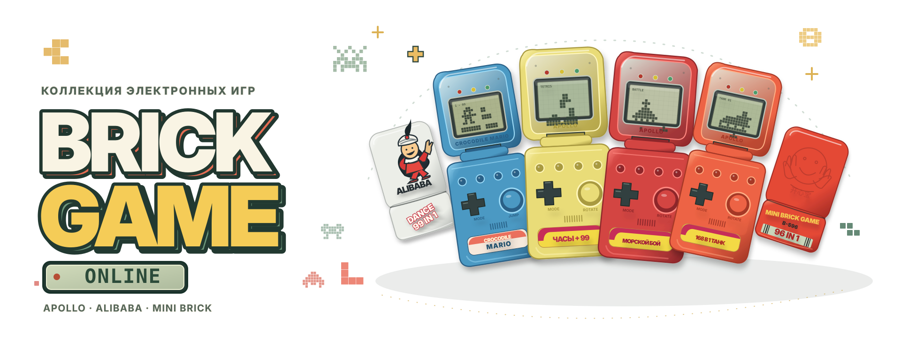
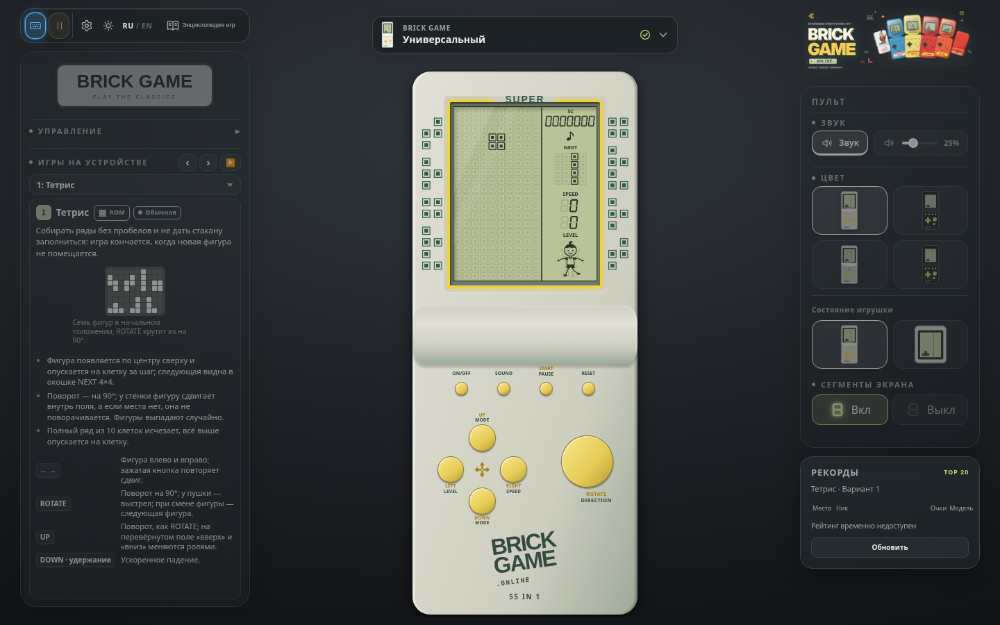
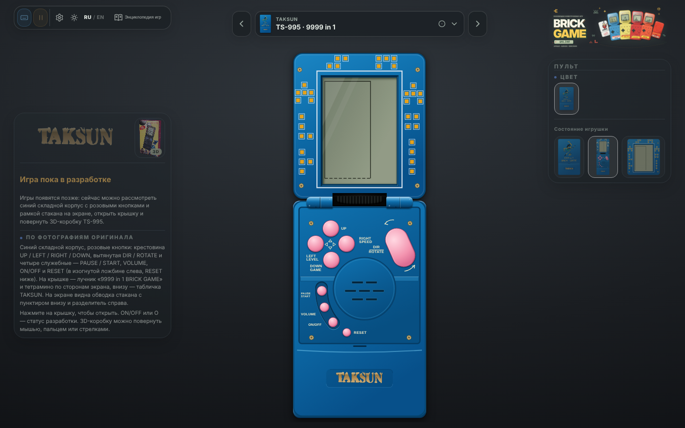

<p align="center">
  
</p>

<h1 align="center">Карманное детство — прямо в браузере</h1>

<p align="center">
  Знакомый щелчок крышки, мерцание LCD и звук маленькой пищалки.<br>
  <b>Коллекция карманных игрушек. Десятки игр. Одна коллекция.</b>
</p>

<p align="center">
  <a href="https://brick-game.online/"><b>Открыть коллекцию →</b></a>
</p>





## Откройте крышку. Вспомните любимую игру.

**Crocodile Mario, Часы+99, Морской бой и 168 в 1 танк** — четыре Apollo с собственными корпусами, наклейками и LCD-экранами. Прыгайте по девяти уровням Mario, собирайте ряды, управляйте танком, ищите корабли, стройте лестницу для Ромео. В общей библиотеке — более 50 записей игр и вариантов: гонки, арканоид, змейка, стрелялки и головоломки.

- **Игрушка как на ладони.** Анимированная крышка, шарниры, цветные корпуса, светодиоды и режим крупного экрана.
- **Ваш способ играть.** Клавиатура, геймпад или касания; переназначение кнопок, памятки и справка на русском и английском.
- **Энциклопедия игр.** Правила, крупные демонстрации и источники реконструкции — в отдельном справочнике с поиском; игры идут по возрастанию редкости (Common → Ultra Rare, по [Retro Consoles Wiki](https://retroconsoles.fandom.com/wiki/Brick_Game#Games)), у каждой — значок редкости.
- **Знакомое звучание.** Синтезируемые эффекты и мелодии; у Mario — ещё и музыкальный ремастер.
- **Место для творчества.** Редактор уровней Mario и студия настройки коллекции: состав игр, порядок и цвета каждой Apollo.

Выпадающий **каталог устройств** над консолью (поиск и категории «Все | Apollo | TAKSUN | Brick Game», значок готовности у каждой модели; описание — в [docs/toys.md](docs/toys.md#каталог-устройств)) объединяет Apollo, **Brick Game E‑88**, **Apollo B0202**, **TAKSUN TS-995** ([docs/taksun.md](docs/taksun.md): складной корпус, игры позже), а также **Alibaba Dance 99 in 1** и **Mini Brick Game B-S96**. Бренд и готовность каждой модели настраиваются в админке (если другой бренд не установлен, модель считается Brick Game). У Alibaba корпус готов, игры появятся после изучения оригинала; **Mini Brick Game B-S96** играет: заставка с рожицей, меню номеров 00–96 (00 и 01 — гонки, 02–96 — вариации тетриса), «Коробейники» один раз за партию — см. [docs/minibrick.md](docs/minibrick.md). **Brick Game** — наша универсальная приставка в сером и чёрном корпусах с крупным матричным экраном, всеми игровыми кнопками и собственной мелодией. Здесь живут игры, не назначенные другим моделям.

У E‑88 и B0202 восстановлены корпуса и оригинальные меню; часть игровых профилей ещё исследуется ([состояние моделей](docs/devices/e88-b0202.md)).

Коллекция продолжает расти: часть игровых правил пока восстановлена приблизительно, а статусы и источники доступны в справке.

## Запуск и разработка

Нужен **Node.js 22.13+ в ветке 22 или Node.js 24+**.

```bash
npm ci
npm run dev
```

Для локальной игры серверное хранилище и секреты не нужны. Стек: **TypeScript, Vite, Canvas 2D, Web Audio**. Игровые ядра находятся в `src/core`, `src/tetris`, `src/brick`; интерфейс — в `src/app`, звук — в `src/audio`. Ресурсы лежат в `public`, тесты — в `tests`.

```bash
npm run typecheck
npm run lint
npm test
npx playwright install chromium
npm run test:smoke
```

**Деплой в Cloudflare Workers:** настройте имя Worker в `wrangler.jsonc`, авторизуйтесь и выполните:

```bash
npx wrangler login
npx wrangler deploy
npx wrangler secret put ADMIN_TOKEN
```

Сборка запускается автоматически. Секрет — случайная строка от 32 символов; он нужен для публикации настроек из `/admin`. Конфигурация хранится в Durable Objects, исходный набор — в `src/config/default.json`. Редактор уровней доступен в карточке Mario в `/admin`.

**Статический хостинг:** `npm run build`, затем разместите содержимое `dist`. Для подкаталога: `npm run build -- --base=/your-path/`. Без Worker настройки коллекции публикуются через `src/config/default.json` и повторную сборку.

[Архитектура](docs/architecture.md) · [Проверка репозитория и CI](docs/repository-review.md) · [Настройка коллекции](docs/admin.md) · [Редактор Mario](docs/editor.md) · [Энциклопедия](docs/encyclopedia.md) · [Каталог и статус игр](docs/brick/library.md) · [Источники](docs/reference-status.md) · [Сторонние материалы](docs/THIRD_PARTY.md)

Общие рекорды TOP-20 без регистрации: [настройка Cloudflare, категории и API](docs/leaderboards.md).
