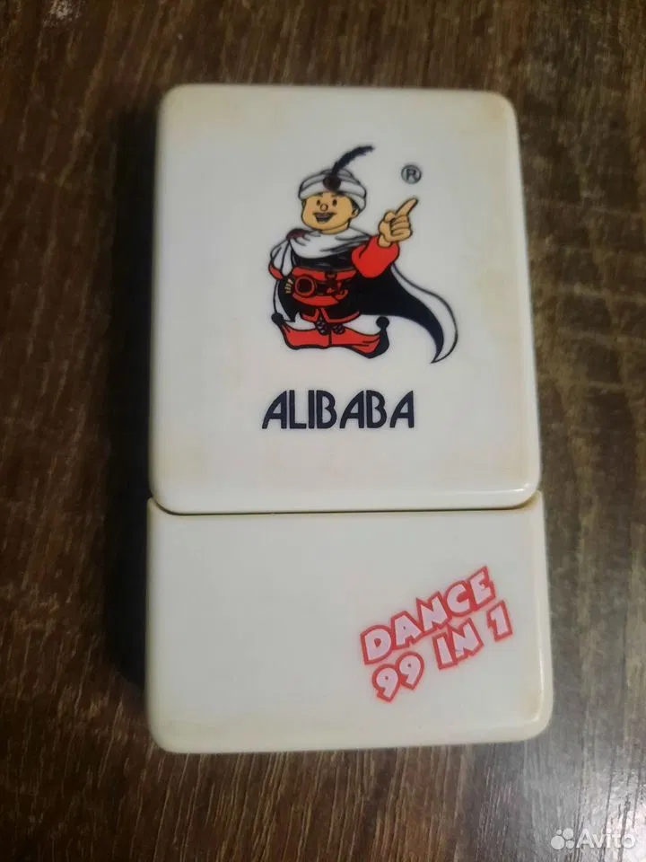
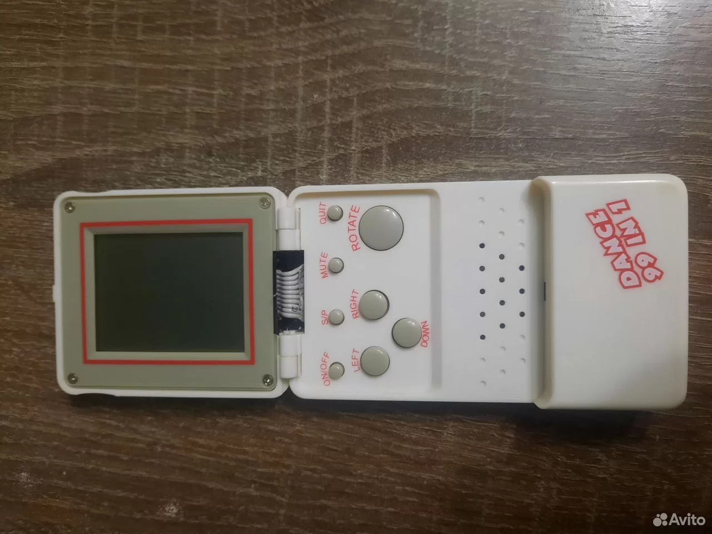
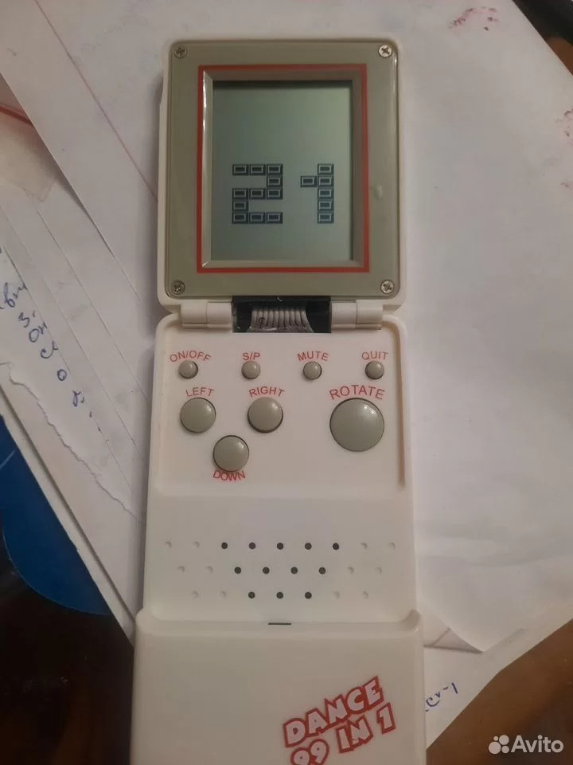

# Alibaba Dance 99 in 1

Первая модель раздела **Другие**. Это визуальная реконструкция корпуса: игры, звук, меню и поведение оригинальной прошивки пока не реализованы. Название «99 in 1» воспроизводит надпись, а не подтверждённое количество отдельных игр.

## Референсы

Владелец предоставил три фотографии и два логотипа. Фотографии сохранены без изменений:

| Закрыта | Открыта | LCD |
| --- | --- | --- |
|  |  |  |

На фотографиях видны белый прямоугольный корпус, оливковая лицевая панель с четырьмя винтами, красная рамка цельного портретного LCD, светлый шлейф и две втулки. Четыре малые круглые кнопки подписаны ON/OFF, S/P, MUTE, QUIT; ниже — LEFT, RIGHT, DOWN и большая ROTATE. Кнопки UP нет. На крышке — персонаж Alibaba, на нижней части корпуса — DANCE 99 IN 1.

Прозрачный лист логотипов `public/brand/alibaba-logos.png` подготовлен инструментом редактирования изображений по предоставленным логотипам. SVG-окна показывают каждый знак отдельно, сохраняя пропорции и прозрачность.

## Геометрия и экран

Корпус рисуется отдельно от Apollo. Рабочие координаты — 400×440 для крышки и 400×660 для основания; это оценка пропорций по фотографиям, не измерение оригинала. Основная игрушка и миниатюры используют одну SVG-разметку. Общие механизм поворота крышки, ось шарнира и режимы «закрыта / полная / экран» сохранены; автоматическая проверка контролирует промежуточные кадры открытия.

Фото LCD подтверждает область экрана и прямоугольные контурные сегменты числа 21. Оно не даёт полной карты сегментов или надёжного числа строк и столбцов. Поэтому сейчас экран пустой и выключенный, без выдуманного поля 10×20, боковой панели Apollo или заставки.

## Что доступно

- Прямой адрес `?toy=alibaba`, переключение между семействами и история браузера.
- Белый корпус, открытие крышки, три вида и адаптация к мобильным экранам.
- ON/OFF, O, Enter/пробел на открытой игрушке или касание в режиме «экран» показывают сообщение о разработке. Питание не включается, игровой движок не создаётся.
- Справка и сообщение на русском и английском; общие настройки языка и темы.

Логотипы загружаются при открытии группы «Другие». В режиме осмотра нет игрового цикла, аудио или постоянной перерисовки. Конфигурация `/admin` по-прежнему относится только к четырём Apollo; опубликованные конфигурации версии 1 остаются совместимыми.

После изучения оригинала нужно уточнить карту LCD, список игр, навигацию, действия кнопок, звук и размеры корпуса.
