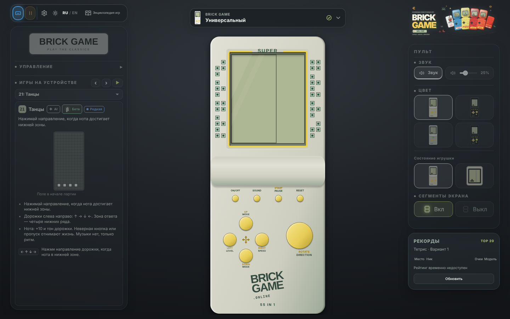
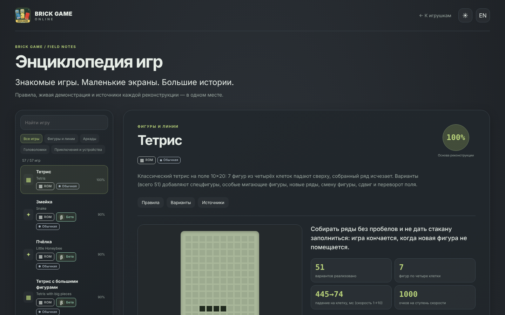

# Редкость игр

Игры помечены значком редкости по разделу «Games» страницы [Retro Consoles Wiki · Brick Game](https://retroconsoles.fandom.com/wiki/Brick_Game#Games); сохранённый текст страницы лежит в
[`docs/research/Brick Game _ Retro Consoles Wiki _ Fandom.html`](../research/Brick%20Game%20_%20Retro%20Consoles%20Wiki%20_%20Fandom.html). Данные — `src/games/rarity.ts`.

## Ступени

Вики делит игры на четыре ступени: **Common**, **Uncommon**, **Rare** («These can only be found on certain models») и **Ultra Rare**; отдельный раздел **Mobile games** — игры, которых на настоящих приставках нет
(редкость там не указана). В проекте «Mobile» стоит после «Ultra Rare»: это не ступень редкости, а раздел вики.

| Значок | Ступень | Порядок |
| --- | --- | --- |
| Обычная | Common | 1 |
| Нечастая | Uncommon | 2 |
| Редкая | Rare | 3 |
| Сверхредкая | Ultra Rare | 4 |
| Мобильная | Mobile games | 5 |

Игры, которых в вики нет (**Crocodile Mario**, **часы**, **«Ромео и Джульетта»**), редкости не имеют: значка у них нет, в списках они стоят в конце.

## Где показывается

- **Энциклопедия** — значок в списке игр и в заголовке статьи (у вариаций игры в перечне режимов своего значка нет: редкость относится к игре в целом). Список отсортирован по возрастанию редкости,
  внутри ступени — по убыванию достоверности реконструкции.
- **Универсальный Brick Game** — в левой панели список игр разбит на группы по ступеням, у открытой игры виден значок рядом со значками ROM/AI и α/β.
  Консоль следует тому же порядку: `universalGames()` (`src/config/schema.ts`) всегда сортирует игры по редкости, поэтому номера в списке слева совпадают с номерами в меню консоли.
  Порядок ↑ ↓ в админке действует внутри одной ступени (сортировка устойчивая); в строке игры админка показывает её ступень.
- Значок редкости — особенность универсальной консоли: у приставок со своим набором игр (E‑88, B0202, «Часы+99», «168 в 1 танк», «Морской бой», Mini) в левой панели его нет.

## Соответствие игр проекта играм вики

Название в вики — в последнем столбце. Соответствие — решение проекта, где оно неочевидно, оно помечено в допущениях.

| Игра проекта (`GameId`) | Ступень | Игра в вики |
| --- | --- | --- |
| `tank` | Common · обычная | Tank game (Battle City) |
| `tetris` | Common · обычная | Tetromino game |
| `tetris-big` | Common · обычная | Tetromino game: вариации с большими фигурами |
| `tetris-pentix` | Common · обычная | Tetromino game: вариации с пентамино |
| `racing` | Common · обычная | Car racing game (2 Racing/3 Racing) |
| `obstacle-race` | Common · обычная | Obstacles Race |
| `shooting-array` | Common · обычная | Shooting Disappearing (ряды блоков опускаются, их нужно расстрелять) |
| `shooting-figures` | Common · обычная | Shooting Disappearing / Shooting filling (общий вариант по таблице docs/brick/modes-reference.md) |
| `construction` | Common · обычная | Shooting filling |
| `frog` | Common · обычная | Frogger |
| `arkanoid` | Common · обычная | Unilateral Table Tennis (Arkanoid) |
| `pong` | Common · обычная | Bilateral Table Tennis (Pong) |
| `snake` | Common · обычная | Snake |
| `honeybee` | Common · обычная | Little Honeybee (Galactica) |
| `pneumatic-ball` | Common · обычная | Pneumatic Ball |
| `matching-blocks` | Uncommon · нечастая | Matching Blocks |
| `whack-a-mole` | Uncommon · нечастая | Whack-a-mole |
| `simon` | Uncommon · нечастая | Simon Says |
| `dice` | Uncommon · нечастая | Dice (Da Xi Bao) |
| `racing-shooting` | Rare · редкая | Shooting Car Racing |
| `dance` | Rare · редкая | Dance Dance Revolution |
| `quarth` | Rare · редкая | Shoot Blocks (known Fire block) |
| `lights-out` | Rare · редкая | Lights Out |
| `boat-racing` | Rare · редкая | Boat racing |
| `talking-shooting` | Rare · редкая | Shooting Disappearing (Talking Gamemate Version) |
| `ufo-raiders` | Rare · редкая | UFO Raiders (Talking Gamemate Version) |
| `tetris-flicker` | Rare · редкая | Tetris Flickering Dot |
| `super-tank` | Rare · редкая | Super Tank |
| `racing-pickup` | Rare · редкая | Car Racing/Boat Racing (Pickup Mode) |
| `jigsaw` | Ultra Rare · сверхредкая | Jig Saw Puzzles Game |
| `punch-racing` | Ultra Rare · сверхредкая | Punching Car Racing |
| `meteor-fighter` | Ultra Rare · сверхредкая | Meteor Fighter Game |
| `sokoban` | Ultra Rare · сверхредкая | Sokoban (Warehouse Workers) |
| `columns` | Ultra Rare · сверхредкая | Colomus game (Magic Diamond) |
| `columns-flicker` | Ultra Rare · сверхредкая | Colomus game (Flickering Dot) |
| `shooting` | Ultra Rare · сверхредкая | Space Invader (Invaders): вертикальный шутер по донору InvadersGame |
| `space-invaders` | Ultra Rare · сверхредкая | Space Invader |
| `peg-solitaire` | Ultra Rare · сверхредкая | Solitaire Board game (Smarty Chess) |
| `sea-battle` | Ultra Rare · сверхредкая | Battleship |
| `basket` | Ultra Rare · сверхредкая | Basket game |
| `dr-mario` | Ultra Rare · сверхредкая | Column Game (Dr. Mario Clone) |
| `bowling` | Ultra Rare · сверхредкая | Bowling |
| `dual-shooting` | Ultra Rare · сверхредкая | Shooting (два ствола, шкалы здоровья) |
| `maze` | Ultra Rare · сверхредкая | Maze |
| `tetris-shooting` | Ultra Rare · сверхредкая | Tetris Shooting |
| `racing-four` | Ultra Rare · сверхредкая | Car racing game (4 lane) |
| `pong-double` | Ultra Rare · сверхредкая | Pong (Double Ball) |
| `arkanoid-dots` | Ultra Rare · сверхредкая | Arkanoid (Two Flickering Dots) |
| `flappy-bird` | Mobile games · мобильная | Flappy Bird |
| `reversi` | Mobile games · мобильная | Reversi |
| `fill-connect` | Mobile games · мобильная | Fill Connect |
| `2048` | Mobile games · мобильная | 2048 |
| `digger` | Mobile games · мобильная | Digger |
| `helicopter-bomber` | Mobile games · мобильная | Helicopter Bomber |

## Допущения

- `tetris-big` и `tetris-pentix` — вариации Tetris с большими фигурами и пентамино; вики отдельно их не выделяет, поэтому они получают ступень «Tetromino game» (Common).
- `shooting-figures` — по таблице вариаций `docs/brick/modes-reference.md` это «Shooting Disappearing / Shooting filling» (Common); `construction` — «Shooting filling» (Common).
- `shooting` — вертикальный шутер, написанный по донору `InvadersGame`: в вики ему соответствует Space Invader (Ultra Rare), а отдельный `space-invaders` — то же название игры; обе записи сохраняют ступень Ultra Rare.
- `racing-pickup` («Car Racing/Boat Racing (Pickup Mode)») и `talking-shooting` / `ufo-raiders` («Talking Gamemate Version») — Rare, как в вики.
- Названия игр в вики переводятся нестрого; если на странице соответствие изменится, правится только `RARITY_BY_GAME` в `src/games/rarity.ts`.
