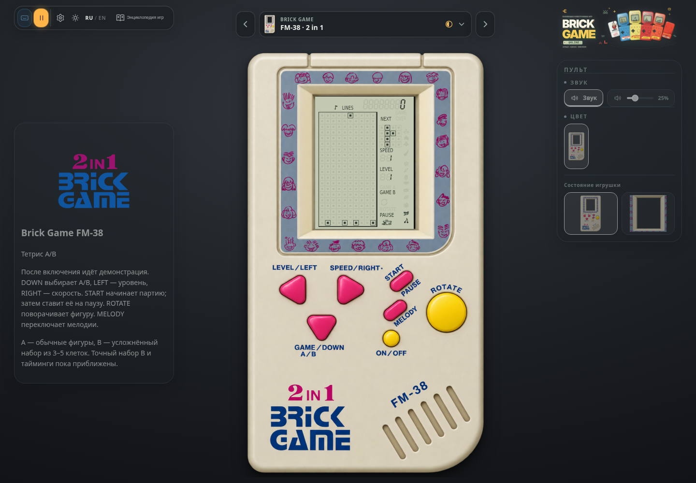
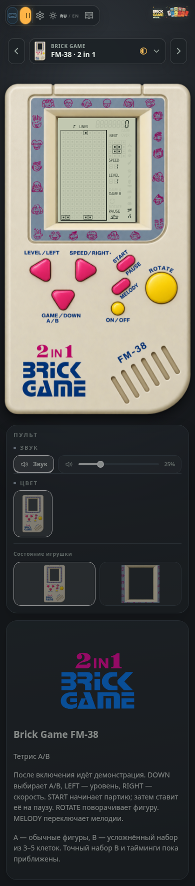

# Brick Game FM-38

Корпус и печать взяты из графики, предоставленной владельцем в `docs/research/fm-38.zip`; локальные ресурсы находятся в `public/devices/fm38`. Они предназначены для этого проекта. Фото и объяснение владельца — источник управления и структуры устройства; подтверждённого ROM FM-38 нет.

## Поведение

Включение сразу запускает демонстрацию тетриса. LEFT выбирает уровень (0–12), RIGHT — скорость (0–9), DOWN — A/B. START начинает новую партию с выбранными параметрами, затем ставит её на паузу и продолжает. ROTATE поворачивает фигуру, MELODY переключает мелодии (подтверждено владельцем). Громкость и выключение звука — в пульте. Модель не складывается, доступно увеличение экрана.

До расшифровки записи оригинала владелец согласовал временный синтезированный набор: «Коробейники» и «Ода к радости» Бетховена. Это адаптации общественного достояния, не заявление о репертуаре прошивки. Выбранная мелодия играет один раз при старте; MELODY меняет её без сброса партии. Звуки движения, поворота и посадки — чистые синтезированные сигналы B-S96. Пауза останавливает музыку, продолжение сохраняет позицию.

A использует обычные тетромино, B — набор Pentix из 26 фигур размером 3–5 клеток. Точный набор B, тайминги и алгоритм демонстрации оригинала неизвестны и являются приближением (в левой панели этого нет — только в допущениях энциклопедии). Шкала фруктов переиспользуется из B-S96 по подтверждению владельца. Демонстрационные очки не сохраняются; локальные рекорды A/B изолированы от других моделей. Общий рейтинг для этой реконструкции пока не подключён.

## Кнопки — отдельные объекты

Корпус нарисован целиком, поэтому кнопки в нём были частью картинки. Скрипт `scripts/research/fm38_cut_keys.py` вырезает все семь кнопок (три розовых треугольника, две розовых пилюли, две жёлтых круглых) в спрайты `public/devices/fm38/keys/*.png` — исходные пиксели с мягким краем, ничего не перерисовано — и сохраняет корпус без них (`body-plain.png`: место кнопок заполнено гладкой поверхностью, подогнанной по окружающему пластику, надписи не тронуты). Исходный `body.png` остаётся для миниатюр каталога (там кнопки видны). Геометрия — `scripts/research/fm38-keys.json`: рамка спрайта в пикселях корпуса и контур силуэта.

В игрушке у каждой кнопки две части (`src/app/fm38Model.ts`): прозрачная область нажатия с `clip-path` по силуэту (угол рамки спрайта кнопкой не является) и следующий за ней спрайт. Нажатие (мышь, касание, клавиша, геймпад — `data-pressed`) уводит спрайт вглубь: сжатие со сдвигом и небольшое затемнение вместе с его формой; при «уменьшении движения» без перехода.

## Экран по фото владельца

ЖК нарисован отдельным SVG (`src/render/fm38Screen.ts`) по фото (511 × 688): координаты в пикселях фото, ход клетки поля 28,4 (замеры по яркости: рамка, клетки, превью, подписи, цифры). Что видно на фото и воспроизведено:

- матрица 10 × 20 и рамка стакана — **одна** линия: слева и сверху тонкая, справа толстая, снизу тонкая; левый и нижний края рамки совпадают с краем стекла (раньше справа и снизу получалась двойная обводка);
- NEXT 4 × 4 с клетками того же размера, что у поля; «GAME OVER» двумя строками справа вверху;
- подпись LINES слева от ряда из восьми цифр, горят **две средние** (число рядов); остальные только в «призраке»;
- SPEED над своей цифрой, затем цифра LEVEL и подпись LEVEL **под** ней; GAME A/B, ROTATE (горит, пока идёт игра или демонстрация) и значок звука;
- шкала из 13 значков у правого края (те же значки, что у B-S96).

Чего на фото не видно (погашенные сегменты: GAME A, PAUSE, чашка) — размещено по допущению рядом с видимыми подписями; значок звука — косой мазок на фото — нарисован как лежащая нота и горит, пока звук включён. «Сегменты экрана» (призрак погашенных сегментов) переключаются в пульте, как у других игрушек.

## Вид «только экран»

Экран той же ширины, что у остальных «кирпичей» (54,4 % ширины игрушки, как у Mini Brick). Корпус вырезан **по внешнему контуру рамки экрана** (синяя полоса с рожицами и фаска, `screen-frame.png`, за контуром прозрачно, край сглажен) — а не обрезан квадратом; размеры рамки и окна — `scripts/research/fm38-frame.json`. Скрипт `fm38_cut_keys.py` пересоздаёт все ресурсы (`python3 scripts/research/fm38_cut_keys.py` из корня репозитория; нужны numpy и opencv-python).

## Левая панель

Карточка устройства (бренд, модель, игры, источники; год и питание — прочерки до данных владельца) и вкладки **A** и **B** с описанием по правилам игр (`src/brick/guides/fm38.ts`, как у других игр: цель, схема, правила, кнопки, очки). Допущения (набор фигур B, темп, демонстрация) — только в энциклопедии.

