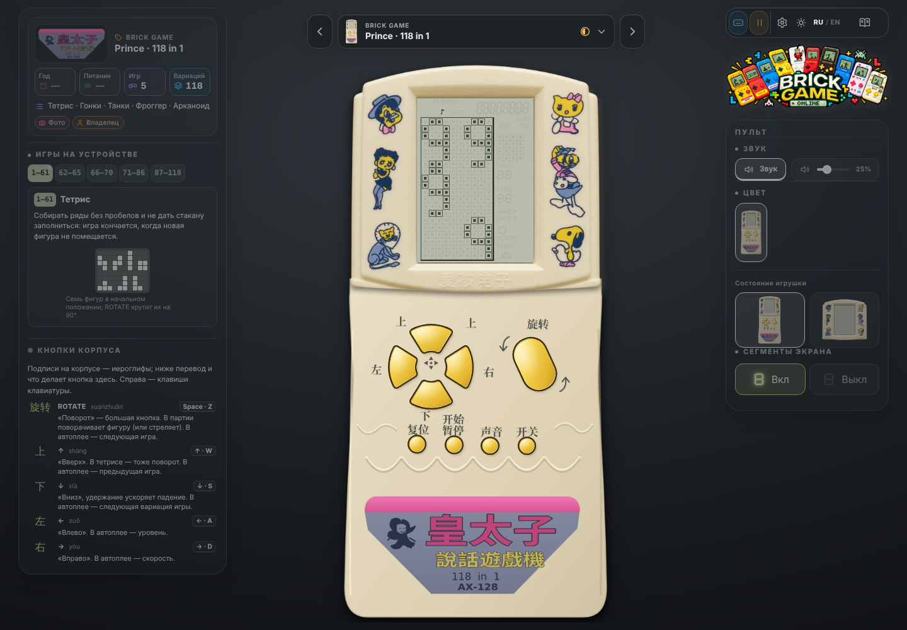
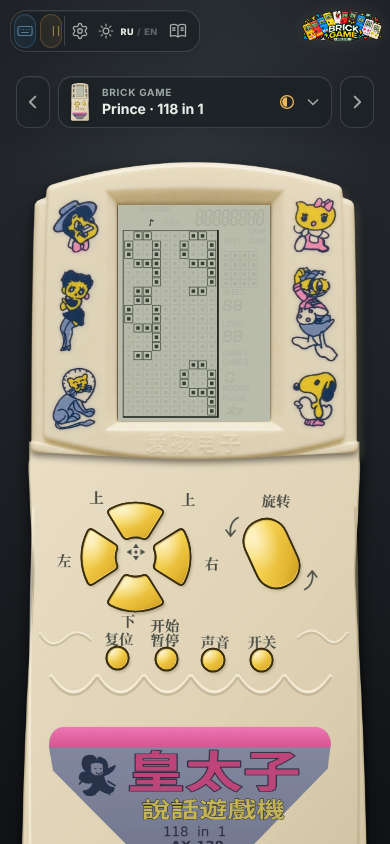

# Prince 皇太子 · 118 in 1 (AX-128)

Моноблок-«кирпич» (не раскладушка) с одним экраном, большой кнопкой ROTATE, крестом из четырёх вееров и кнопками RESET, START/PAUSE, SOUND, ON/OFF. Страница `…/?toy=prince118`, готовность в каталоге — «◐ восстанавливается». Модель не складывается; вид «только экран» показывает одну верхнюю рамку с экраном.

## Источники

- `docs/research/Prince-118-AX128-graphics.zip` — графика владельца (трассированные декали); сама по себе годилась только как набросок.
- `docs/research/Prince-front-panel.webp` — снимок передней панели оригинала, присланный владельцем (рамка с декалями и тиснением 爱孩电子, прозрачное окно под экран). Верх корпуса (`body.webp`, `lid.webp`) собран из него без перерисовки; крупные плоскости по контуру сглажены, края прозрачные.
- Фото устройства владельца — по нему перерисованы нижняя часть корпуса, подписи и девять кнопок (обводки, веера, нажатые копии).

Две изогнутые стрелки у ROTATE нарисованы симметрично: нижняя — верхняя, повёрнутая на 180° вокруг центра кнопки.

Ресурсы — `public/devices/prince118/{body.webp,lid.webp,logo.webp,keys/*.svg}`; пересобираются `python3 scripts/research/prince_build.py` (Pillow, NumPy, SciPy, OpenCV; для SVG → PNG нужен Chromium Playwright). Геометрия окна и кнопок лежит в `scripts/research/prince118-layout.json` и читается `src/app/princeModel.ts`.

## Поведение (по описанию владельца)

1. **Включение.** Один раз играет «Финал» (Allegro vivace) увертюры к опере «Вильгельм Телль» — монофонией; пока он звучит, внизу экрана вверх поднимаются по одной цифры «9 9 9 9 in 1».
2. **Автоплей.** Сразу после заставки идёт демонстрация игр: тетрис, гонки, танки, фроггер, арканоид. Большая кнопка переключает игру; в автоплее можно выбрать скорость и режим и нажать START, чтобы играть самому.
3. **Старт партии.** Один раз звучит куплет «Ти ж мене підманула» (синтез, монофония).
4. **Экран** — как у Mini Brick B-S96 (тот же ЖК: поле 10 × 20, цифры, превью), но без шкалы фруктов. «Сегменты экрана» в пульте включают и гасят призрак погашенных сегментов (это же есть у Mini Brick и FM-38).

## Допущения проекта (уточнить у владельца)

| Что | Принято | Почему |
| --- | --- | --- |
| Разбивка 118 вариаций | тетрис 1–61, гонки 62–65, танки 66–70, фроггер 71–86, арканоид 87–118 | у устройства нет дампа; числа взяты из реализаций библиотеки так, чтобы в сумме вышло 118 |
| Кнопки в автоплее | ROTATE — следующая игра, ↑ — предыдущая, ↓ — вариация, ← — уровень, → — скорость, START — играть, RESET — назад в автоплей | оригинального руководства нет |
| Раскладка заставки | четыре девятки в два ряда («99» над «99»), под ними «in 1» мелким шрифтом | в матрицу 10 × 20 две цифры в ряд помещаются, четыре — нет |
| Автоплей | простые «игроки» (`src/brick/princeDemo.ts`): тетрис двигает и поворачивает фигуры случайно и иногда ускоряет падение, гонки объезжают препятствия, танки ходят и стреляют, фроггер прыгает вперёд, арканоид ведёт платформу за мячом | демонстрация оригинала не записана |
| Год, питание | не указаны | заполняются в админке (карточка устройства) после данных владельца |

## Мелодии

Обе — общественное достояние, звучат одним голосом-меандром (`src/audio/princeTunes.ts`). Ноты взяты из открытых записей, а не сняты с устройства; темп и высота — допущения.

- «Финал» увертюры «Вильгельм Телль» Дж. Россини — тема финала в до мажоре из ABC-записи (аранжировка Hugh Barwell, trillian.mit.edu/~jc/music/abc), 4/4, четверть 165 мс, около 12 секунд.
- «Ти ж мене підманула» — одноголосная MIDI-запись куплета (pidmanula.narod.ru), 16 четвертей по 536 мс, 27 нот.

Остальные сигналы (движение, поворот, посадка, пауза) — как у B-S96.

## Левая панель

Карточка устройства (бренд, модель, пять игр, 118 вариаций, источники; год и питание — прочерки до данных владельца), пять вкладок-справок с номерами вариаций — **1–61** тетрис, **62–65** гонки, **66–70** танки, **71–86** фроггер, **87–118** арканоид (`src/brick/guides/prince.ts`) — и раскрывающийся блок **«Кнопки корпуса»**. Правила и очки — общие описания игр, а в примечании — управление автоплеем.

Блок «Кнопки корпуса» нужен потому, что подписи на корпусе — иероглифы: для каждой из девяти кнопок показаны иероглиф, чтение (пиньинь), подпись на английском, клавиша клавиатуры и что кнопка делает здесь (в партии и в автоплее): 旋转 ROTATE (Space · Z), 上 ↑ (↑ · W), 下 ↓ (↓ · S), 左 ← (← · A), 右 → (→ · D), 开始 暂停 START/PAUSE (Enter · P), 复位 RESET (X), 声音 SOUND (M), 开关 ON/OFF (O). Данные — `PRINCE_BUTTONS` в `src/brick/guides/prince.ts`, вывод — `MiniInfoPanel.buttonsSection`. На окне высотой от 1000 px блок раскрыт сразу, на более низком свёрнут; выбор пользователя сохраняется при смене языка. Допущения (разбивка, кнопки автоплея, боты) — в энциклопедии игр.

## Код

| Файл | Что делает |
| --- | --- |
| `src/brick/princeConsole.ts` | консоль: заставка → автоплей → выбор → партия; наследует `MiniConsole` |
| `src/brick/princeIntro.ts`, `princeDemo.ts` | заставка «9 9 9 9 in 1» и боты автоплея |
| `src/brick/games/prince.ts` | пять игр и разбивка вариаций 118 |
| `src/audio/princeTunes.ts` | «Финал» и куплет |
| `src/app/princeModel.ts`, `prince.css` | корпус, кнопки-спрайты, окно ЖК, вид «только экран», миниатюра |
| `src/app/miniBrickApp.ts` | общая оболочка Mini / FM-38 / Prince |
| `tests/brick/princeConsole.test.ts`, `tests/audio/princeTunes.test.ts`, `tests/smoke/prince118.spec.ts` | проверки |
