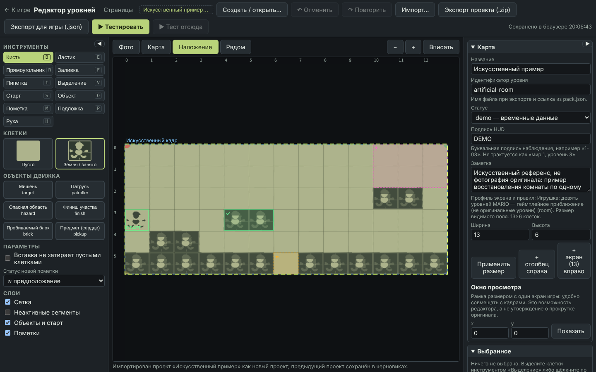
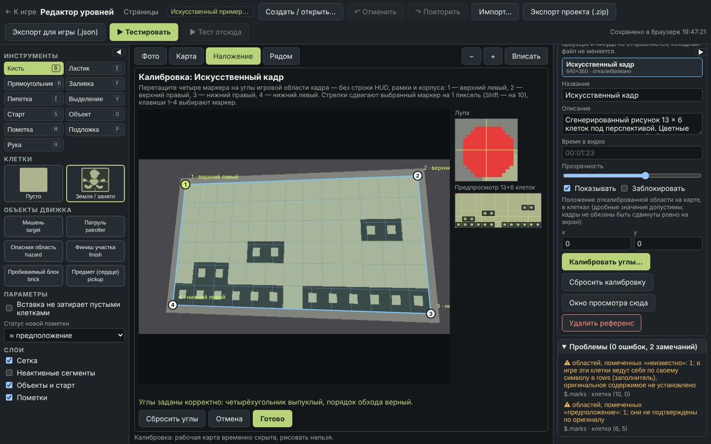
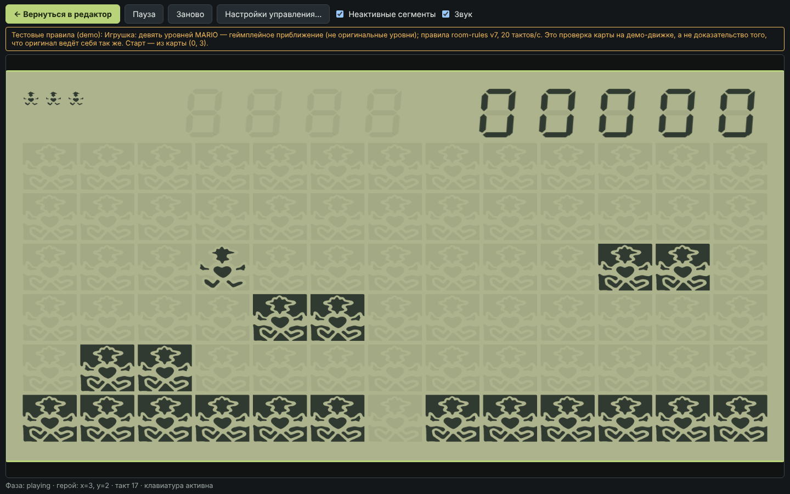

# Редактор уровней

Встроенный браузерный редактор для восстановления карт **по фотографиям оригинала** без правки JSON и кода. Открывается по адресу
`#/editor` (в игре — значок карандаша в уголке страницы) и работает в том же статическом приложении, в том числе в подкаталоге
`/CrocodileMario/`. Сервера, авторизации и отправки данных нет: черновики и фотографии остаются в вашем браузере.

**Связь с игрой.** Всё, что сохранено в редакторе (автосохранение в IndexedDB), показывает и запускает блок «Пользовательские» на пульте справа от игрушки: клик запускает карту на самой игрушке,
карандаш рядом с названием открывает именно эту карту в редакторе (`#/editor?project=<id>`). Карты, которые игра запустить не может (нет старта, переход на другой уровень, карта для пакета `demo`),
остаются в списке с причиной. Список читает только документ карты, без фотографий, и обновляется при возврате на вкладку.

В верхней панели редактора — меню «Страницы»: технические страницы проекта (техническая демоверсия движка, тестовый уровень по видео, контрольный лист ресурсов),
которые убраны со страницы игры.

> Редактор восстанавливает **данные карты**, а не прошивку. Тест идёт на демо-правилах движка: он не доказывает, что оригинал ведёт себя так же.

## Как восстановить комнату по фотографии

1. **Откройте редактор** (`#/editor`). Нажмите «Создать / открыть…» → «Новая карта…»: либо пустая комната по профилю экрана
   (размер берётся из видимого поля профиля, внизу ряд земли и старт), либо копия `demo-room`.
2. **Добавьте фото.** В разделе «Референсы» нажмите «Добавить фото…» или перетащите файл JPG/PNG/WebP на рабочую область.
   Файл не изменяется и никуда не отправляется. Если у кадра есть временная отметка видео, впишите её в поле «Время в видео».
3. **Откалибруйте углы.** Откроется окно калибровки. Перетащите четыре маркера на углы **именно игровой области** — без строки HUD, рамки и корпуса:
   1 — верхний левый, 2 — верхний правый, 3 — нижний правый, 4 — нижний левый. Лупа справа помогает попасть в пиксель, стрелки двигают маркер на 1 пиксель
   (Shift — на 10), клавиши 1–4 выбирают маркер. Предпросмотр показывает выпрямленный кадр с сеткой клеток. Вырожденный, самопересекающийся
   или невыпуклый четырёхугольник не принимается — под полем будет сказано, что не так. Кнопка «Готово» применит калибровку; «Сбросить углы» вернёт начальное положение.
4. **Нарисуйте карту поверх фото.** Режим «Наложение» показывает фото под полупрозрачной картой; «Фото», «Карта» и «Рядом» переключают показ.
   Выберите клетку в палитре и рисуйте кистью (`B`), прямоугольником (`R`), заливкой (`F`); ластик (`E`) стирает клетки. Поставьте старт героя
   инструментом «Старт» (`S`). Колесо мыши — масштаб, пробел + перетаскивание (или инструмент «Рука», `H`) — перемещение.
5. **Отметьте, чего вы не знаете.** Инструмент «Пометка» (`M`) рисует область со статусом: `?` не видно / неизвестно, `≈` предположение, `✓` подтверждено,
   с короткой заметкой и названием кадра. Пустая наблюдаемая клетка (нет пометки) и неизвестная клетка (пометка `?`) — разные состояния.
   Персонаж, враги, пули и тени на снимке **не** становятся клетками карты автоматически: объекты ставятся явно инструментом «Объект».
6. **Сверьтесь и проверьте.** Раздел «Проблемы» перечисляет ошибки общего валидатора игры (клик по пункту ведёт к клетке/объекту) и замечания. Кнопка
   «▶ Тестировать» запускает копию карты из памяти (включая несохранённые правки) на том же ядре и вводе, что и игра: клавиатура и геймпад, привязки из «Настроек управления».
   «Вернуться в редактор» восстанавливает всё как было: выделение, масштаб, подложки, историю. «▶ Тест отсюда» запускает с выделенной свободной клетки, не меняя сохранённый старт.
7. **Сохраните.** Автосохранение пишет черновик в IndexedDB браузера (время последнего сохранения — вверху справа). Для переноса используйте архив.

Первая комната восстанавливается по одному кадру. Для длинного уровня добавьте следующие кадры, откалибруйте каждый и задайте им положение на карте
в клетках («x», «y» референса; дробные значения допустимы, кадры не обязаны быть сдвинуты ровно на экран); «Окно просмотра» — рамка размером с один экран
игры, помогает совмещать кадры. Расширить карту: «+ столбец справа», «+ экран вправо» или ширина/высота.

## Инструменты и клавиши

| Инструмент | Клавиша | Что делает |
| --- | --- | --- |
| Кисть / Ластик | `B` / `E` | Рисует выбранной клеткой / стирает только клетки карты. Мазок — одна операция отмены |
| Прямоугольник | `R` | Заполняет прямоугольник выбранной клеткой |
| Заливка | `F` | Заливает связную область одинаковых клеток |
| Пипетка | `I` | Берёт клетку под курсором |
| Выделение | `V` | Прямоугольник клеток; перетаскивание внутри него переносит клетки |
| Старт | `S` | Ставит или переносит единственную точку старта |
| Объект | `O` | Ставит тип объекта из палитры «Объекты движка»; клик по объекту выделяет и переносит его; параметры — в инспекторе |
| Пометка | `M` | Исследовательская пометка области (`Shift` — новая поверх существующей) |
| Подложка | `P` | Двигает активный референс (`Shift` — по целым клеткам); заблокированный референс не двигается |
| Рука | `H` | Перемещает область (также пробел + перетаскивание, средняя кнопка) |

`Ctrl/Cmd+Z` — отмена, `Ctrl/Cmd+Shift+Z` или `Ctrl+Y` — повтор, `Ctrl+C` / `Ctrl+X` / `Ctrl+V` — копирование, вырезание и вставка выделенного участка
(переносятся только клетки карты), `Ctrl+D` — копия участка рядом, `Ctrl+A` — выделить всё, `Delete` — стереть выделение или удалить выбранный объект/пометку/старт,
`Esc` — отмена текущего действия и снятие выделения, `+` / `-` / `0` — масштаб и «вписать». В полях ввода, диалогах, калибровке и тесте горячие клавиши редактора не действуют.

## Изменение размера карты

Уменьшая карту, вы сначала увидите красным, что исчезнет (клетки, объекты, пометки, старт), и подтвердите обрезку; её можно отменить. Данные молча не удаляются.
Объект, который не помещается целиком, удаляется вместе со своими переходами; пометка, у которой остаётся часть, обрезается.

## Файлы

| Что | Как получить | Что внутри |
| --- | --- | --- |
| **Игровой JSON** | «Экспорт для игры (.json)» | Уровень общего формата ([content-format.md](content-format.md)) без фотографий; пометки наблюдений сохраняются в поле `marks`. Выгружается только если нет ошибок валидатора |
| **Проект (.zip)** | «Экспорт проекта (.zip)» | `project.json` (карта, пометки, калибровки, привязки) и копии референсов `refs/<id>.png|jpg|webp`. Позволяет продолжить работу в другом браузере или на другом компьютере |
| **Импорт** | «Импорт…» | Архив проекта (.zip) или игровой JSON уровня; открывается как **новый** проект, текущий остаётся в черновиках |

Импорт проверяет версию схемы, размеры, координаты, идентификаторы и ссылки между записями и **не заменяет** рабочий документ при ошибке: причина показывается списком.
Для архивов действуют пределы: не более 64 записей, 128 МБ суммарно, 32 МБ на запись; допустимы только `project.json` и `refs/<id>.png|jpg|webp`; тип и размер
изображения проверяются по заголовку. Фото — не более 16 МБ, 8192 пикселей по стороне и 16 мегапикселей, не более 20 референсов на проект.

### Как добавить выгруженную карту в игру

1. Положите `<id>.json` в `public/content/<пакет>/levels/` (для однокомнатного демо — `public/content/room/levels/`).
2. Добавьте путь `levels/<id>.json` в массив `levels` файла `pack.json` пакета; если карта должна открываться первой — укажите её `id` в `firstLevel`
   (переходы между уровнями задаются в `transitions`).
3. Выполните `npm test` — валидатор проверит файл.
4. Чтобы открыть выгруженный JSON для правки, нажмите «Импорт…» и выберите его (фотографии в игровой JSON не входят: для них держите архив проекта).

Автоматических коммитов, токенов GitHub и облачной синхронизации нет.

## Если что-то не сохраняется

Если браузер запрещает IndexedDB (приватный режим, запрет сайта) или хранилище переполнено, вверху появится предупреждение, а документ останется в памяти.
Выгрузите архив проекта сразу: автосохранение не считается резервной копией.

## Демонстрационный проект

В [`docs/editor-demo/`](editor-demo/README.md) лежат **искусственный** референс (сгенерированная картинка, не фотография оригинала),
проект по нему и игровой JSON. Откройте `artificial-room.crocodile-project.zip` через «Импорт…», чтобы увидеть калибровку, пометки и подложку.

| Калибровка | Тест |
| --- | --- |
|  |  |
