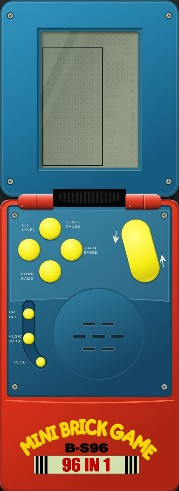
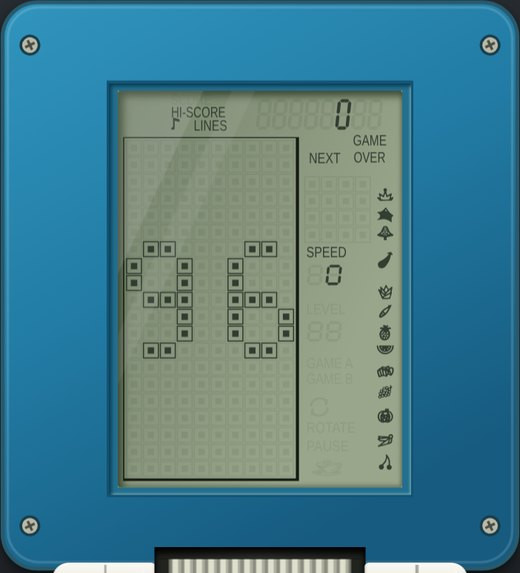
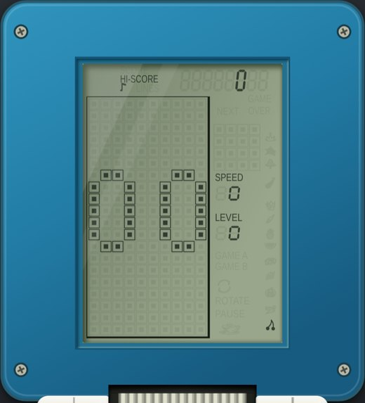
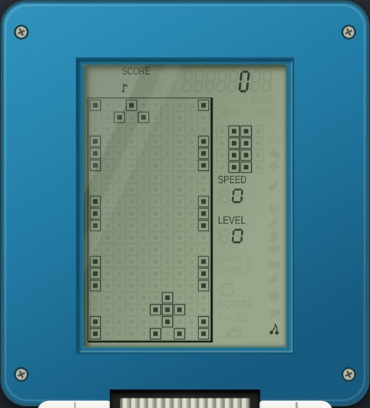

# Mini Brick Game B-S96 · 96 IN 1

Вторая модель группы **Другие**, адрес `?toy=minibrick`. Играющая модель: свой корпус и ЖК, своя консоль (`src/brick/miniConsole.ts`), общие игровые ядра проекта. В админке модели нет: набора игр для настройки у неё нет, формат опубликованной конфигурации не менялся.

## Референс и допущения

Владелец предоставил фотографии открытой приставки (крупно — экран со всеми включёнными сегментами, заставка «96», меню с числом «01», нижняя половина с кнопками), два логотипа, чёрную иконку чашки паузы и колонку из 13 чёрных значков шкалы. По фото восстановлены красное основание, синяя крышка изнутри и панель управления, яркие жёлтые кнопки, чёрный шлейф, круглый динамик и нижняя наклейка. **Основание и втулки шарнира целиком красные, белого на них нет** (владелец: «корпус снизу полностью красный, и петли тоже»); шлейф чёрный, не белый. Три функциональные кнопки слева (ON/OFF, MUSIC/VOICE, RESET) сидят в одной выемке-ложбине (дно темнее панели, светлая кромка снизу). Кнопки LEFT/LEVEL, START/PAUSE, RIGHT/SPEED и DOWN/GAME образуют ромб, вытянутая наклонная ROTATE — справа; ON/OFF, MUSIC/VOICE и RESET — в ложбине слева от динамика.

Красный знак на закрытой крышке — предварительный: фото закрытого оригинала нет. Рабочие поверхности — 400 × 440 для крышки и 400 × 650 для основания; это оценка по перспективной фотографии. Лист логотипов `public/brand/minibrick-logos.png` подготовлен по двум присланным изображениям.

## ЖК (`src/render/miniScreen.ts`)

SVG с видом 219 × 304; единица — 1/13 шага клетки матрицы; все размеры и положения (подписи, цифры, превью, значки) сняты с крупного фото заставки «96», присланного владельцем. Поля вокруг рисунка узкие, как на фото: рамка стакана почти касается левого края стекла. Стекло в крышке подогнано под эти пропорции (`minibrick.css`). Состав — по фото:

- **Рамка стакана** — тонкая чёрная линия вплотную к клеткам матрицы 10 × 20 (слева и сверху ≈ 1 единица, справа и снизу толще — «тень», как на фото) — видна всегда, **даже при выключенном устройстве**; остальные сегменты при выключенном питании — слабый «призрак» (прозрачность 9 %), включённые — 94 %. Клетка — квадрат-контур почти во весь шаг и квадрат внутри.
- Сверху справа восемь цифр: **шесть — счёт, две последние — число рядов** (LINES; считается по событиям тетриса), слева от них подписи HI-SCORE и SCORE (одна над другой), нота «звук включён» (горит, пока звук не выключен MUSIC/VOICE) и LINES. Нуль в меню и на заставке горит в шестой цифре, как на фото. Цифры слегка скошены.
- Справа от матрицы: NEXT и GAME OVER (двумя строками), превью 4 × 4 из клеток того же размера, что у поля, SPEED и LEVEL (две цифры: старшая показывает только «1»), GAME A, GAME B, значок ROTATE, PAUSE с чашкой.
- Крайняя правая колонка — **шкала из 13 значков** (корона, звезда, гриб, баклажан, агава, перец, ананас, арбуз, стопка фигур, виноград, помидор, бананы, вишни). Контуры сняты с присланной колонки скриптом `scripts/research/mini_icons_trace.py` (OpenCV, сглаживание, кривые Безье; результат — `src/render/miniIcons.ts`, вручную не править). Значки мелкие (≈ клетка в ширину) и стоят по фото неравномерно. В партии и меню горят снизу вверх: число горящих значков — уровень + 1 (на уровне 0 горит одна вишня, как на фото меню); уровней 13 (0–12) — как значков; на заставке горят все.
- Чашка паузы — тот же контур, что у «Морского боя» (`src/render/seaCup.ts`, присланная иконка).

**Заставка «96» зажжена по фото**: горят HI-SCORE с нулём, LINES, NEXT, GAME OVER, SPEED с нулём и вся шкала из 13 значков (LEVEL не горит). Что не видно на фото и сделано по допущению: положение LEVEL, GAME A, GAME B, ROTATE и PAUSE; когда горят GAME A, GAME B и значок ROTATE (сейчас — только в режиме «все сегменты», он есть в рисовальщике, но игрой не вызывается); форма семисегментных цифр.

## Заставка и меню

1. **ON/OFF** — заставка: рожица (пустой экран ≈ 0,5 с, затем лицо с морганием, подмигиванием и широкой улыбкой ≈ 2,5 с), потом неподвижное «**96**» на матрице. Кадры рожицы нарисованы по описанию владельца, а не сняты с видео. Звук заставки — короткий восходящий сигнал, тоже допущение.
2. Любая кнопка открывает меню (на «96» или раньше, во время рожицы). **Меню — только число**: крупное двузначное число на матрице (**00…96**), без названий и превью; сверху HI-SCORE (рекорд номера), справа SPEED и LEVEL как в меню на фото (по умолчанию 0 и 0), горит одна вишня.
3. Кнопки меню: **DOWN/GAME** — следующий номер, **ROTATE** (и клавиша ↑) — предыдущий (допущение: на 97 номеров листать только вперёд неудобно), **LEFT/LEVEL** — уровень 0–12, **RIGHT/SPEED** — скорость 0–9 (по кругу), **START/PAUSE** — запуск.

## Игры (`src/brick/games/mini.ts`)

Владелец: настоящие только две — 00 и 01 («гонки» в двух вариациях), а 02–96 — вариации тетриса.

| Номера | Игра | Ядро |
| --- | --- | --- |
| 00, 01 | Гонки: «две полосы», «три полосы» | `RacingGame` (схемы 0 и 1 донора) |
| 02–96 (95 штук) | Вариации тетриса | `TetrisCore` с набором из 95 вариантов |

Правил оригинала нет; **какая вариация под каким номером, неизвестно — порядок допущение**: 02–46 — типы 1–45 класса I донора (обычный тетрис без особых фигур, затем семейства рассыпающихся, кислотных, сквозных и случайных фигур и наборы спецфигур), 47–51 — классы J, K, L, M, N (новые ряды по таймеру, смена фигуры вместо поворота, сдвиг поля и сочетания), 52–96 — те же типы 46–90 с перевёрнутым полем. Номер 02 — обычный тетрис.

Управление в партии: LEFT, RIGHT, DOWN — движение; ROTATE (и ↑) — поворот, в гонках — ускорение; START/PAUSE — пауза и продолжение; RESET — в меню (выбор сохраняется); MUSIC/VOICE — звук. После конца игры START начинает ту же игру заново. Отдельной кнопки «вверх» и «огонь» на корпусе нет. Рекорд хранится отдельно у каждого номера (`crocodile-mario:minibrick:NN:hi`). Рейтинга нет.

## Звук (`src/audio/miniTunes.ts`)

Музыка в играх проигрывается **один раз** при старте партии — классические «Коробейники» из tetris brick game, **монофония**: один голос-меандр, 16 тактов 4/4 (две части по 8 тактов), 150 уд/мин, ≈ 25,6 с; тема не повторяется и не звучит в меню. Высота — равномерная темперация от ля первой октавы 440 Гц; с настоящего устройства запись не снималась, это общеизвестная мелодия, а не расшифровка прошивки. Остальные сигналы (шаг меню, движение, поворот, посадка) — короткие допущения; ряды, конец игры, авария и бонус используют общие сигналы Brick Game.

## Поведение страницы

- Три вида: закрытая, полная, только экран; крышка открывается щелчком или Enter/пробелом. Включённую игрушку закрыть нельзя (сначала ON/OFF). В виде «только экран» касание включает игрушку, открывает меню и запускает партию.
- Клавиатура: стрелки / WASD — направления, ↑ как ROTATE, Enter — START/PAUSE, P / Esc — пауза, O — ON/OFF, M — звук. Те же действия работают с геймпада и экранных кнопок.
- Скрытие вкладки или потеря фокуса ставят партию на паузу.
- Общие язык RU/EN, тема, пульт справа (звук, громкость, вид, дубль кнопок), справка; цвет корпуса фиксирован по референсу. Питание переходит на следующую игрушку при переключении (как у остальных моделей).
- При `?debug` в `window.__minibrick` лежит консоль (для проверок).

## Проверки

`tests/brick/miniConsole.test.ts` (97 номеров, заставка, меню, настройки, запуск всех 97 игр, партия до конца), `tests/audio/miniTunes.test.ts` (мелодия и сопоставление событий), `tests/smoke/minibrick.spec.ts` (рамка при выключенном питании, заставка, меню и шкала, партия, пауза, RESET, звук, телефон, «только экран», переключение игрушек).

## Что осталось уточнить

Фотографий закрытого оригинала, видео заставки и ЖК в движении нет: точные кадры рожицы и «96», условия включения LINES, GAME A/B и ROTATE, номера и состав вариаций тетриса, звуки меню — по появлении материалов.
