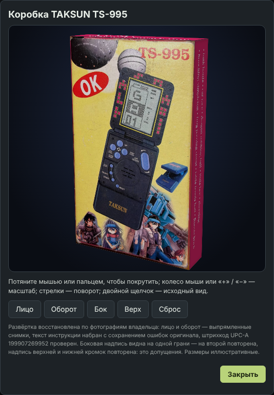

# TAKSUN TS-995 · 9999 in 1

Складная игрушка с синим корпусом и розовыми кнопками. В коллекции пока **только корпус**: игр, звука и поведения оригинала ещё нет (значок готовности ○ «Только корпус», бренд TAKSUN).
Адрес — `…/?toy=taksun`. Игры для неё будут сделаны позже; корпус, экран и левая панель готовы под них.

## Источники и границы

- Фотографии владельца (26 октября 2026): основание с кнопками крупно, крышка с декором крупно, закрытая игрушка с лучником и табличкой TAKSUN, игрушка целиком в руке. Цвета на двух
  фото искажены тёплым светом; синий корпус взят по снимку закрытой игрушки, розовый — по снимку целиком.
- [Логотипы TAKSUN](https://github.com/grayhex/ApolloBrickGames/blob/914601f/docs/research/TAKSUN-brand-assets.zip): векторные трассировки с фото — лучник «9999 in 1 BRICK GAME» (в корпус идёт трафаретная версия: синий пластик виден сквозь непропечатанные
  места) и золотая надпись TAKSUN. Лежат в `public/brand/taksun-upper-logo-stencil.svg` и `public/brand/taksun-wordmark.svg`. Это реконструкция по поцарапанному фото, не заводской файл.
- Развёртка коробки TS-995: [`docs/research/TS995_packaging_assets.zip`](https://github.com/grayhex/ApolloBrickGames/blob/914601f/docs/research/TS995_packaging_assets.zip) — восстановление по фотографиям владельца (панели лица и оборота, боковые панели, векторная
  раскладка `TS995_box_dieline.svg`). Лицо и оборот — выпрямленные фотографии (на лице печатная картинка с аниме-героями и игрушкой, износ оригинала виден), текст инструкции набран с сохранением
  ошибок оригинала («Russia brick», «get ride of them», «bunching simpleton»), штрихкод UPC-A `199907269952` восстановлен и имеет верную контрольную цифру. **Допущения автора архива:** боковая надпись видна
  на одной грани, на второй она повторена; надпись верхней и нижней кромок повторена по образцу «Танка»; размеры сгибов иллюстративные (бока 340 px, верх и низ 302 px), для промышленной
  печати непригодны.
- Из надписей на коробке известно название модели **TS-995** и набор игр оригинала (tank battle, car race, dragon robbing ball, little bee, shooting, bunching simpleton, frog passing street,
  table tennis ball, Russia brick); 9999 in 1 — надпись на крышке. Эти игры пока не реализованы.

## Отличия от Mini Brick Game B‑S96

Компоновка близка (крышка 400 × 440, основание 400 × 650, ромб кнопок, вытянутая кнопка вращения справа, круглый динамик), но:

| | Mini Brick Game B‑S96 | TAKSUN TS-995 |
| --- | --- | --- |
| Корпус | синяя крышка, красное основание | синий целиком (крышка, основание, втулки шарнира); шлейф чёрный |
| Кнопки | жёлтые | розовые |
| Служебные кнопки | три в ложбине: ON/OFF, MUSIC/VOICE, RESET | четыре: PAUSE/START, VOLUME, ON/OFF в изогнутой ложбине слева и RESET ниже, вне ложбины |
| Подписи | LEFT/LEVEL, START/PAUSE, RIGHT/SPEED, DOWN/GAME, ROTATE | UP, RIGHT/SPEED, LEFT/LEVEL, DOWN/GAME, DIR / ROTATE; PAUSE START, VOLUME, ON/OFF, RESET |
| Ромб | START/PAUSE — верхняя кнопка | UP — верхняя кнопка; в центре ромба контурная крестовина из четырёх треугольников |
| Основание | ровная панель | поперечный уступ под ромбом; внизу вытравленная выемка с надписью TAKSUN |
| Экран | рамка стакана и шкала значков | обводка стакана: слева, сверху, справа сплошная, **внизу пунктир** (10 штрихов), разделитель справа; без шкалы |
| Декор крышки | нет | тонкая светлая рамка вокруг экрана и восемь групп тетрамино (бело-оранжевые клетки) по бокам и над экраном |
| Закрытая крышка | красная, надпись «96 IN 1» | синяя, лучник и надписи «9999 in 1 BRICK GAME» |

Табличка TAKSUN внизу — **не выделенная плашка**, а едва заметная вытравленная выемка (владелец: «там просто немного вытравлено»): чуть темнее корпуса, тонкая тень сверху и слабый свет снизу, золотые
буквы без рамки.

## Что работает

- Три вида, как у остальных моделей: закрытая (лучник), полная, «только экран». Крышка открывается щелчком.
- Девять кнопок с подписями как на корпусе (`TAKSUN_KEYS`), нажатие и фокус с клавиатуры; ON/OFF или клавиша `O` показывает статус «Игра пока в разработке» (питание не включается).
- Экран с обводкой стакана виден всегда (`taksunLcd`), независимо от питания.
- Левая панель: наклейка TAKSUN, миниатюра **3D-коробки TS-995** (открывается в диалоге, вращается мышью, пальцем и стрелками; шесть граней по развёртке), статус и описание корпуса. RU и EN.
- Каталог устройств: бренд TAKSUN, значок ○; бренд и готовность меняются в админке.

## Файлы

| Файл | Что делает |
| --- | --- |
| `src/app/taksunModel.ts` | корпус: крышка, основание, кнопки, экран, миниатюры; `applyTaksunModel()` |
| `src/app/taksun.css` | цвета корпуса и кнопок, окно экрана, шлейф |
| `src/app/exhibit.css` | общая раскладка экспонатов (Alibaba, Mini, TAKSUN) |
| `src/app/exhibitApp.ts` | приложение-экспонат: виды, пульт, диалог статуса, левая панель с 3D-коробкой |
| `src/app/packs.ts`, `public/brand/box-taksun/` | модель 3D-коробки `taksun` и шесть граней (`front`, `back`, `left`, `right`, `top`, `bottom`; нарезаны из панелей архива, webp) |
| `tests/smoke/taksun.spec.ts` | корпус, кнопки, обводка стакана, подложка, 3D-коробка, переключение, телефон |

