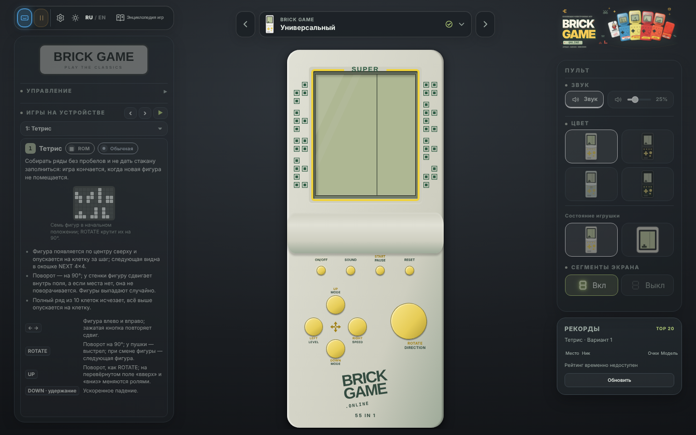
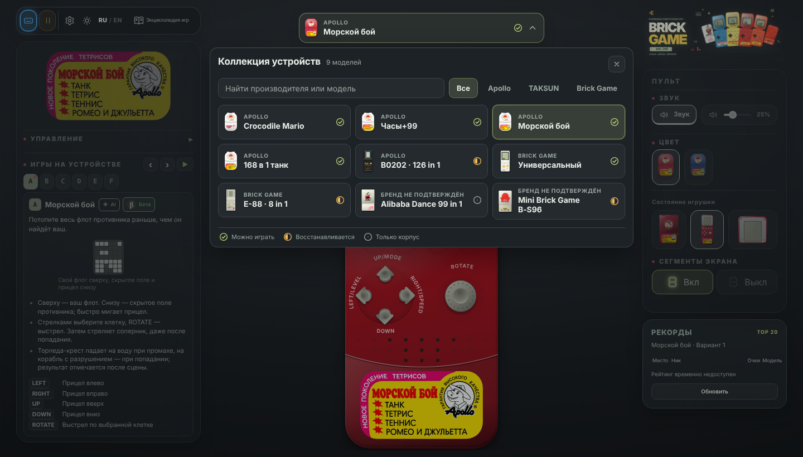
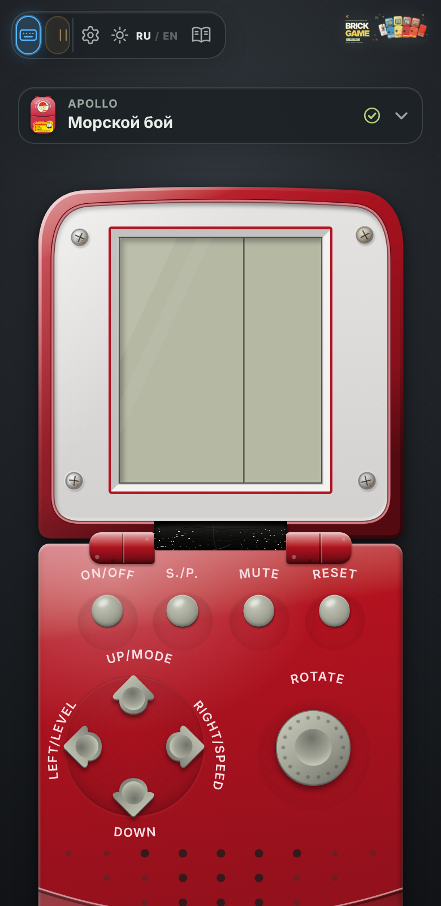
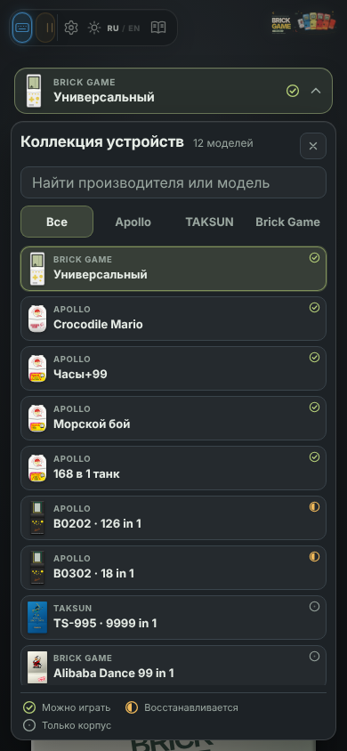
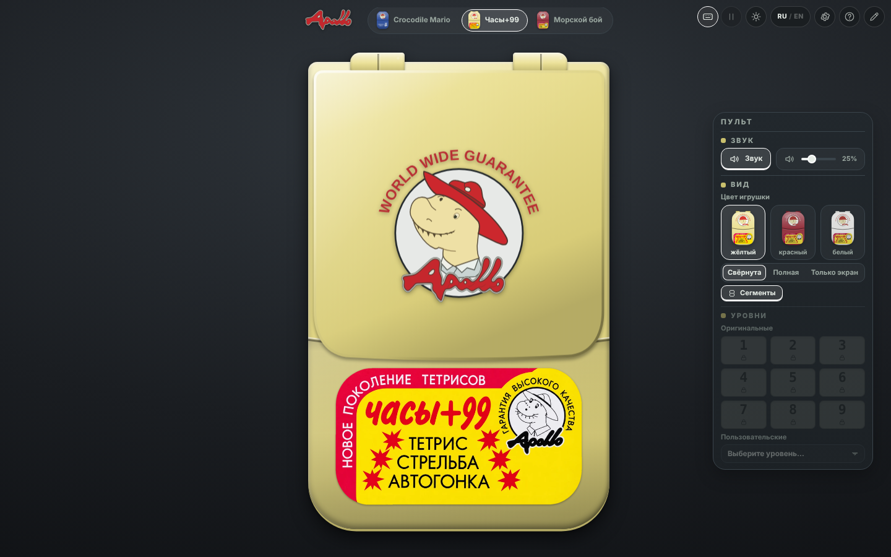
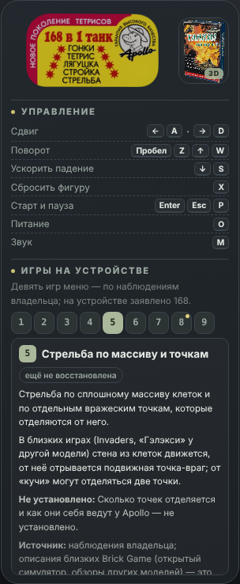
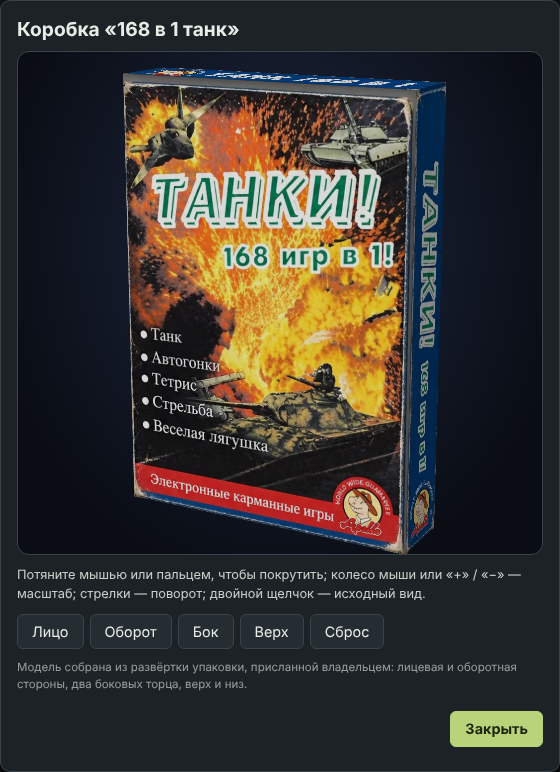
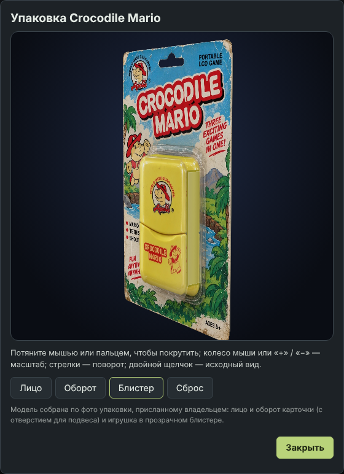
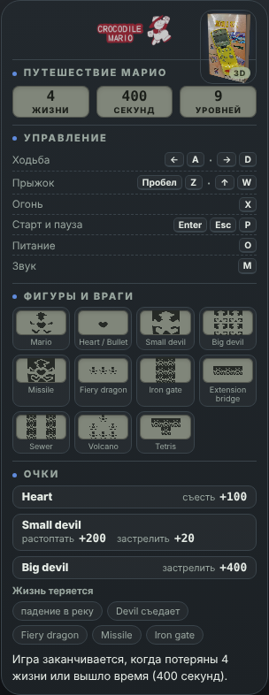

# Корпуса коллекции Apollo и Brick Game

В коллекции четырнадцать моделей. Этот раздел описывает четыре складные Apollo; [E‑88 и B0202](devices/e88-b0202.md) — отдельные моноблоки с собственными LCD, кнопками и профилями; [TAKSUN TS-995](taksun.md) — складной корпус без игр, [Mini Brick Game B‑S96](minibrick.md) — играющая модель на своём корпусе.

У четырёх складных Apollo корпус один — **раскладушка** с шарниром, четырьмя круглыми кнопками, крестовиной, большой кнопкой, динамиком и
наклейкой на «подбородке», — но «аппаратная часть» у каждой своя: экран, рамка вокруг него, кнопки и их подписи, наклейка, цвета. Исключение — отливка нижней половины: у Crocodile Mario, «Морского боя», «168 в 1 танк» и «Часов+99» она **одна** (круглые кнопки в лунках, клавиши-стрелки, три ряда отверстий динамика, шов; `cast: 'sea'`, `src/app/seaBody.ts`; у Mario её применяет `startApp`), различаются только подписи, цвета, наклейка или логотип и экран.

Вверху страницы по центру — компактная панель **выбора устройства**: миниатюра, производитель и модель, значок готовности и стрелка. Нажатие на неё раскрывает вниз
[каталог устройств](#каталог-устройств) со всеми моделями коллекции. Игрушка выбирается адресом:

| Адрес | Игрушка | Игра |
| --- | --- | --- |
| `…/` | Crocodile Mario | оригинальный движок, девять уровней (приближение) |
| `…/?toy=clock99` | Часы+99 | консоль с меню на общем Brick Game: десять пунктов (1–3 с наклейки, 4–10 — подборка проекта) |
| `…/?toy=seabattle` | Морской бой | консоль с меню на общем Brick Game: A–F (морской бой, танки, Ромео и Джульетта, два тетриса, арканоид); меню, заставка, анимации, мелодии и корпус — по фото и видео оригинала ([sea-battle-originals.md](brick/sea-battle-originals.md)) |
| `…/?toy=tank168` | 168 в 1 танк | консоль с меню на общем Brick Game: девять игр меню |

**Что открывается без параметра.** Сайт без `?toy=` открывает универсальный Brick Game (`DEFAULT_TOY` в `src/app/toys.ts`); Crocodile Mario — `…/?toy=mario`, неизвестное значение параметра тоже ведёт к универсальной модели. Ссылка карточки каталога на Brick Game параметра не содержит, на остальные — содержит.

**Универсальный Brick Game: корпус.** Жёлтая рамка лежит вплотную к вдавленному стеклу экрана (ровный скруглённый прямоугольник); в разрыве её верхней линии напечатано **SUPER** цветом узора (как на оригинале серии SUPER). Винтов нет, надписи «DOT MATRIX • 10 × 20» и линий динамика нет. По бокам экрана — узор из вложенных квадратов в двух столбцах: четыре группы с каждой стороны, левая и правая стороны разные; рисунок восстановлен по фотографии оригинала (допущения: шаг решётки, цвет, зазор до рамки). **Кнопки** — гладкие, без текста и значков: подписи напечатаны рядом с ними в две строки, как на оригинале — слово кнопки и её дело в меню (`UP`/`DOWN` — `MODE`, `LEFT` — `LEVEL`, `RIGHT` — `SPEED`, большая кнопка — `ROTATE` / `DIRECTION`), между кнопками направлений — печатный крест из четырёх стрелок. Надпись на корпусе — по снимкам оригинала (серии E-S88 и E3000): «BRICK» и «GAME» двумя параллельными строками под углом вверх вправо, ниже и правее тонкое «N IN 1», где N — число игр, назначенных универсальной модели сейчас (`TOYS.brickgame.games.length`: меняется настройкой в админке), рядом — красный круглый знак с улыбкой и **двумя пальцами «V» на каждой руке** (иероглифы под знаком не воспроизведены: что на них напечатано, не установлено; цвет знака у разных серий разный — здесь красный). **По умолчанию универсальной модели назначены все 55 игр каталога, кроме Mario** (в том числе два пары общих реализаций: `tetris-big`/`tetris-pentix` и `shooting`/`shooting-array`); порядок — по возрастанию редкости по Retro Consoles Wiki (Common → Uncommon → Rare → Ultra Rare → Mobile; [`docs/brick/rarity.md`](brick/rarity.md)), внутри ступени — порядок админки; в левой панели список разбит на группы ступеней, у открытой игры — значок редкости. Кнопка **FIRE нарисована только у игры, без которой не обойтись, — Jig Saw** (`BrickGameDef.usesFire` = `needs: ['fire']`); у Tetris, Pentix, Dr. Mario, Columns, Sokoban, Peg Solitaire, «Ромео и Джульетта» и остальных её нет, клавиатурный FIRE не вводится (как и на Apollo), справка её не упоминает (`guideForBody`). Атрибут `data-fire` на корпусе (`ConsoleCabinet.buttons`).

**Человечек на экране «Brick Game»** — тонкий рисунок-сегмент (мальчик с хохолком, руки в стороны) в трёх положениях: стоит, радуется (руки вверх, улыбка, ноги шире), огорчён (руки опущены, брови, слезинка). Радуют события `lines`, `bonus`, `win`, `levelUp` (≈1,5 с), огорчают `crash`, `lifeLost` (≈2 с) и `gameOver` (остаётся, пока не начата новая партия); на паузе и в меню он стоит. Какое положение горит — `Mood` в `TetrisScene`, выбор — `moodOf` в `src/app/cabinet.ts`; остальные положения при включённом слое сегментов еле видны. Допущения: набор событий и время реакции, рисунок по небольшому снимку-образцу.

**Пульт: дубль кнопок корпуса.** Пока видна только крышка с экраном (вид «только экран»), в правой панели сверху появляется блок «Кнопки корпуса»: ON/OFF, START / PAUSE и RESET (у Mario — без RESET: на его корпусе такой кнопки нет). Они работают так же, как кнопки на корпусе (`ToyPanel.bindRemote`), чтобы включить и запустить игру мышью.

Актуальный перечень игр и состояние готовности — в [brick/STATUS.md](brick/STATUS.md) и [brick/library.md](brick/library.md); эта страница описывает корпуса. Раздел «Тетрис-заглушка» ниже — историческая запись о первой версии (до подключения Brick Game), не текущее состояние.

## Каталог устройств

Каталог заменил прежнюю горизонтальную карусель. **По бокам закрытой панели — стрелки «предыдущее / следующее устройство»**: они листают модели по кругу в порядке каталога (универсальный первым, за последней моделью снова первая), подпись и подсказка называют соседнюю модель, при открытом каталоге стрелка закрывает его и переключает устройство; панель остаётся над серединой консоли (`devpick__step`, `neighbour()` в `toySwitch.ts`). Закрытая панель стоит там же, где стояла карусель, — по центру над консолью; высота шапки и положение консоли не меняются
(на телефоне панель занимает всю ширину окна). Нажатие в любом месте панели (или стрелка вниз при фокусе на ней) раскрывает каталог **вниз поверх страницы**; ничего вокруг не сдвигается. Каталог **широкий и компактный**: до 1120 px, заголовок, поиск и категории в одной строке, карточки по 176 px и шире (на 1440 px — две строки по шесть карточек, около 210 px высоты), значок готовности — в углу карточки, чтобы названию хватало ширины и слово «Универсальный» не переносилось по буквам; на телефоне — одна колонка.

**Состав каталога.** Заголовок «Коллекция устройств» с числом моделей и кнопкой закрытия, одно поле поиска (производитель, название, обозначение: `E88`, `e-88`, `B0202`, `126 in 1`) и категории
**Все | Apollo | TAKSUN | Brick Game** (по умолчанию «Все», фильтров по готовности нет). Модели — карточки одной сетки: настоящая миниатюра корпуса (`miniConsole` из `shellPicker.ts`,
цвет — `thumbShell` из админки), мелкий вторичный текст — производитель, основной — модель, справа один значок готовности. Универсальный Brick Game — **первая модель каталога** (`FIRST_DEVICE` в `deviceCatalog.ts`; она же выбрана по умолчанию), дальше бренды подряд: Apollo, TAKSUN, Brick Game. Новая модель, добавленная в `TOY_IDS`, появляется в каталоге сама: запись в `DEVICE_DEFAULTS` обязательна, без неё проект не соберётся.

| Значок | Готовность | Смысл |
| --- | --- | --- |
| ✓ | Можно играть | есть играбельная реализация; это не утверждение, что оригинал воспроизведён точно |
| ◐ | Восстанавливается | реконструкция продолжается: часть игр, экрана или поведения пока приближённая |
| ○ | Только корпус | игр и поведения оригинала ещё нет |

Готовность — **явное решение** в `src/app/deviceCatalog.ts` (или настройка админки), а не вычисление по числу готовых игр, процентов нет. У значка есть подсказка (`title`) и текст для скринридеров.

**Правила классификации** (ничего не выводится по названию, форме корпуса и `ToyModel.family`):

- **Бренд** — производитель и одновременно категория фильтра: Apollo, TAKSUN или Brick Game. **Если другой бренд не установлен, модель считается Brick Game**: пометки «бренд не
  подтверждён» нет (так записаны E‑88, Alibaba и Mini Brick). Подтверждённый бренд — печать на корпусе или упаковке, документы репозитория или решение владельца: Apollo — Crocodile Mario,
  Часы+99, Морской бой, 168 в 1 танк, B0202; TAKSUN — TS-995 (печать «TAKSUN» на корпусе и коробке).
- Модели с `family: 'other'` **не** сводятся в TAKSUN автоматически; чтобы отнести новую модель к бренду, нужен источник — его записывают в комментарии рядом с записью.
- **Админка.** Бренд и готовность каждой модели задаются в блоке «Каталог устройств» страницы `/admin` и публикуются вместе с остальной конфигурацией (`config.catalog`). В конфигурации
  хранятся только отличия от значений по умолчанию из `deviceCatalog.ts`: совпадающие записи при проверке отбрасываются, документ без отличий не содержит поля `catalog`. Если у бренда
  не осталось моделей, его вкладка показывает «В этой категории пока нет моделей», а не прячется.

| Модель | Бренд (по умолчанию) | Готовность (по умолчанию) |
| --- | --- | --- |
| Crocodile Mario, Часы+99, Морской бой, 168 в 1 танк | Apollo | ✓ |
| B0202 · 126 in 1 | Apollo | ◐ |
| B0302 · 18 in 1 | Apollo | ◐ |
| TS-995 · 9999 in 1 | TAKSUN | ○ |
| Универсальный | Brick Game | ✓ |
| E‑88 · 8 in 1 | Brick Game | ◐ |
| E‑23 Plus Mark II · 96 in 1 | Brick Game | ◐ |
| Alibaba Dance 99 in 1 | Brick Game | ○ |
| Mini Brick Game B‑S96 | Brick Game | ◐ |
| [FM‑38 · 2 in 1](devices/fm38.md) | Brick Game | ◐ |
| [Prince 皇太子 · 118 in 1](devices/prince118.md) | Brick Game | ◐ |

**Поведение.** Открытие всегда показывает все модели (поиск и категория сбрасываются); фокус попадает на текущую карточку. Выбор карточки закрывает каталог и переключает игрушку тем же
механизмом, что и раньше (см. ниже): страница не перезагружается, адрес и история обновляются, вид и цвет корпуса сохраняются, панель показывает новую модель. Закрывают каталог Escape, щелчок
мимо, повторное нажатие на панель, кнопка закрытия, уход фокуса со страницы каталога и кнопка «назад» браузера.

**Ввод и прокрутка.** Пока каталог открыт, игровой ввод заблокирован (`src/app/inputLock.ts`: клавиатура и геймпад в `InputHub`, игры ставятся на паузу), зажатые клавиши отпускаются и после закрытия
не «залипают». Щелчок мимо только закрывает каталог и до кнопок игрушки под ним не доходит (под каталогом лежит перехватывающая подложка). Страница под каталогом не прокручивается: колесо над подложкой и шапкой гасится,
список карточек прокручивается внутри каталога.

**Клавиатура.** Стрелка вниз на панели открывает каталог. Стрелки двигают по сетке, Home/End — в начало и конец, стрелка вверх из первой строки — в поиск, Enter и пробел выбирают карточку; Tab идёт
по одной остановке на группу (кнопка закрытия, поиск, текущая категория, текущая карточка); стрелки влево/вправо на вкладках переключают категории.

**Адаптивность.** Три колонки на десктопе, две на планшете (< 1100 px), одна на телефоне (< 560 px); ширина каталога не больше 760 px, высота ограничена видимой областью окна (`visualViewport`: с экранной
клавиатурой каталог сжимается), отступы учитывают `safe-area`. `prefers-reduced-motion` отключает анимацию появления.

**Локализация.** Подписи интерфейса — RU/EN (`picker.*` в `messages.ts`); названия брендов и моделей не переводятся.

Проверки: `tests/app/deviceCatalog.test.ts`, `tests/app/inputLock.test.ts`, `tests/smoke/picker.spec.ts` (открытие и закрытие, поиск, категории, ввод, клавиатура, адаптив для 15 карточек, RU/EN).

## Обводка стакана на экране

У экранов на холсте (Часы+99, 168 в 1 танк, «Морской бой» и универсальный Brick Game) постоянно виден напечатанный разделитель справа; дополнительные линии вдоль краёв экрана не рисуются. У моноблоков с оригинальными SVG при выключении скрывается группа сегментов `#display`, а рамка `#frame` остаётся видимой. У Mini Brick Game и TAKSUN рамки задаются собственной разметкой.

## Переключение без перезагрузки

Карточки каталога — обычные ссылки (работают и без скрипта, и по Ctrl/⌘/Shift/средней кнопке в новой вкладке), но обычный щелчок **меняет игрушку на месте**
(`src/app/host.ts`): страница не перезагружается, адрес меняется через `history.pushState` (`?toy=…`), «назад» и «вперёд» тоже переключают на месте.

- **Сохраняются** вид (свёрнута / полная / только экран), цвет корпуса и питание. Цвет остаётся, если он есть у новой игрушки; если нет — игрушка открывается своим цветом, но
  **выбор игрока не теряется**: следующая игрушка, где этот цвет есть, получит его снова (жёлтый → «Морской бой» красный → «Часы+99» снова жёлтый). `level`, `seed` и т. п. из адреса
  при переключении не переносятся, `debug` остаётся.
- **Перерисовывается минимум.** Шапка, угловые меню, диалоги, каркас игрушки (крышка, шарнир, нижняя половина) и положение на странице остаются теми же элементами. Заменяются только
  лицевая панель крышки (экран, светодиоды, рамка) и нижняя половина (кнопки, подписи, наклейка) — из чистого снимка разметки Crocodile Mario, который хозяин страницы делает при запуске, и
  боковые панели. Данные Crocodile Mario и картинки наклеек подгружаются заранее, поэтому замена проходит за один кадр: прежнее приложение снимается только после того, как новое готово.
- **Прежняя игрушка снимается целиком.** Каждое приложение (`startApp`, `startTetrisApp`) возвращает хэндл: `dispose()` снимает обработчики окна, документа и постоянных элементов (через
  `AbortSignal` — `src/app/lifecycle.ts`), цикл кадров, таймеры, наблюдатель за размером, подписки на язык, ввод (`InputHub.detach`) и звуковое устройство (`WebAudioPort.dispose`); `carry()` отдаёт
  вид, цвет и питание следующей игрушке. Поэтому клавиша, переключатель фона или языка срабатывают один раз, а не по разу за каждую прежнюю игрушку (проверено в `tests/smoke/switch.spec.ts`).

Системные настройки оформлены в одном стиле с выбором игрушки: справа сверху находятся сегменты, фон, язык и диалоги, слева — индикаторы ввода и паузы. Обе боковые панели приглушены до наведения или фокуса с клавиатуры; на сенсорных экранах они читаемы без наведения.

## Чем отличаются игрушки

| | Crocodile Mario | Часы+99 | Морской бой | 168 в 1 танк |
| --- | --- | --- | --- | --- |
| Цвета корпуса | синий, красный, жёлтый, белый | **жёлтый, красный, белый** | **красный, синий** | **красный, жёлтый** |
| Экран | 13 × 6 ячеек, широкий, толстая рамка | портретный: матрица **10 × 20** + боковая панель, тонкая рамка | то же | то же |
| Ячейка | сегменты героя/блока/сердца (спрайты владельца) | **звёздочка** (цветок из шести лепестков) в рамке | **точка в прямоугольнике** | **точка в прямоугольнике** («классические» сегменты) |
| Светодиоды над экраном | есть | есть | **нет** | есть |
| Оформление рамки | горы и три фигурки под экраном | тонкая линия у края серой панели + завитки и ромбик по бокам от экрана (цвет — по корпусу; у жёлтого золотистый, у белого красный) | линия цвета корпуса вплотную вокруг экрана | как у «Часов+99»: тонкая линия, завитки и ромбик по бокам (красные / золотистые) |
| Круглые кнопки (слева направо) | ON/OFF, S./P., SOUND, FIRE | ON/OFF, MUTE, TIME/GAME, START/PAUSE | ON/OFF, S./P., MUTE, RESET | ON/OFF, S./P., MUTE, RESET — как у «Морского боя» |
| Крестовина | UP, LEFT, RIGHT, DOWN | + +, ALARM SET, TIME SET, − | UP/MODE, LEFT/LEVEL, RIGHT/SPEED, DOWN | UP/MODE, LEFT/LEVEL, RIGHT/SPEED, DOWN — как у «Морского боя» |
| Большая кнопка | JUMP | ROTATE (подпись снизу — ALARM ON/OFF) | ROTATE | ROTATE |
| Подбородок | логотип Crocodile Mario | наклейка «Часы+99» | наклейка «МОРСКОЙ БОЙ / Новое поколение» | наклейка «168 в 1 танк» |
| Левая панель | **карточка устройства**, справка по упаковке | карточка устройства, **вкладки игр** (1–4) | карточка устройства, **вкладки игр** (A–F) | карточка устройства со ссылкой на **3D-коробку**, **вкладки игр** (1–9) |
| Правая панель | звук, музыка, вид, уровни, спидран | звук, миниатюры цвета и вида, **уровни выключены** | то же | то же |

Цвета, **которых на фото оригинала нет, не сделаны**: у «Часов+99» нет синего, у «Морского боя» — жёлтого и белого, у «168 в 1 танк» — синего и белого. Цвет по умолчанию берётся из настроек (там по умолчанию синий): у «Морского боя» он бывает, а у «Часов+99» синего нет — игрушка открывается жёлтой. Если цвета из настроек у
игрушки не бывает, берётся её собственный цвет по умолчанию (жёлтый у «Часов+99», красный у «Морского боя» и «168 в 1 танк»).

### Панель «Цвет»

Блок справа называется **«Цвет»**; в нём только подтверждённые цвета из назначенной модели палитры. Неподтверждённые цвета не рисуются и не участвуют в клавиатурной навигации. У Crocodile Mario доступны синий, красный, жёлтый и белый; у «Часов+99» — жёлтый, красный, белый; у «Морского боя» — красный и синий; у «168 в 1 танк» — красный и жёлтый. Вид корпуса выбирается отдельными миниатюрами.

### Жёлтый корпус

Жёлтый по фото «Часов+99» **тусклее**, чем был у Crocodile Mario: бледный кремово-жёлтый пластик (`--rim: #ebe093`, `--rim-dark: #d8cc78`), а не насыщенный лимонный
(`#f3dc3f`). Поправлен и жёлтый корпус Crocodile Mario — палитра `[data-shell='yellow']` общая. Оттенок оценён по четырём фото (при дневном и ламповом свете цвет на снимках
заметно плавает: от почти белого крема до жёлтого), поэтому это **ориентир, а не измерение**.

## Наборы игр у консолей

У консолей игры **пересекаются** (тетрис — у всех четырёх, стрельба — у Mario, «Часов+99» и «168 в 1 танк», гонки — у «Часов+99» и «168 в 1 танк», танк — у «Морского боя» и «168 в 1 танк»),
поэтому игра описана один раз — в каталоге `src/games/catalog.ts` (`GameId`, названия RU/EN, есть ли движок), а набор игр **закреплён за консолью** полем `games` модели (`src/app/toys.ts`):
игры в порядке и с названиями **как напечатано на наклейке или упаковке**, у каждой — состояние на этой консоли (`ready` — играет настоящая игра, `placeholder` — вместо неё заглушка, `planned` — ещё не восстановлена).
Когда будут восстановлены логика и настройки каждой игры (в том числе индивидуальные — в «админке»), они подключатся к каталогу по `id`; набор консоли решает, какие игры ей доступны.

| Консоль | Набор игр | Откуда |
| --- | --- | --- |
| Crocodile Mario | MARIO (9), TETRIS (99), SHOOTING (1) | упаковка; в проекте есть только Mario (приближение) |
| Часы+99 | 1 часы, 2 тетрис, 3 стрельба, 4 автогонка | наклейка и подписи кнопок; **что встроено на самом деле, уточняется** |
| Морской бой | A морской бой, B танки, C Ромео и Джульетта (постройка лесенки), D тетрис усложнённый с большими фигурами, E обычный тетрис, F арканоид | список владельца; на наклейке напечатано «танк, тетрис, теннис, Ромео и Джульетта» — «теннис», видимо, и есть арканоид (не подтверждено) |
| 168 в 1 танк | 1 танки (5 вариантов), 2 лягушка (Frogger), 3 гонки, 4 гонки со стрельбой, 5 стрельба по массиву и отдельным точкам-врагам, 6 стрельба по фигурам и их достройка, 7 строитель, 8 тетрис (51 вариант), 9 тетрис усложнённый (Pentix) | наблюдения владельца; на наклейке и упаковке заявлено **168 игр** (`gamesCount`), названы девять |

Играют Mario (свой движок) и «кирпичные» игры (`src/brick`): у «Морского боя» и «168 в 1 танк» — консоль с меню (девять игр и режимы B, D, E, F), у «Часов+99» — та же консоль с меню (десять пунктов); `engineOf(модель)` выбирает приложение. Набор виден в справке («?») в разделе «Игры на устройстве»: название и
состояние каждой игры, а у игрушек с тетрисом ещё и **в левой панели — вкладками** (ниже). «Гонки» и «автогонка» — одна игра (`racing`) с разным названием у разных консолей; «гонки со стрельбой», «стрельба по массиву и точкам», «стрельба по фигурам», «тетрис Pentix», «тетрис с большими фигурами» и «арканоид» — отдельные игры каталога: совпадение названий не доказывает одинаковой логики.

**Игры восстанавливаются по открытому симулятору** (правила донора; подробности — `docs/brick-games.md`, `docs/brick/*`); у каждой игры в наборе консоли `status` (`ready` — играет, `planned` — ещё нет), а `engine` — в каталоге (`src/games/catalog.ts`).

## Левая панель: вкладки игр

У «Часов+99», «Морского боя» и «168 в 1 танк» левая панель устроена так: **карточка устройства** (см. ниже: логотип, бренд и модель, год, питание, число игр и вариаций, список игр, источники, ссылка на 3D-коробку) и раздел **«Игры на устройстве»** с вкладками. Схемы клавиш в панели нет: привязки видны и меняются в настройках управления.
Вкладки отмечены так, как игры отмечены в меню устройства: **1…9** у «168 в 1 танк», **A…F** у «Морского боя», **1…4** у «Часов+99». Открыта та игра, что играет сейчас (тетрис: 8, E и 2), и на её вкладке стоит точка; выбор
не сбрасывается при смене языка и настроек, а при переключении игрушки начинается с её играющей игры. Вкладки — ARIA-`tablist`: стрелки, Home и End перебирают их по кругу, в порядке табуляции остаётся одна; выбор вкладки (щелчком или стрелками) переключает и меню консоли, пока она в меню.

Содержимое вкладки собирает `InfoPanel.gamePanel`. Шапка — номер и название, **состояние в проекте** и число вариантов (то, что показывает сама консоль: танки — 5, тетрис — 51, у «Морского боя» — по списку владельца).
Дальше две ветки.

- **Игра играет по правилам ядра (`status: 'ready'`, консоль с меню)** — описание **«по факту реализации»** (`src/brick/guides/*.ts`, тип `GameGuideData` из `src/brick/guide.ts`, вывод — `src/app/guidePanel.ts`): что за игра и цель, четыре факта-числа,
  раскрывашки **«Правила»** (открыта), «Кнопки» (подписи кнопок корпуса), «Очки, жизни, скорость», «Схемы» (рисунки клетками, какими их рисует сама игра), «Варианты (N)» (названия вариантов, как в меню консоли; подсказка — пометка донор/допущение)
  и «Допущения» (только настоящие допущения), в конце — «Источник». Числа в описаниях берутся из констант игры, а тесты `tests/brick/games/*.guide.test.ts` и `tests/brick/guides.test.ts` сверяют их с поведением игры (жизни, очки, пороги, скорости, число вариантов).
- **Игра ещё не восстановлена или заглушка** — общие сведения (`game.<id>.what/how/open` в `messages.ts`): что за игра, что известно по близким Brick Game и что **«Не установлено»**; у тетриса-заглушки сверху ещё поле, правила и очки.

**Геймплей и запуск из справки.** Рядом со схемой «Поле в начале партии» стоит вторая иллюстрация — **«Геймплей»**: несколько секунд настоящей игры (тот же движок), записанные по простому детерминированному сценарию ввода (`src/app/demoClip.ts`: стрельба с качанием, смена полос, повороты фигур) и проигрываемые по кругу на `<canvas>`; 10 кадров в секунду, запись делается один раз при первом показе игры. Это демонстрация движения, а не игра на результат; при `prefers-reduced-motion` показан один средний кадр без анимации, а цикл прекращается, когда холст убран из панели (смена вкладки, языка, игрушки). Рядом с заголовком «Игры на устройстве» стоят кнопки **‹ ›** (предыдущая / следующая игра по кругу — то же, что стрелки на вкладках или в списке) и **▶** (запустить показанную игру: включить игрушку, если она выключена, вернуться в меню, выбрать игру через `ConsoleCabinet.selectGame` и начать партию, как S./P. на корпусе; если идёт проверка экрана при включении, запуск откладывается до её конца; выключение игрушки в это время отменяет отложенный запуск). У Mario и экспонатов без меню этих кнопок нет.

**Карточка устройства** (`src/app/deviceCard.ts`, данные — `src/app/deviceFacts.ts`, стили — `src/app/deviceCard.css`) — верх левой панели каждой игрушки; она заменила прежнюю шапку с наклейкой и схему «Управление». В карточке: логотип (наклейка остаётся, как была), бренд и модель (из каталога устройств), четыре ячейки — год выпуска, питание, число игр и число вариаций, список игр (просто названия, не больше трёх строк, остальное — «и ещё N», полный список во всплывающей подсказке), значки источников реконструкции (ROM из эмулятора, фото оригинала, видео, вики, материалы владельца, открытый код — у каждого подсказка) и, где есть, ссылка **«3D-коробка»** без миниатюры (`data-box-open`). Мелкие анимации (появление по очереди, «зарядка» батарейки, блик на логотипе, подъём ячеек и значков, вращающийся куб у ссылки, пульс у ROM) выключаются при «уменьшении движения». Год выпуска и питание в репозитории нигде не записаны: **вносятся в админке** (блок «Каталог устройств», поля «Год выпуска» и «Питание», [admin.md](admin.md)) и публикуются вместе с конфигурацией; пока поле пустое, в ячейке прочерк (значения по умолчанию — `year` и `power` в `deviceFacts.ts`, настройки админки важнее). Значки в карточке цветные: у каждого свой оттенок, в светлой теме темнее. Универсальный Brick Game показывает игры, назначенные ему в админке; вариаций у него нет.

**Панель настроек — в правом углу.** Верхняя панель (клавиатура, пауза, настройки, фон, язык, справка) на окне шире 1200 px стоит в правом столбце над картинкой сайта и пультом, по их центру и ширине (`src/app/dockAlign.ts`: `--dock-left` и `--dock-width` пульта справа из `getBoundingClientRect`, `ResizeObserver`), так что три блока — панель, картинка и пульт — одной ширины; подпись кнопки «Энциклопедия игр» в ней скрыта (остаётся подсказка и имя для скринридеров). Картинка сайта и пульт сдвинуты вниз на высоту панели, а левая панель поднялась к верху окна. На узком окне панель остаётся в левом углу, а картинка сайта — в правом, как раньше. Блок **«Рекорды»** не затемняется вместе с остальной карточкой пульта и всегда обведён.

Вкладка занимает всю свободную высоту панели (прокрутка — внутри вкладки).
Тесты: `tests/app/gameGuide.test.ts` (общие тексты на обоих языках), `tests/brick/guides.test.ts` (форма и пределы длины описаний, двуязычность, жизни и числа), `tests/smoke/guide.spec.ts` (вкладки и раскрывашки).

**Откуда сведения** (`docs/research/apollo-tank168-research.md` — присланный владельцем разбор источников):

| Источник | Что взято | Пометка на вкладке |
| --- | --- | --- |
| Наблюдения владельца | список девяти игр «168 в 1 танк» и A–F «Морского боя», число вариантов (5 у танков, 51 у тетриса), «постройка лесенки» у «Ромео и Джульетты» | «наблюдения владельца» |
| Открытый симулятор Brick Game ([n0Live/BrickGame](https://github.com/n0Live/BrickGame), MIT) | как устроены близкие игры: 8 вариантов танков (3–6 врагов), 32 варианта «лягушки», 4 варианта гонок, стена и отделяющиеся точки, добавляющий выстрел «строителя», Pentix | «описания близких Brick Game — это не прошивка Apollo» |
| Описания владельца другой модели (MT1997, «Чапай», «Гэлэкси») | разрушение и достройка фигур выстрелами, две точки-врага, «гонки со стрельбой» | то же |
| Наклейка и упаковка | «часы+99», «МОРСКОЙ БОЙ», кнопки TIME/GAME, ALARM SET, TIME SET | «наклейка и упаковка» |

**Чего нет и что не выдумано.** Точный дамп ROM и таблица режимов именно складных «168 в 1 танк» и «Морского боя» не найдены: описания — **высокоуровневые**, совпадение названий не считается совпадением прошивки,
а «Морской бой» (A), «Ромео и Джульетта», «стрельба» у «Часов+99» и часы описаны только тем, что известно (названием и подписями кнопок), остальное прямо названо «не установлено». «Теннис» с наклейки «Морского боя» мы отождествили с арканоидом (F) **предположительно**.

## 3D-упаковки: коробки «168 в 1 танк» и Crocodile Mario

У двух игрушек в левой панели есть **3D-модель упаковки** (`pack` в модели игрушки, данные — `src/app/packs.ts`): у обеих — обычная коробка из шести граней: у «168 в 1 танк» по присланной развёртке, у Crocodile Mario — лицо по присланному фото упаковки и оборот с оригинальной инструкцией. Просмотрщик у них один (`boxViewer.ts`), различаются картинки граней и положение кнопки.

### Коробка «168 в 1 танк»

В карточке устройства «168 в 1 танк» есть ссылка **«3D-коробка»** (миниатюры упаковки в панели больше нет): щелчок открывает **диалог «Коробка “168 в 1 танк”»** с крупной моделью.
В диалоге коробку можно **рассмотреть и покрутить**: перетаскивание мышью или пальцем (с инерцией, кроме «уменьшения движения»), колесо мыши или «+»/«−» — масштаб (0,55…2,2), стрелки — поворот на 12° / 10°, двойной щелчок, Home и «Сброс» — исходный трёхчетвертной вид; кнопки видов «Лицо», «Оборот», «Бок», «Верх» плавно
поворачивают к нужной грани по кратчайшей дуге. Пока диалог открыт, игра на паузе (как у справки), клавиши в неё не уходят, Esc или «Закрыть» закрывает диалог; геймпад — «назад».

**Как сделана.** Шесть граней-картинок на CSS `transform-style: preserve-3d` (без библиотек и WebGL): ширина 525, высота 750, толщина 122 условных пикселя — по присланной развёртке. Грани вырезаны из неё (лицо и оборот 529 × 746 и 521 × 757, боковые торцы с текстом
«ТАНКИ! 168 игр в 1!», верх и низ с надписью «ТАНК 168 В 1», `public/brand/box-tank168/*.webp`, ≈ 330 КБ); клапаны-«язычки» картона на концах полос отрезаны. Освещение пересчитывается при каждом повороте: на каждой грани тёмный слой, непрозрачность — по нормали грани и направлению света
(`boxMath.faceDim`), поэтому гранёность видна и на плоских картинках; грани обратной стороны скрыты (`backface-visibility`). Масштаб сцены и глубина перспективы меняются вместе (`scale3d` и `perspective: calc(2400px * var(--s))`), чтобы коробка выглядела одинаково и мелкой, и крупной.

**Допущения и ограничения.**

- Размеры взяты по развёртке; толщина и пропорции торцов — оценка (полосы верха и низа шире лица на ≈ 14 %, они сжаты по ширине до размеров лица).
- Грани — плоские картинки с их же потёртостями: ни скруглённых рёбер, ни настоящей бумаги; закрытые клапаны и внутренняя сторона не моделируются.
- Разрешение граней — как у присланной развёртки (лицо ≈ 530 × 750): при максимальном приближении видны пиксели.
- Ориентация торцов (текст читается сверху вниз на обоих боках) принята по развёртке.
- Коробка только у «168 в 1 танк»: у остальных игрушек развёрток нет.
- Освещение (направление и фон) подобрано на глаз.

### Коробка Crocodile Mario

> **Сейчас не выводится.** Модель готова (`PACKS.mario`, картинки в `public/brand/pack-mario`), но по просьбе владельца вывод выключен: коробка выпирала за границы блока левой панели. У Mario нет ни кнопки у логотипа, ни диалога
> (`pack: null` в `src/app/toys.ts`); снимки ниже сделаны до отключения. Чтобы включить, вернуть `pack: 'mario'`, поправить размер миниатюры в CSS (`.side--info:not([data-toy]) .boxbtn`) и восстановить проверки из коммита `1d3e3a6`
> (`tests/smoke/guide.spec.ts`, `tests/smoke/screenshots.spec.ts`); сам диалог проверяют `tests/app/packs.test.ts` и такие же тесты коробки танка.

Кнопка стояла у логотипа в левой панели Mario; диалог «Коробка Crocodile Mario» устроен так же, как у коробки танка: те же кнопки видов («Лицо», «Оборот», «Бок», «Верх», «Сброс») и тот же исходный трёхчетвертной вид (−28° / −14°).
Раньше здесь была блистерная карточка с раскрытой игрушкой и прозрачным пластиком (около семидесяти граней); она убрана — вместо неё обычная коробка.

**Как сделана.** Шесть граней на CSS `preserve-3d` (без библиотек и WebGL), размеры лица 660 × 1053 (как у оборота), толщина 170 условных пикселей:

- **лицо** — присланное фото упаковки (карточка с игрушкой в блистере) как есть: `tools/pack-mario/build.py` выпрямляет карточку по четырём углам в 660 × 1053, отступает от кромки на 14 пикселей (чтобы в лицо не попал фон и скруглённые углы) и закрашивает отверстие для подвеса сглаженным цветом картона вокруг;
  исходник — `tools/pack-mario/source/blister-front.webp`, результат — `public/brand/pack-mario/front.webp` (сплошной прямоугольник). Игрушка в блистере остаётся на лице, как на присланной картинке;
- **оборот** — оригинальная инструкция с карточки (`public/brand/pack-mario/back.webp`, **не изменялась**); её скруглённые углы и отверстие для подвеса прозрачны — за ними виден тот же картон, что на боковых гранях;
- **бока, верх и низ** — картон без рисунка: цвет взят по краям лица (`#b99e84`, градиент вдоль грани), на рёбрах лёгкая тень, чтобы стыки читались.

Освещение — как у коробки танка: тёмный слой на грани по нормали (`boxMath.normalDim`), грани обратной стороны скрыты.

**Допущения и ограничения.** Боков, верха и низа настоящей упаковки на фото нет: **толщина (170) и цвет картона — оценка**, рисунка на них нет (появятся, когда владелец пришлёт фото). Лицо — фото карточки в блистере, поэтому на нём блики плёнки и тени «запечены» и не движутся; размер лица (660 × 1053) взят у оборота, у фото карточки пропорции чуть уже (≈ 0,58 против 0,63), поэтому лицо растянуто по ширине на ≈ 7 %;
это именно карточка, а не коробка из развёртки, — настоящей коробки у Crocodile Mario нет, это модель «как у танка» по просьбе владельца.

### Где ссылка у Mario

Миниатюры упаковки в левой панели больше нет ни у одной игрушки: коробка открывается ссылкой **«3D-коробка»** в карточке устройства. У Crocodile Mario модель упаковки готова (`PACKS.mario`), но вывод по-прежнему выключен (`pack: null` в `toys.ts`): включить его можно одной строкой, ссылка появится в карточке сама, место в потоке панель Mario уже не занимает.

## Тетрис-заглушка (историческая запись)

> **Состояние на момент первой версии, до подключения Brick Game (октябрь 2026).** Сейчас все три консоли играют на общем Brick Game с меню игр ([brick/STATUS.md](brick/STATUS.md)); раздел сохранён как описание ядра `src/tetris` и оболочки. Подтверждённых правил оригинальных прошивок по-прежнему нет — игры остаются реконструкцией.

Оригинальные игры «Часов+99», «Морского боя» и «168 в 1 танк» (наборы — выше) в первой версии **не были восстановлены**:
все три игрушки играли в обычный тетрис, чтобы оболочка, экран и звук можно было проверить целиком. Восстановленные игры заменили
`src/tetris` и `src/app/tetrisApp.ts` как игру по умолчанию — оболочка и аппаратная часть остались.

- **Ядро** — `src/tetris` (без DOM, без `Math.random`; границы проверяет `tsconfig.core.json`): поле 10 × 20, семь фигур, «мешок» (7-bag) на ГСЧ ядра, поворот по часовой с
  простыми «пинками» от стен, автоповтор сдвига (12 тактов, затем каждые 3), мягкое и мгновенное падение, мигающие сгорающие ряды, очки (100 / 300 / 700 / 1500, +1 за
  клетку мягкого и +2 за клетку мгновенного падения), скорость 1…10 (каждые 10 рядов), анимация конца игры (поле заливается снизу вверх), рекорд. Темп 60 тактов/с. Одинаковое зерно и
  одинаковый ввод дают одинаковую игру (`tests/tetris`, в том числе фаззинг на 12 000 тактов).
- **Экран** — `src/render/tetrisScreen.ts`: холст 264 × 320 (ячейка 16), включённые сегменты рисуются чернилами, остальные — бледным «призраком» (переключатель «Сегменты экрана» на пульте). Боковая панель по
  фото красного «Морского боя» с полностью включённым экраном: рекорд/счёт семью цифрами, нота (звук), NEXT 4 × 4, SPEED, LEVEL, у «Морского боя» внизу чашка; у «Часов+99» сверху
  значки PM, часов и игры. При включении все сегменты горят около 0,8 с (проверка экрана), затем на экране рекорд (`HI-SCORE`); в игре — счёт (`SC`). Рекорд хранится в
  `localStorage` отдельно у каждой игрушки (`crocodile-mario:tetris:<игрушка>:hi`).
- **Управление.** Клавиатура — как у Mario: стрелки или A/D — сдвиг, ↓ — вниз, ↑ / Пробел / Z / W — поворот, X — мгновенное падение, Enter — старт и продолжение, P / Esc — пауза.
  Кнопки корпуса: сдвиг и «вниз» — крестовина; поворот — ROTATE и верхняя клавиша крестовины; START/PAUSE (S./P.) — старт и пауза; **RESET** («Морской бой») — партия заново; **TIME/GAME**
  («Часы+99») — **без действия** (часов в заглушке нет); ON/OFF и MUTE — питание и звук.
- **Звук.** Те же короткие сигналы пищалки, что у Mario (сдвиг, поворот, фиксация, сгорание рядов, конец игры): отдельных записей у этих игрушек нет. **Музыки нет**, поэтому блока выбора музыки и её
  громкости на пульте тоже нет — только «Звук» и громкость эффектов.
- **Уровни** (девять плиток и список пользовательских карт) показаны, но выключены: у заглушки уровней нет. Спидран-HUD скрыт.

## Как это устроено

| Файл | Что делает |
| --- | --- |
| `src/games/catalog.ts` | каталог игр (`GameId`, названия RU/EN, есть ли движок), общий для всех консолей |
| `src/app/gameGuide.ts` | описания игр для вкладок левой панели: что за игра, что известно, что не установлено, откуда сведения (тексты — в `messages.ts`, ключи `game.<id>.what/how/open`) |
| `src/app/infoPanel.ts` | левая панель: карточка устройства и вкладки игр консоли (ARIA-вкладки со стрелками, Home и End) |
| `src/app/deviceCard.ts`, `deviceCard.css`, `deviceFacts.ts` | карточка устройства: данные (год, питание, игры, вариации, источники), разметка, значки и мелкие анимации |
| `src/app/fm38Model.ts`, `fm38.css`, `src/render/fm38Screen.ts` | FM-38: корпус, кнопки-спрайты, ЖК по фото, вид «только экран» ([devices/fm38.md](devices/fm38.md)) |
| `src/app/princeModel.ts`, `prince.css`, `src/brick/princeConsole.ts`, `src/audio/princeTunes.ts` | Prince 皇太子 118 in 1: корпус по снимку передней панели, кнопки-спрайты, заставка «9 9 9 9 in 1», автоплей игр, две мелодии ([devices/prince118.md](devices/prince118.md)) |
| `src/app/boxViewer.ts`, `src/app/boxMath.ts`, `src/app/packs.ts` | 3D-упаковки на CSS-преобразованиях: просмотрщик (мышь, касание, клавиши, колесо, виды) и диалог; модели упаковок (грани, нормали, виды, тексты); углы, видимость граней, освещение — чистые вычисления с модульными тестами |
| `src/app/toys.ts` | описание четырёх игрушек (цвета, набор игр по наклейке, подписи кнопок, цвета LCD, оформление рамки и панели экрана), разбор `?toy=`, ссылка переключателя, `shellFor`, `engineOf` |
| `src/app/host.ts` | хозяин страницы: запускает игрушки по очереди, переключает на месте (снимок каркаса, `dispose`, перенос вида, цвета и питания, история) |
| `src/app/lifecycle.ts` | `Lifecycle` — один `dispose()` снимает всё, что приложение навесило на страницу; типы `AppHandle` и `Carry` |
| `src/app/toySwitch.ts` | панель выбора устройства и выпадающий каталог (карточки-ссылки с миниатюрами; обычный щелчок — переключение на месте) |
| `src/app/deviceCatalog.ts` | явные метаданные моделей (производитель, категория, готовность), порядок, поиск и фильтр каталога |
| `src/app/inputLock.ts` | блокировка игрового ввода, пока открыт каталог |
| `src/app/taksunModel.ts`, `src/app/taksun.css` | корпус TAKSUN TS-995: крышка, основание, кнопки, экран с обводкой стакана, миниатюры ([taksun.md](taksun.md)) |
| `src/app/miniInfo.ts`, `src/brick/guides/mini.ts`, `src/brick/guides/fm38.ts` | левая панель Mini Brick Game и FM-38: карточка устройства и описание игр ([minibrick.md](minibrick.md), [devices/fm38.md](devices/fm38.md)) |
| `src/app/toyModel.ts` | подгоняет общую разметку `index.html` под игрушку 2–4: подписи и порядок кнопок, наклейка, рамка и орнамент, светодиоды |
| `src/app/tetrisApp.ts` | оболочка «тетрисных» игрушек: питание, вид, звук, пульт, ввод, цикл; повторяет `startApp` Mario — общая часть вынесется, когда у игрушек появятся свои игры |
| `src/render/tetrisScreen.ts` | LCD «Часов+99», «Морского боя» и «168 в 1 танк» |
| `src/tetris` | ядро тетриса |
| `src/styles.css` | шапка, `.toy[data-model]` / `[data-deco]` (форма рамки и экрана, орнамент, наклейка), палитра жёлтого, недоступные цвета |

Форма и размеры одинаковы у всех четырёх: крышка 400 × 391 и нижняя половина 400 × 620 (`aspect-ratio`), поэтому расчёты размера игрушки по высоте окна общие. Подписи кнопок
и порядок круглых кнопок меняются на месте: разметка Mario остаётся основой, у игрушек 2–4 `data-key` круглых кнопок переставляется по подписям корпуса.

## Что взято с фото, а что — допущение

Источник — фото владельцев «Часов+99» (жёлтый, красный, белый, в руке, крупным планом экрана), «Морского боя» (красный, синий, экран с полным набором сегментов), «168 в 1 танк» (жёлтая версия: кнопки и играющий экран;
красная: экран с полным набором сегментов и играющий экран) и три
стикера в PNG (в репозитории — обрезанные и повёрнутые WebP `public/brand/sticker-*.webp`: ореол по краю убран, наклейка «Морского боя» повёрнута в горизонталь; у наклейки «168 в 1 танк» была прозрачная подложка — обрезана по контуру).

С фото: цвета корпусов и их набор, подписи кнопок и их расположение, светодиоды (у «Часов+99» есть, у «Морского боя» нет), портретный экран с боковой панелью (на фото красного «Морского боя» —
матрица 10 × 20 квадратных ячеек, рекорд, NEXT, SPEED, LEVEL, чашка), оформление рамки, наклейки.

**Допущения:**

- рисунок ячейки: «звёздочка» и «точка в прямоугольнике» нарисованы по словам владельца и мелким фото, не с резкого снимка;
- у «Часов+99» боковая панель устроена как у «Морского боя» плюс значки PM / часы / игра сверху: в режиме часов экран на фото повёрнут на 90°, настоящая раскладка панели в игре не видна;
  часов, будильника и режима TIME/GAME нет;
- светодиоды заглушки: ожидание — зелёный, игра — жёлтый и зелёный, пауза — жёлтый мигает, конец игры — красный, проверка экрана — все три (оригинальная логика не известна);
- завитки «Часов+99» нарисованы приблизительно по фото; белый корпус «Часов+99» — красная рамка и завитки (по фото белой версии);
- «168 в 1 танк»: сегменты «классические, как в обычном тетрисе» — прямоугольник с точкой (как у «Морского боя»); значок игры в углу боковой панели — танк (на фото красной версии значок виден мелко, нарисован приблизительно);
  подписи на жёлтом корпусе зелёные (по фото), на красном светлые; цвета LCD по фото оценены приблизительно;
- форма крестовины и пропорции кнопок взяты от Crocodile Mario (на фото они слегка другие);
- звук и скорость падения — условные.
