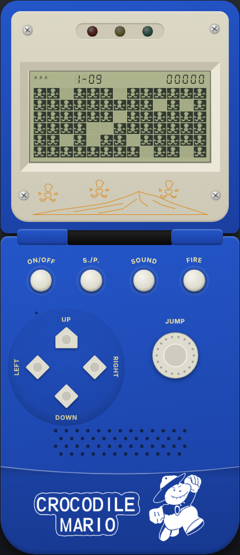
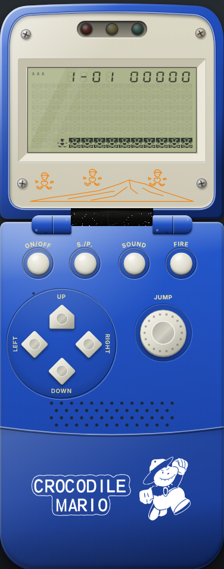
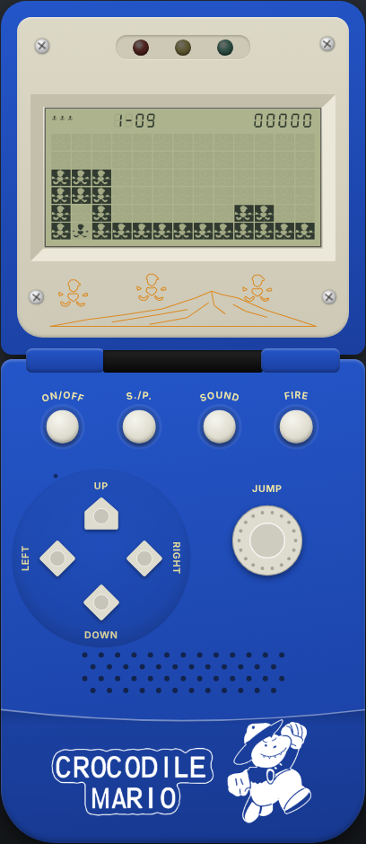
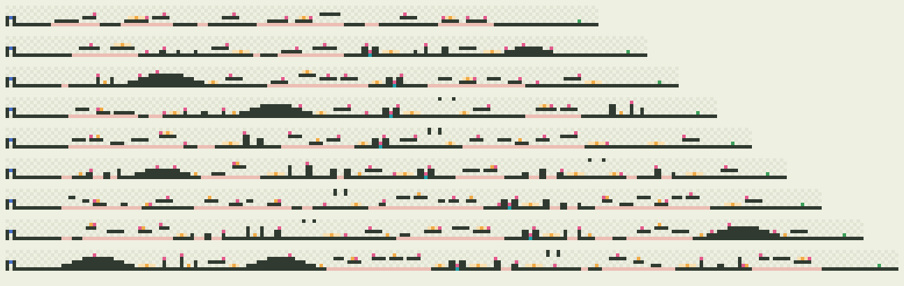

# Наблюдения по видео фрагмента

Владелец прислал видео работающего устройства: сначала `Video_Project_3.mp4` (без звука), затем `Video_Project_6.mp4` — тот же фрагмент, но длиннее и **со звуком**
(синий корпус, экран `1-09 / 00000`, три значка жизни, три светодиода). Здесь записано, что на них **измерено**, что из этого попало в движок и что осталось неясным.
Экран, физика героя и анимации — по первому видео (разделы 1–7); звук, мелодия и светодиоды — по второму (раздел 8); устройство уровней, враги, очки и таймер — по третьему, видео геймплея (раздел 9).

> **Статус: ЧЕРНОВИК.** Это наблюдения по одному видео (один фрагмент, снят с руки), а не подтверждённые правила оригинала.
> Всё, что взято в движок, помечено `status: "demo"`; сам тестовый уровень — [реконструкция геометрии с кадров](#5-тестовый-уровень),
> а не оригинальный уровень. Подтверждать числа нужно по резкой съёмке или на самом устройстве.

## 1. Источник и методика

| | |
| --- | --- |
| Файл | `Video_Project_3.mp4`: 1280 × 720, 30 кадров/с, 21,87 с (656 кадров), H.264 + AAC (в репозитории видео нет) |
| Что снято | включённая раскладушка, синий корпус, экран и три светодиода; камера в руке, перспектива, лёгкий дрейф кадра |
| Звук | дорожка есть, но **тишина** (RMS = 0,0): звук устройства в этом файле не записан. Звук — во втором видео, [раздел 8](#8-звук-и-светодиоды-запись-со-звуком) |
| Масштаб времени | 1 кадр = 33 мс = 0,67 такта движка (20 тактов/с): **точность измерений ± 1 кадр** |

Методика (скрипты — [tools/video-analysis](../tools/video-analysis/README.md)):

1. Каждый кадр совмещён с эталонным (кадр 15) гомографией по ORB-точкам (RANSAC); все 656 кадров стабилизированы.
2. Поле LCD выпрямлено в прямоугольник 520 × 284 px; по заполненному кадру найдена сетка **13 столбцов × 6 строк**
   (шаг ≈ 37,9 × 37,0 px) — это совпадает с принятой в проекте сеткой `reference_1` (13 × 6) и **подтверждает 6 строк** на этом экране.
3. Для каждой клетки считалась доля тёмных пикселей («чернильность»): ≥ 0,40 — блок, 0,06–0,40 — частично погашенный/гаснущий.
4. Герой отслежен по шаблону (кадры 136–139) нормированной корреляцией по клеткам; результат надёжен примерно до 10 с, дальше
   (сцена 2) совпадения шумные, и выводы по ней не делаются.

Нумерация клеток ниже — `(столбец, строка)`; строки 0–5 сверху вниз, столбцы 0–12 слева направо (в таблицах — `x, y`).

## 2. Хронология фрагмента

| Время, с | Кадры | Что происходит |
| --- | --- | --- |
| 0,00–0,27 | 0–8 | поле пустое; HUD уже показан: три значка жизни, `1-09`, `00000` |
| 0,30–0,85 | 9–28 | **заливка**: клетки поля покрываются блоками в случайном порядке (на кадре 15 заполнено ≈ 85 % клеток, 11–12 «дырок» из 78) |
| 0,85–1,20 | 28–36 | пауза: поле заполнено |
| 1,20–1,85 | 36–55 | **растворение**: блоки исчезают в случайном порядке |
| 1,85–2,00 | 56–59 | пустое поле |
| 1,85–4,30 | 56–130 | **построение**: герой входит справа в нижний ряд и идёт влево до (2, 5); поднимается по клеткам (2, 4), (2, 3); влево (1, 3), (0, 3); вниз (0, 4), (0, 5); вправо в клетку (1, 5) — яму. Все покинутые клетки остаются твёрдыми блоками |
| 4,30–7,50 | 130–225 | герой в яме (1, 5) прыгает вверх: удары головой о перекладину (3, 0–2) в кадрах 143, 177 и 210 |
| 7,00–7,50 | 210–225 | **третий удар**: центральный блок перекладины (1, 3) исчезает, копия перекладины поднимается ещё на ряд и распадается на осколки; герой поднимается до строки 2 и переходит на верхушку правой стойки (2, 2) |
| 7,50–8,90 | 226–266 | герой стоит на стойке (2, 2) |
| 10,5–11,1 | 316–332 | конструкция гаснет и поле очищается, остаётся только нижний ряд |
| 11,1–11,7 | 333–350 | нижний ряд строится заново — смена сцены |
| 11,7–18,6 | 350–560 | **сцена 2**: герой бежит вправо — стоит в столбце 6, мир прокручивается влево ≈ 3 клетки/с; справа появляются колонны и блоки; по верхнему ряду летят маленькие тёмные «сердечки» (выстрелы) парами — см. [тестовый уровень](#5-тестовый-уровень) |
| 17,0–17,4 и 17,8–18,2 | 510–522 и 534–546 | счёт `00000` → `00010` → `00020` (события не установлены) |
| ≈ 18,6 | 560 | на поле выложены крупные знаки из блоков (похоже на цифры); в HUD `00020` |
| 20,4–21,9 | 612–656 | метка `1-09` гаснет, кадр пересвечен; остаются три значка и `00000`; камера уходит от экрана, стабилизация нарушается |

## 3. Физика героя

Все числа — кадры видео (30/с) → такты движка (20/с, 1 такт = 1,5 кадра). «Кадров на клетку» — сколько героя видно в одной клетке подряд.

| Параметр | Измерено | В тактах | Значение в движке (`rules.json`) | Основание |
| --- | --- | --- | --- | --- |
| Ходьба (клеток подряд, 10+ шагов) | 4,4 кадра на клетку (4–5) ≈ 147 мс | 2,9 | `move.repeatIntervalTicks: 3` (150 мс) | измерено |
| Начало удержания направления | на видео не видно | — | `move.repeatDelayTicks: 3` (ровный ритм с первого шага) | **допущение** |
| Подъём в прыжке | 4,7 кадра на клетку (4–5) | 3,1 | `jump.stepTicks: 3` | измерено (3 прыжка) |
| Вершина прыжка | 6,7 кадра (5–8) | 4,5 | последний шаг таблицы + 2 такта до падения = 5 | измерено |
| Спуск | 5,0 кадра на клетку (4–6) | 3,3 | `fall.periodTicks: 3` | измерено |
| Высота прыжка | 2 клетки под перекладиной; 3 клетки в третьем прыжке | — | `jump.table: [-1, -1, -1]` | см. ниже |
| Темп | — | — | `tickRateHz: 20` (без изменений) | согласуется: шаг 3 такта = 150 мс |
| Нижний край поля | герой стоит и ходит **в нижнем ряду** (строка 5), под ним земля | — | `bottomEdge: "floor"` | измерено |

Выводы:

- Ходьба, подъём и падение — **один и тот же шаг ≈ 150 мс на клетку**; движок получил единый «пульс» в 3 такта для всех трёх.
- Высота: пока над ямой стоит перекладина, герой поднимается на 2 клетки (вершина — клетка перекладины (1, 3)), в третьем прыжке
  — на 3 клетки (строка 2). Принята таблица в три шага: перекладина в движке — **потолок**, поэтому под ней прыжок получается
  короче.
- Нижний ряд — рабочий: герой стоит в клетке (1, 5) и ходит по строке 5, значит, за нижним краем нет «провала». Для этого в правила
  добавлен необязательный параметр `bottomEdge` (`pit` — как раньше, `floor` — земля).
- Время полного прыжка в воздухе в видео не получено: все три прыжка идут в яме под перекладиной.
- Паузы между прыжками (13–15 кадров ≈ 0,45 с) — реакция игрока, а не физика.

Модельный прыжок движка в свободном воздухе (по тактам: строка у героя): `y−1` × 3, `y−2` × 3, `y−3` × 5, `y−2` × 3, `y−1` × 3, затем земля.
Сравнение с видео — [tests/core/video-physics.test.ts](../tests/core/video-physics.test.ts).

## 4. Анимации уровня

| Эффект | Наблюдение | Как реализовано |
| --- | --- | --- |
| **Интро: заливка** | поле заполняется блоками в случайном порядке за ≈ 0,63 с (≈ 13 тактов), заполнено ≈ 85 % клеток | `animations.json → intro.fillTicks: 13`, `coverage: 0,85`; порядок — детерминированная перестановка по id уровня |
| **Интро: пауза и растворение** | пауза ≈ 0,35 с (5 тактов), затем блоки исчезают за ≈ 0,63 с (13 тактов), затем ≈ 0,1 с пусто | `holdTicks: 5`, `dissolveTicks: 13`, `emptyTicks: 3`; перед заливкой ещё 6 тактов пустого экрана (`blankTicks`) |
| **Построение следом героя** | герой проходит маршрут, каждая покинутая им клетка становится блоком (17 из 17 наблюдаемых клеток; на 1–2 кадра блок «гаснущий» — это инерция LCD) | `intro.stepTicks: 3`, `intro.routes["tunnel-run"]` — 18 клеток; клетки и объекты открываются, когда герой их покинул |
| **Отскок перекладины** | при ударе головой копия перекладины (все три клетки) на ≈ 7–8 кадров (с нарастанием и затуханием LCD) вспыхивает на ряд выше; сама перекладина на месте | событие ядра `bump`, `animations.json → bump.ticks: 5` (≈ 0,25 с); копия — блок, по которому ударили, и его соседи по ряду без разрывов |
| **Крышка арки ломается** | центр перекладины пережил два удара и исчез на третьем; без очков | объект `brick` с `hp: 3`, `score: 0` — **гипотеза по одному случаю** |
| Осколки | при разрушении копия перекладины поднимается на ряд выше и распадается, куски разлетаются | не реализовано |

Интро проигрывается только в фазе «готов к старту» (`ready`); нажатие Старт пропускает его. В тестовом запуске редактора интро выключено.
Все эти эффекты — **презентация**: ядро и replay они не меняют, состоянием игры не управляют (кроме объекта `brick`, который — игровая механика).
Выбор «копия блока над местом удара» — моя интерпретация кадров (сама перекладина не двигается, над ней на несколько кадров появляется копия,
а стойки визуально «вытягиваются» на один ряд).

## 5. Тестовый уровень

`public/content/room/levels/tunnel-run.json` — первый (и единственный открываемый) уровень основного пакета. Экран 13 × 6, уровень 56 × 6 — шире экрана; HUD настоящий
(3 жизни, подпись `1-09`, счёт), физика — как в [разделе 3](#3-физика-героя).

```
. . . . . . . . . . . . . .      строки 0–2: пусто (дальше — блоки в воздухе)
# B # . . . . . . . . . . .      строка 3: верх стоек (0, 3), (2, 3); B — пробиваемый блок (1, 3), объект brick
# . # . . . . . . # # . . .      строка 4: стойки; первое препятствие (9, 4), (10, 4)
# H # # # # # # # # # # # #      строка 5: пол; H — старт героя в яме (1, 5)
```

Геометрия арки — с кадров 130–140 видео (пол по всей ширине, арка из двух стоек и перекладины, герой в яме); **расстановка справа от арки придумана**: на видео в сцене 2 видны
колонны и блоки, но не их точное положение. Выстрелы — «сердечки» (со слов владельца: центральный сегмент фигурки), на видео они летят по верхнему ряду парами со скоростью ≈ 4 клетки/с;
в движке: интервал 6 тактов, не более двух одновременно, 1 клетка за 2 такта (**оценка**). Четыре мишени по 10 очков (на видео счёт растёт на 10 дважды) и финиш — допущения.

**Как идёт игра.** S./P. запускает **сценарий входа** (≈ 2,4 с; `animations.json → entry`): три прыжка — три удара головой о крышку (копия перекладины вспыхивает, на третьем крышка исчезает),
четвёртый прыжок на три клетки и шаг вправо — герой оказывается на верхушке правой стойки (2, 2), как на видео (кадры 210–225). Дальше управляет игрок: бежит вправо, камера держит героя
в столбце 6 (как на видео в сцене 2), прыгает через блоки, стреляет по мишеням. Если игрок сойдёт влево, он упадёт обратно в яму и выпрыгнет тем же способом.

Что видно в игре (снимки из тестового прогона `SCREENSHOTS=1 npm run test:smoke -- screenshots`):

| Заливка (≈ 0,75 с) | Построение (≈ 3,2 с) | Старт: удар головой, копия перекладины над ней |
| --- | --- | --- |
|  |  |  |

Отличия от видео: перекладина не сдвигается и не распадается на осколки, герой не заходит в клетку перекладины, а упирается в неё (потолок). Остальные сцены после смены
(≈ 11 с) в уровень не вошли. Пометки уровня: `assumed` — число ударов крышки, `unknown` — всё справа от арки.
Уровень проходим: тест `tests/core/tunnel-run.test.ts` проводит бота от старта до финиша (бежит, прыгает, стреляет по мишеням).

## 6. Светодиоды, HUD, звук

- **Светодиоды.** По первому видео вывод был «горят все три постоянно» (максимум яркости окна 11 × 11 px у каждого светодиода — 255 в кадрах 0–599).
  **Этот вывод пересмотрен:** на записи со звуком, где светодиоды выделены по цвету, они не горят постоянно — под мелодию горит один и бежит
  красный → жёлтый → зелёный, в тишине все погашены ([раздел 8](#светодиоды)). Максимум по окну 11 × 11 насыщался от белого корпуса и бликов, а не от светодиода.
- **HUD.** Три значка жизни на протяжении всего фрагмента (потери жизни нет), подпись `1-09` постоянна (до ≈ 20,4 с), счёт `00000`,
  затем `00010` и `00020` (приращение 10). События, дающие очки, не установлены — в уровень очки не вошли.
- **Размер строки HUD** (по кадрам второго видео и фотографиям других корпусов, `1-03`, `1-02`): цифры **крупнее**, чем в первом наборе референсных экранов. Цифра ≈ 5,3 % ширины экрана и ≈ 14 % высоты
  (отношение ≈ 0,75), шаг ≈ 7,7 % (почти клетка поля, 128 из 1728), счёт из пяти цифр занимает ≈ 36 % ширины и прижат к правому краю, подпись из четырёх позиций начинается на ≈ 23 % и кончается на ≈ 51 %,
  счёт начинается на ≈ 61 %. В логических пикселях (1728 × 864): цифра 90 × 118, шаг 133, подпись x = 397, счёт x = 1050, y = 32. Значки жизни такого же размера, как раньше. Ширина цифр — оценка по
  размытым кадрам (± 1 px при ширине экрана ≈ 250 px, то есть ± 0,4 % ширины). На втором участке записи вместо подписи показан счётчик `TIME 397…` (буквы мельче цифр, три цифры времени) — в движке не реализован.
- **Звук.** В первом видео не записан (тишина); восстановлен по второму — [раздел 8](#8-звук-и-светодиоды-запись-со-звуком).

## 7. Что не реализовано и открытые вопросы

1. **Герой в клетке перекладины.** В прыжках 1–2 герой на вершине занимает клетку перекладины (1, 3), а над ней вспыхивает копия.
   В движке перекладина — потолок. Что это в оригинале (мягкий блок, «крышка», сдвиг) — неизвестно.
2. **Число ударов** (3) — один случай; прочность блоков других типов не измерена.
3. **Высота прыжка**: 2 клетки (под перекладиной) и 3 клетки (после разрушения); возможна зависимость высоты от удержания кнопки — на видео не видно.
4. **Сцена 2** (с ≈ 11 с): вошли бег героя в столбце 6 с прокруткой ≈ 3 клетки/с и стрельба; точная расстановка колонн и блоков, поведение мишеней,
   пересвет кадра и гаснущая метка в конце — не установлены и в движок не вошли. Крупные знаки из блоков на ≈ 18,6 с — это метка `1-09` крупно
   (во втором видео видна чётко, [раздел 8](#что-на-экране-во-время-звука)).
5. **Очки** `+10` дважды и их события; что значит метка `1-09` и что запускает её крупный показ — не установлены.
6. **Начало удержания** кнопки (задержка повтора) и поведение движения в воздухе — на видео не видно.
7. **Осколки** при разрушении перекладины.
8. **Нет кадров с нажатием кнопок**, по которым можно было бы связать ввод и действия. Звук есть только во втором видео ([раздел 8](#8-звук-и-светодиоды-запись-со-звуком)).

Что нужно от владельца для следующего шага: видео со звуком **при выключенном SOUND** (чтобы проверить, гаснут ли светодиоды и умолкает ли мелодия), кадры включения/выключения (`ON/OFF`),
запуска (`S./P.`), смерти и перехода на следующий уровень, свободный прыжок без перекладины, видео с видимыми кнопками (для связи нажатий и действий).

## 8. Звук и светодиоды (запись со звуком)

Источник: `Video_Project_6.mp4` — тот же фрагмент (построение комнаты, три удара, бег, стрельба, метка `1-09`), но **37,6 с и со звуком**: 852 × 480,
30 кадров/с, AAC 48 кГц стерео (в репозиторий видео не входит). Скрипты — `tools/video-analysis/` (`audio_spectrogram.py`, `audio_notes.py`, `led_chase.py`).
Статус: черновик, как и остальной документ; **измерено** и **допущено** помечено отдельно.

### Методика

1. Дорожка → моно 44,1 кГц; STFT (окно 1024, шаг 221 отсчёт = 5 мс, FFT 8192), спектрограммы.
2. Основной тон по кадрам — суммирование нечётных гармоник (1, 3, 5, 7, 9) по логарифмической амплитуде; сегменты «нота — длительность»
   (`audio_notes.py`). Нечётные гармоники и ровные «полочки» огибающей — признак **прямоугольной волны** без огибающих (1-битная пищалка).
3. Высоты: кластер ≈ 762 Гц — нота «до» (C); все остальные ноты — равномерно-темперированные полутоны от неё (отклонение < 0,2 полутона):
   `a = 9`, `b = 11`, `c = 12` полутонов; в таблице — ре = 2, ми = 4, фа = 5, соль = 7, ля нижняя = −3, си = −1.
4. Сетка мелодии: сдвиги аккордов двух заходов дают долю **135,6 мс** (такт 0,5425 с ≈ 110 ударов/мин); «микро-нота» эффектов — 1/5 доли = **27,1 мс**.
5. Светодиоды — цветовые пятна в HSV, «белизна» окна 9 × 9 px по кадрам, порог Оцу на каждый светодиод (`led_chase.py`); сравнение с нотами при сдвиге по времени.
6. Точность: по времени ≈ 5 мс (звук) и ≈ 33 мс (светодиоды, 30 кадров/с); AAC срезает слабые составляющие, поэтому тихие голоса аккорда видны не везде.

### Устройство звука

- **Один звуковой канал на пищалке:** прямоугольные волны, не более двух голосов одновременно (аккорд «до + ми» — две линии), громкость фиксирована.
- **Эффекты звучат поверх мелодии**, не обрывая её: на спектрограмме полосы мелодии идут сквозь выстрелы и прыжки. В движке это два слоя
  (мелодия и эффекты), эффекты внутри слоя — один канал с приоритетами.
- **Мелодия — 20 тактов (80 долей ≈ 10,85 с):** такты 0–10 слышны чисто (заход 2), такты 11–19 — из обоих заходов со сравнением (стрельба поверх мелодии).
  Ноты — в `src/audio/phrases.ts` (`TUNE_BARS`): аккорды «до + ми» (`CE`), «до + ре» (`CD`), одиночные `C`, `D`, `A` (нижняя ля).
- Светодиод переключается на **каждой новой ноте**: нота длиннее двух долей считается двумя (совпадение предсказания с записью — 92 % долей).

### Что записано (время по звуковой дорожке)

| Время, с | Звук | Событие на экране |
| --- | --- | --- |
| 0 – 2,06 | тишина: заливка, растворение и пустое поле (40 тактов — как в интро движка) | светодиоды погашены |
| 2,06–4,44 | построение комнаты: 17 щелчков с периодом 149 мс (падающий свип ≈ 3000 → 1550 Гц за 32 мс + короткий тон) | герой идёт по маршруту построения |
| 4,88 – ≈ 7,0 | прыжки героя из ямы: «лесенка» до-ре-ми-фа-соль-фа-ми по 27 мс (≈ 190 мс); удары головой — восходящий свип ≈ 700 → 2800 Гц за 150 мс + треск | удары о крышку арки |
| 7,08 – ≈ 8,9 | **третий удар — шумовые всплески** (10 × 115 мс через 180 мс ≈ 1,8 с) вместо свипа | крышка арки исчезает |
| 9,147–9,789 | **фанфара**: 12 нот по 53,5 мс — ми ре ми ре до ре ми ре ми ля си до | светодиоды бегут по нотам |
| 9,925–20,52 | **мелодия** (78,4 доли), поверх неё — выстрелы (падающий свип 3800 → 1800 Гц за 32 мс), прыжки, приземления («ми ля си ми ля си») | бег, стрельба, счёт 00010, 00020 |
| 20,52 | мелодия обрывается на 0,43 доли 78-й; ≈ 2,2 с без мелодии | метка `1-09` крупно из блоков (с ≈ 18,6 с) гаснет — экран пуст, счёт `00000`, построение |
| 22,758 | мелодия **с начала, без фанфары** (69 долей, до гибели) | новый участок: в HUD вместо метки — `TIME 397…` |
| 32,12 | гибель: падающий свип 1700 → 800 Гц (240 мс), пауза 210 мс, грохот (12 пачек шума по 40 мс через 65 мс), пауза 120 мс, **джингл** из 8 нот по доле (ми ми ми ля ми ми ля ля поверх «до») — всего ≈ 2,4 с | герой упал в провал пола, мелодия оборвана, светодиоды погашены; в HUD три значка жизни → два |
| 34,735–35,813 | **тон готовности**: нота «ре» 1,077 с (8 долей), светодиоды красный → жёлтый → зелёный на 2 + 3 + 3 доли | участок начат заново (герой слева), `TIME` стоит на 383 |
| 35,823 | мелодия **с начала, без фанфары**; игра идёт сама, без нажатия кнопки (`TIME` 382) | |
| 36,70 | щелчок (8 мс шума) | выключение (ON/OFF) |

От момента падения (32,12 с) до тона готовности — **2,6 с**: в комнате `deathDelayTicks` поднят с 20 до **52** (2,6 с; версия правил 4).

### Светодиоды

- Под мелодией — фанфарой, игрой и тоном готовности — горит **ровно один** светодиод, и каждая новая нота зажигает следующий: красный → жёлтый → зелёный → красный…
  Пауза внутри мелодии (доля тишины после фанфары) гасит все. В тишине — построение комнаты, гибель героя — **все погашены**. Короткие эффекты их не трогают.
- Светодиоды **опережают звуковую дорожку на ≈ 0,19 с**; так же опережает звук и экран (мелодия обрывается на 20,52 с, а метка гаснет на ≈ 20,35 с по кадрам).
  Это сдвиг записи, а не устройства: в движке светодиод и нота синхронны (сдвиг 0); порт Web Audio лишь сдвигает светодиоды на задержку вывода звука браузера.
- **Пересмотр:** по первому видео я записал «горят все три постоянно»; это артефакт метода (максимум яркости окна от белого корпуса и бликов). Оценка по цвету на записи со звуком его опровергает.

### Что на экране во время звука

Метка `1-09` в HUD весь первый заход. С ≈ 18,4 с (по кадрам) на поле крупно складывается та же метка `1-09` из блоков, счёт `00020`, мелодия идёт ещё ≈ 2 с; потом поле пустеет
(`00000`), строится заново, и мелодия начинается с начала. Новый участок показывает счётчик `TIME` вместо метки. Что это — конец участка, перезапуск по времени или другое, — по записи не установлено.
В движок вошла только звуковая сторона: **при переходе на следующий участок мелодия начинается с начала без фанфары**; сама метка и таймер не реализованы.

### Как записанное связано с событиями движка

| Событие движка | Звук | Источник |
| --- | --- | --- |
| построение комнаты (интро): герой встал в новую клетку маршрута | `introStep`: щелчок | измерено (период 3 такта) |
| `jump` | `jump`: 7 нот | измерено |
| `bump` | `bump`: свип + треск, **задержка 100 мс** (событие движка приходит на 150 мс позже начала прыжка, в записи свип — через 250 мс) | измерено |
| удар головой, разрушивший блок (`hit` с `destroyed` у `brick`) | `crumble`: шум ≈ 1,8 с вместо второго свипа (на третьем ударе) | измерено |
| `land` | `land`: «ми ля си ми ля си» | измерено |
| `shot` | `shot`: быстрый падающий свип | измерено |
| сценарий входа закончился (игрок получил управление) | фанфара → доля тишины → мелодия по кругу | измерено |
| пауза / продолжение | мелодия замирает и продолжается с того же места, голоса обрываются | допущение (в записи паузы нет) |
| `death` | мелодия обрывается, `death`: падение, грохот, джингл | измерено |
| возрождение (`dead → ready`) | тон готовности, светодиоды R → Y → G; следующий старт — мелодия без фанфары | измерено |
| `levelCompleted` с переходом | мелодия начинается с начала без фанфары, эффекта нет | измерено |
| выключение (ON/OFF) | всё глохнет, затем щелчок `powerOff` | измерено |
| `hit` по мишени, `projectileBlocked`, `levelCompleted` в конце игры, `gameOver`, подтверждение переключателя «Звук» | условные сигналы прежнего демо | **условно, в записи не встретилось** |

### Допущения и открытые вопросы

1. **Граница цикла не видна**: первый заход оборван сменой экрана (78,4 доли), второй — гибелью (69 долей). Мелодия зациклена по такту; две последние доли такта 19 (`C D`) допущены.
   Что мелодия зацикленная, подтвердил владелец, но шов (пауза между кругами?) не измерен.
2. **Фанфара** — только при первом запуске (после выхода героя из ямы). После гибели и перехода на участок мелодия начинается без неё (две записи).
   В записи после гибели игра продолжается сама сразу за тоном готовности; в движке после возрождения игра, как и раньше, ждёт `S./P.` — мелодия стартует по нажатию.
3. **Герой в «комнате» погибнуть не может** (нет ям, врагов и таймера; в записи гибель — падение в провал пола на втором участке), поэтому гибель и тон готовности слышны на технической странице и на картах из редактора с врагами и ловушками.
4. **Звук выключен (SOUND)**: что делает устройство, не снято. В движке звук глохнет, а часы мелодии и светодиоды идут по-прежнему (допущение).
5. **Пауза**: мелодия замирает, светодиоды переходят на условное мигание паузы.
6. Приоритеты каналов эффектов и **задержки** `bump` (100 мс) и `crumble` (50 мс) подобраны по записи; приоритет `crumble` понижен (допущение: следующий прыжок или выстрел обрывает грохот, а не глохнет на 1,8 с).
7. **Громкость**: абсолютный уровень записью не определить (AAC, автоматика камеры); мелодия в движке тише эффектов в 0,6 раза — оценка на слух.
8. Во время заливки, растворения и пустого поля интро звуков не найдено; щелчки — только при шагах построения.

## 9. Видео геймплея: устройство уровней (девять «геймплейных» уровней)

Источник: `Apollo-Tetris-Crocodile … .mp4` — длинная съёмка с руки: **640 × 360, 30 кадров/с, 326,5 с**, звук есть (в этом разделе не разбирался). Устройство то же (дисплей `1-0N`, три значка жизни),
камера подрагивает, кадры местами размыты; иногда в кадр попадает палец. Скрипты — [tools/video-analysis](../tools/video-analysis/README.md) (`gameplay_lcd.py`, `gameplay_world.py`).
Статус: **черновик**. Это один просмотр одного человека, поэтому уровни получены **приближением**, а не восстановлены: владелец передаст полные прохождения всех девяти уровней, по ним их восстановят 1 в 1.
Фрагмент игры **TETRIS** (24–36 с) в разбор не входит — по просьбе владельца.

### Хронология

| Время, с | Что на экране |
| --- | --- |
| 0–22 | подпись `1-01`, интро (заливка → построение → «яма»), счёт `00000` → `00010`: сразу уровень 1 |
| 24–36 | `2-01` — другая игра (TETRIS), в разбор не входит |
| 38–40 | `3-01`, счёт `00100`, `00200` — третья игра (стрельба по фигурам); тоже не разбирается |
| 42–56 | снова `1-01`: тот же старт из ямы, дальше платформы; счёт `00120` |
| 58–86 | выбор уровня: подпись меняется `1-03 → 1-04 → 1-07 → 1-09 → 1-03 → 1-07 → 1-09 → 1-05`; **каждый уровень начинается одной и той же «ямой»**; на `1-09` (66–78 с) виден подъём платформ-«лестницы» вправо |
| 88–96 | `1-05`: платформы вправо и вверх, над ними двое малых врагов |
| 104–106 | метка `1-01` крупно из блоков, затем чистый экран |
| 108–290 | **режим на время**: вместо подписи `TIME 397 … 179` (обратный отсчёт, 400 с), счёт растёт `00100 → 01800`; игрок несколько раз гибнет и начинает уровень заново (таймер идёт, счёт сохраняется) |
| 292–298 | на экране слово «GAME» из блоков (конец игры) — таймер замирает на `179` |
| 300–325 | снова `1-01` с чистого листа; счёт `00000 → 00580` |

Из хронологии: подпись — **«игра-уровень»** (`G-LL`): `1-0N` — уровень N игры MARIO, `2-01` — TETRIS, `3-01` — стрельба; в режиме на время подпись заменена таймером `TIME 400`.
Три значка жизни слева от подписи; гибель отнимает жизнь и возвращает **к началу того же уровня** (яма, три удара головой), счёт и таймер остаются.

### Что видно в уровнях

- **Старт** одинаковый у всех: две колонны высотой 3 клетки (столбцы 0 и 2), яма между ними с «крышкой» над ней, пол с 3-го столбца; герой выпрыгивает тремя ударами головой (как в [разделе 5](#5-тестовый-уровень)).
- **Провалы** — пустые столбцы пола; падение убивает. Широкие провалы (13–15 клеток) закрыты **цепочками платформ** в рядах 4, 3, а на поздних уровнях — 2; между краями прыжок на 3–5 клеток.
- **Колонны и «створки»**: колонны разной высоты; пары высоких колонн, свисающих сверху с узким проходом между ними (≈ 216–224 с); лестницы из колонн (≈ 240–290 с).
- **Враги**: малые (1 × 1) стоят и ходят по платформам и по полу; большие (2 × 2) парят в рядах 1–2 и медленно смещаются к герою (≈ 202–216 с). Точные маршруты по видео не разобрать.
- **Очки**: приращения счёта на видео — 10, 20, 100 и 200 (например `00100 → 00200 → 00300 → 00400` на 120–134 с — по одному сердцу; `00140 → 00340` на 312–314 с — вероятно, 200 за растоптанного малого, как на упаковке). Какое приращение чему соответствует, по видео надёжно не установить.
- **Сердца** — предметы, подбираются касанием (в движке 100 очков); по упаковке малый враг стоит 20 (выстрел) или 200 (прыжок сверху), большой — 400.
- **Стрельба**: герой стреляет «сердечками» вправо/влево, по врагу попадание — очки. Растаптывание (200 за малого — по упаковке) в видео не различить.
- Камера держит героя в столбце 6 (как в [разделе 5](#5-тестовый-уровень)); при гибели экран возвращается к «яме».

### Методика

1. `gameplay_lcd.py`: каждый третий кадр ORB + RANSAC совмещается с опорным (60 с) и выпрямляется в LCD 432 × 216 (1/4 логического 1728 × 864): совмещено 3245 из 3266 выборок.
2. `gameplay_world.py ink`: занятость каждой из 13 × 6 клеток (тёмная доля после вычитания размытого фона, порог 0,30).
3. `gameplay_world.py stitch`: кадры склеиваются по сдвигу прокрутки (−2…+2 столбца, при размытии — до ±12); гибель определяется по возврату экрана «ямы», сдвиг обнуляется; клетка мира — голосование по кадрам.
4. `gameplay_world.py consensus`: карты разных попыток совмещаются (±6 столбцов) и голосуют ещё раз. Три попытки на 108–225 с сходятся по первым ≈ 119 столбцам уровня 1 с точностью **± 2 столбца**.
   Подпись `G-LL` распознать цифрами по размытым кадрам не удалось (OCR шумный), поэтому номера уровней (`1-03`, `1-07`, `1-09`, `1-05`) прочитаны глазами по кадрам.

Измеренные первые ≈ 119 столбцов **уровня 1** (13 столбцов старта, затем цепочки платформ рядов 4 и 3 над провалами 13 и 15 клеток, полы по 6–14 клеток, провалы 3 и 4 клетки, ещё одна цепочка через ряд 2) вошли в `mario-1` как есть;
остальное в нём и все другие уровни — **допущения** по общей логике.

### Как девять уровней устроены в игре

Генератор `tools/levels/generate.mjs` (детерминированный, зерно на уровень) пишет `public/content/room/levels/mario-1…9.json`, список уровней в `pack.json` и сценарии интро/входа в `animations.json`.
Все девять: общий старт «яма», `hudLabel` `1-01 … 1-09`, финиш `goal` с переходом на следующий (после девятого — конец игры), пометка `assumed` на всём поле.

| № | Ширина | Что нового (допущение) |
| --- | --- | --- |
| 1 | 170 | измеренные 119 столбцов + продолжение; малые враги, верхние площадки с сердцами |
| 2 | 184 | колонны (до 2 клеток), провалы до 4 клеток |
| 3 | 194 | лестницы вверх и вниз, площадки в ряду 2 |
| 4 | 204 | большие парящие враги 2 × 2, «створки», провалы шире |
| 5 | 214 | длинные цепочки площадок с подъёмом до 3 клеток |
| 6 | 224 | колонны как «камни» через провалы, плотные провалы |
| 7 | 234 | узкие площадки (2–4 клетки) над самыми длинными провалами |
| 8 | 246 | враги на узких площадках, больше больших врагов |
| 9 | 253 | всё вместе: лестницы, цепочки, колонны-«камни», больше врагов; самый длинный; в начале лестница платформ — как на видео |

**Проходимость доказана на настоящем движке** (`tests/core/mario-levels.test.ts`, решатель `tests/helpers/solver.ts`): поиск по состояниям героя «жадный по x», шесть кадров выбора на такт ({ничего, влево, вправо} × {без прыжка, прыжок}); новое нажатие направления — не чаще раза в 3 такта (шаг при удержании), чтобы решатель не бегал быстрее человека.
Каждый уровень проходится **и с врагами, без единого выстрела** (патрульные учитываются в состоянии поиска); найденное решение воспроизводится с чистого старта. Любая платформа в цепочках удалена от соседней не дальше предела прыжка минус 2 клетки;
таблица пределов `tools/levels/reach.json` (пролёт между краями для каждой пары строк 5…2) сверяется с движком тестом на синтетическом уровне. У платформ в ряду 2 запас мал: над героем остаётся один ряд, голова упирается в потолок (прыжок с ряда 2 на ряд 2 — не дальше 3 клеток).



Обзор карт (`node tools/levels/overview.mjs`): тёмное — твёрдое, светло-розовое — провалы, розовые точки — сердца, оранжевое и красное — малые и большие враги с размахом патруля, зелёное — финиш, синее — крышка ямы.

### Что не реализовано и открытые вопросы

1. **Расстановка всех уровней — допущение**, кроме первых ≈ 119 столбцов уровня 1 (± 2). Ждём полные прохождения девяти уровней.
2. **Таймер `TIME`, растаптывание малого чёрта и движение врагов** — в движке по видео и упаковке, подробности и что не воспроизведено — [раздел 10](#10-видео-геймплея-таймер-враги-растаптывание-механика-движка). **Очки** за сердце 100, малый враг 20 (выстрел) / 200 (наступить), большой 400 — по упаковке и видео, но не подтверждены.
3. **Выбор уровня на устройстве** (подпись переключается кнопками до старта) — в интерфейсе заменён плитками на пульте и параметром `?level=N` (1–9) или `?level=id`.
4. **Падение**: в правилах демо `bottomEdge: floor`, поэтому провалы смоделированы опасной областью по нижнему ряду (невидимой), а не выходом за край карты.
5. Игры TETRIS и стрельба из этого видео в движок не входят.

## 10. Видео геймплея: таймер, враги, растаптывание (механика движка)

Продолжение [раздела 9](#9-видео-геймплея-устройство-уровней-девять-геймплейных-уровней): что в видео геймплея измерено о таймере `TIME`, чертях и очках и как это попало в движок.
Скрипты — `tools/video-analysis/gameplay_enemies.py` (контактные листы, полоса таймера, трекинг большого чёрта), `gameplay_world.py`. Статус по-прежнему **черновик**: расстановка уровней — допущение, механика ниже — по видео
там, где так сказано, иначе по упаковке или допущение.

### Режимы: демонстрация и игра

Подпись `1-01` в начале ролика (0–22 с) и `TIME …` (108–290 с) — **разные режимы**. Вероятное объяснение (не подтверждено): на устройстве после включения идёт демонстрация игр
(**по упаковке: «после включения питания сама показывается демонстрация игр»**) — `1-01 → 2-01 → 3-01 → 1-01` в 0–42 с; на кадрах 58–86 с подпись листается кнопками (выбор уровня), а игра, начатая S./P. (≈ 104 с: подпись `1-01` крупно из блоков, чистый экран),
идёт с таймером: подпись заменяется на `TIME 397`. Поэтому в движке подпись видна, пока игра не началась (интро, ожидание S./P.), а с первого нажатия S./P. её заменяет таймер.

### Таймер

| Что | Измерено | Значение в движке |
| --- | --- | --- |
| Вид | слово `TIME` из четырёх узких букв слева и **три цифры в позициях подписи 0–2**; слово чуть ниже цифр (≈ 85 % высоты) | `hud.time` в `screen.json`: слово — ресурс `hud.time` (SVG), цифры — шрифт HUD; слово x = 214, ширина 160, штрихи тонкие (7 из 100 по высоте, по фотографии оригинала) (логические пиксели) |
| Начало | первое видимое значение — **397** на 108,0 с; к этому моменту герой отыграл сценарий выхода из колодца (≈ 2,65 с = 3 единицы) → отсчёт идёт с нажатия S./P., включая сценарий входа | `gameStarted` = true с первого S./P.; `timerUnits` = `ceil(осталось тактов / 15,4)`: после сценария входа (53 такта) — 397 (тест `timer.test.ts`) |
| Скорость | 345 (156 с) → 246 (232 с): **1,30 единицы/с**, то есть **≈ 0,77 с на единицу** (на 108–118,5 с: 14 единиц за 10,5 с = 0,75 с); пары значений читались глазами по размытым кадрам, ± 1 единица | `timerUnitTicks: 15,4` такта (0,77 с при 20 тактах/с); `timerLimitTicks: 6160` (400 единиц) |
| Пауза | при гибели таймер стоит: 133,0–137,2 с — `365` (падение в провал, грохот, джингл, затемнение, возрождение), снова идёт с 137,5 с (`364`) | таймер считает только в фазе `playing`: на паузе, при гибели и в ожидании S./P. стоит |
| Область действия | гибель не сбрасывает таймер (счёт и таймер продолжаются, значки жизни убывают) | `timerScope: "game"`: один на всю игру; переход на следующий участок и гибель его не сбрасывают, новая игра — с 400 |
| Конец | в видео игра закончилась на 292 с при `TIME 179` (слово «GAME» из блоков) — по-видимому, потеряна последняя жизнь; по времени игра не кончалась ни разу | время вышло → игра окончена сразу (все жизни потеряны, причина `time`) — по упаковке «игра кончается, когда потеряны 4 жизни или вышло время» |

Единица 0,77 с вместо секунды: либо таймер устройства идёт быстрее заявленных «400 секунд» упаковки (≈ 308 с вместо 400), либо видео ускорено; по ходьбе героя (≈ 6,7 клетки/с, как в первом видео) ускорения не видно.
Единица взята как есть: `timerUnitTicks` — обычное число данных, поменять легко. Любой тест времени идёт на правилах комнаты; у карт из редактора таймер отключён (проба механики, а не игра).

### Чёрти

| Что | Измерено | Значение в движке |
| --- | --- | --- |
| Малый чёрт | одна клетка: **два чёрных глаза и рот**; ходит по площадке и полу, по клетке за **≈ 0,6 с** (дольше 0,5 с и короче 0,7 с); у краёв площадки разворачивается без остановки; встречается, по-видимому, и в воздухе — один плыл над площадкой по клетке за 0,6 с (125–128 с; трекинг шумный) | `patroller` 1 × 1: `stepTicks: 12` (0,6 с), размах ±`range`; у края разворот в тот же шаг; плавающих малых в уровнях нет (допущение) |
| Большой чёрт | **2 × 2 клетки, в каждой один чёрный «глаз»**; парит в рядах 0–3, шаг по клетке за **0,6 с**; по траектории (201–215 с): поднимается к верхнему ряду, плывёт по нему к столбцу героя, **оказавшись над героем — пикирует** (ряд 0 → 1 → 2 за 1,2 с), при уходе героя снова поднимается; заходит за героем, когда тот идёт в другую сторону | `patroller` 2 × 2 с `chase: 1`: ряд `minY` (0), ход к столбцу героя, пике вниз, пока не упрётся; привязь ±`range` от точки появления; `stepTicks: 12` |
| Касание | враг убивает касанием (гибель, `cause: enemy`) | без изменений |
| Выстрел | малый: 20 очков (упаковка), большой: 400 (упаковка; число попаданий неизвестно — в данных `hp: 4`) | `score: 20` у малого, `score: 400` и `hp: 4` у большого |

Трекинг большого чёрта (`gameplay_enemies.py big`, левый верхний угол кластера на экране, столбец героя): 207,3 с (11, 1), герой 5 → 207,9 (11, 0) → 208,5 (10, 0) → 209,1 (9, 0) → 209,7 (8, 0) → 210,3 (7, 0) → 210,9 (6, 0), герой 6;
211,5 (7, 0) → 212,1 (8, 0) → 212,7 (7, 0) → 213,3 (6, 0) → 213,9 (5, 0) → 214,5 (5, 1) → 215,1 (5, 2): ровный шаг 0,6 с. Простоев по 1,2 с (дважды в 205–207 с, когда чёрт был внизу) и отскоков у края экрана движок не воспроизводит.

### Растаптывание

Прямых кадров, где герой наступает на чёрта, в видео не нашлось: приращения счёта 10, 20, 100 и 200 разобраны — `+200` на 313,2 и 320,4 с — это **пара сердец** (две точки в воздухе, герой подпрыгивает и забирает обе), а не чёрт.
Поэтому растаптывание — **по упаковке** («растоптать малого чёрта — 200»): герой, **опускаясь**, входит в клетку малого чёрта сверху → враг уничтожен, +200, событие `stomp` (условный звук), герой жив и продолжает падать;
боковое касание и касание снизу — гибель. Большой чёрт не растаптывается (на упаковке этого нет; `stomp: 0`). Отскока героя от врага нет — допущение. Параметр врага: `stomp` (очки, 0 — наступить нельзя).

Сердца в видео — **точки в воздухе, чаще парами** (одна клетка с маленьким сегментом): неподвижны, забираются касанием (+100 каждое).

### Что не воспроизведено

1. **Возрождение без ожидания**: в видео после гибели герой в той же «яме» **без крышки** сам выпрыгивает (≈ 1,2 с после затемнения), игра идёт дальше без S./P.; в движке после возрождения ждёт S./P., и сценарий входа снова бьётся о крышку.
2. Мозаика подписи уровня при старте. (Надпись «GAME OVER» из блоков при конце игры — воспроизведена, см. ниже.)
3. Точный алгоритм большого чёрта (простои, отскок от края экрана, выбор, на какой ряд пикировать) и малые чёрти в воздухе.
4. Отскок героя после растаптывания; число попаданий по большому чёрту.
5. Демонстрация игр при включении и выбор подписи кнопками — в интерфейсе заменены плитками на пульте.

### Конец игры: надпись «GAME OVER» (раскадровка 288–326 с)

На раскадровке видно: на 288–290 с последние блоки уровня и герой; на **292 с** поле заполняется мозаикой из блоков (хаотичный узор) и очищается; с **294 с** справа в поле входит надпись из блоков, которая **плывёт справа налево** и на 296 с читается как «…G A M E», на 298 с «E» уходит за левый край, дальше «OVER»; к 300 с вместо надписи уже подпись следующей игры (`1-01`, счёт 00000) — то есть **после надписи игра начинается заново**. HUD во время надписи прежний (`TIME : 79`, `0 1800`).

Буквы выложены теми же блоками, что и уровень: **3 клетки в ширину и 5 в высоту**, рядами 0–4 (нижний, шестой ряд поля пуст), **одна пустая колонка между буквами**. Начертания, снятые с кадров: `G` — `XXX / X.. / X.. / X.X / XXX`; `A` — `.X. / X.X / XXX / X.X / X.X`; `M` — боковые колонки целиком и перемычка в **двух средних рядах** (`X.X / X.X / XXX / XXX / X.X`); `E` — `XXX / X.. / XXX / X.. / XXX`. Скорость: за 2 с (294 → 296 с) буква `G` прошла ≈ 11 колонок, то есть **≈ 5,5–6 колонок/с**, в движке — 3 такта на колонку (≈ 6,7 колонки/с при 20 тактах/с). **Допущения:** буквы `O`, `V`, `R` в кадрах не видны — нарисованы по общей логике шрифта; расстояние между словами (3 колонки), повтор надписи после полного прохода и начало надписи сразу после конца игры (в записи ей предшествует мозаика) — условные. Реализация — `src/render/banner.ts` и эффект `LevelEffects` (презентация, на состояние игры не влияет).
